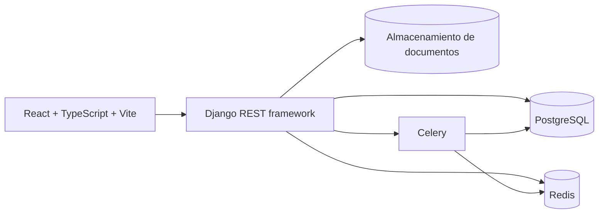

# Plan de producto y arquitectura — sistema de préstamos

> **Primer borrador.** Las decisiones vigentes están en [docs/proyecto/](proyecto/README.md), y donde haya diferencias, manda esa carpeta. Por ejemplo, el stack pasó a Python 3.14 y TanStack Router (ver [01 · Stack y arquitectura](proyecto/01-stack-y-arquitectura.md)).

Estado: propuesta inicial, 28 de septiembre de 2026. Alcance inicial: una compañía. La aplicación de referencia es [Púrpura Datos](https://web.purpuradatos.net/home); el inventario observado está en [INVENTARIO_REFERENCIA.md](INVENTARIO_REFERENCIA.md) y la cobertura pendiente en [MATRIZ_PRUEBAS_Y_DECISIONES.md](MATRIZ_PRUEBAS_Y_DECISIONES.md).

## 1. Objetivo

Construir una aplicación web profesional para originar, administrar y cobrar préstamos, con cifras conciliables, trazabilidad de cada cambio y una experiencia rápida para el personal de oficina y cobro. Debe servir bien a una sola compañía antes de añadir comercialización o aislamiento entre compañías.

### Criterios de éxito del primer lanzamiento

- Registrar un cliente, evaluar una solicitud, aprobarla, desembolsarla y cobrar cuotas hasta el cierre del préstamo sin hojas de cálculo paralelas.
- Poder explicar cualquier saldo con el calendario, pagos, cargos, ajustes y reversos que lo originaron.
- Cerrar caja por usuario y sucursal y conciliar los cobros del día.
- Consultar mora y cartera con filtros útiles, exportar reportes y rastrear quién hizo cada operación.
- Ejecutar el flujo principal en móvil y escritorio, con validación clara y accesibilidad por teclado.

## 2. Alcance y prioridades

| Prioridad | Capacidades |
| --- | --- |
| MVP | Usuarios, roles y sucursales; clientes y documentos; productos y simulación; solicitudes y decisión; desembolso; calendario de cuotas; pagos con recibo y reverso controlado; mora; caja; cartera; auditoría; reportes básicos. |
| Fase 2 | Reestructuración y renovación; garantías y codeudores; promesas de pago y gestión de cobro; clasificación; gastos e ingresos; cuentas por pagar; comisiones; reportes avanzados. |
| Fase 3 | Contabilidad general completa, integración bancaria y de mensajería, automatización de reglas, API de terceros y preparación comercial multiinquilino. |

La funcionalidad exacta del producto de referencia no se copiará automáticamente. Se conservarán los flujos útiles y se corregirán sus puntos débiles. La cuenta de pruebas ya permitió recorrer cliente, solicitud, dos tipos de préstamo, pagos, reverso, gastos y obligaciones; los resultados están en [FLUJOS_VERIFICADOS.md](FLUJOS_VERIFICADOS.md). El resto de productos y reglas aún requiere validación.

## 3. Flujos de negocio

1. **Cliente:** alta, búsqueda por documento, validación de duplicados, datos de contacto, dirección, documentos y consentimiento aplicable.
2. **Solicitud:** seleccionar cliente y producto, simular monto, tasa, plazo, frecuencia, cargos y cuota; guardar borrador; adjuntar evidencias; registrar evaluación y decisión con motivo.
3. **Desembolso:** confirmar términos y cuenta/caja de origen; generar contrato y calendario versionado; registrar asiento o movimiento financiero; emitir comprobante.
4. **Cobro:** localizar préstamo, ver deuda exigible, registrar monto y medio de pago; asignar a conceptos según regla configurada; emitir recibo; permitir reverso con permiso y motivo.
5. **Seguimiento:** recalcular mora por fecha de corte; registrar gestión y promesa de pago; priorizar lista de cobro; mostrar cartera y riesgo.
6. **Cierre diario:** cuadre por cajero y sucursal, movimientos, diferencias justificadas y aprobación del cierre.

### Reglas que deben quedar explícitas antes de codificar el motor

- Definición de cada producto (`San`, `A Rédito`, amortizado, pagaré abierto u otros): interés simple/compuesto, base de días, redondeo, frecuencia y tratamiento de días no laborables.
- Orden de aplicación de pagos entre gastos, mora, interés y capital; pagos parciales, anticipados y excedentes.
- En cuentas por pagar, conservar monto original y saldo pendiente al registrar pagos parciales; no marcar como pagada una obligación con saldo residual.
- Inicio de mora, período de gracia, topes, refinanciación, castigo y cierre.
- Moneda base y posibilidad real de otras monedas; formato de documento e impuestos que correspondan a la jurisdicción.
- Quién puede aprobar, desembolsar, revertir, cambiar tasas y cerrar caja. Las reglas legales y de privacidad deberán revisarse para la jurisdicción de operación antes de producción.

Estas decisiones se convertirán en ejemplos numéricos aprobados por el negocio y pruebas del motor. No se inferirán fórmulas financieras solo a partir de etiquetas de la interfaz de referencia.

## 4. Arquitectura propuesta

- **Backend:** Python 3.13, Django 6.1, Django REST framework 3.18; API REST versionada y contrato OpenAPI. Antes de instalar, fijar el último parche compatible de cada serie y registrar dependencias bloqueadas.
- **Frontend:** React + TypeScript + Vite como SPA privada. React Router para rutas; TanStack Query para datos remotos; React Hook Form + Zod para formularios; Tailwind CSS con componentes accesibles basados en Radix/shadcn. La API mantiene la lógica financiera; el cliente muestra simulaciones devueltas por el servidor.
- **Datos:** PostgreSQL como fuente de verdad. Redis para caché y cola, nunca como registro definitivo de saldos. Celery para PDF, notificaciones, importaciones y tareas de mora; las operaciones monetarias críticas se confirman primero en PostgreSQL.
- **Archivos:** almacenamiento compatible con S3 para documentos, fotos y comprobantes, con permisos y retención definidos. En desarrollo puede usarse almacenamiento local.
- **Entrega:** Docker Compose para desarrollo y entorno de prueba; despliegue reproducible con HTTPS, migraciones, copias de seguridad, monitoreo y CI. Elegir proveedor de producción después de medir necesidades y costos.

**Por qué este frontend:** es una aplicación interna rica en formularios y tablas, sin necesidad actual de indexación pública. La SPA reduce complejidad de renderizado y permite una interfaz consistente. Si más adelante existe un portal público, puede ser una aplicación separada.

### Módulos del monolito Django

`identity`, `organization`, `customers`, `origination`, `loans`, `payments`, `cash`, `collections`, `ledger`, `expenses`, `reporting`, `audit`, `documents`. Separación por dominio dentro de un monolito; no se necesitan microservicios al inicio.

### Entidades principales

`Company` (una fila operativa), `Branch`, `User`, `Role`, `Customer`, `CustomerDocument`, `LoanProduct`, `Application`, `ApplicationDecision`, `Loan`, `LoanTermSnapshot`, `Installment`, `Charge`, `Payment`, `PaymentAllocation`, `Disbursement`, `CashSession`, `CashMovement`, `JournalEntry`, `JournalLine`, `CollectionAction`, `AuditEvent`.

Se incluirá referencia a `Company` en las entidades raíz y a `Branch` donde aplique, sin exponer administración de compañías ni autorización multiinquilino en esta fase. Antes de comercializar habrá una revisión específica de aislamiento, permisos, migración de datos y pruebas entre compañías.

### Invariantes técnicos

- Importes con `Decimal` y precisión declarada; zona horaria explícita; políticas de cálculo versionadas y probadas con ejemplos numéricos.
- Desembolsos, pagos y reversos en transacciones atómicas, con bloqueo de los registros necesarios e idempotencia de solicitudes. El saldo se deriva de movimientos y asignaciones, no de una cifra editable sin respaldo.
- En cada pago y liquidación, el importe neto recibido debe coincidir exactamente con la suma de asignaciones a capital, interés, mora y cargos, con el movimiento de cuenta/caja y con el recibo. Si existe condonación, descuento o cambio, debe representarse como concepto separado y autorizado. El caso de liquidación observado en la referencia se documenta en [FLUJOS_VERIFICADOS.md](FLUJOS_VERIFICADOS.md).
- No borrar movimientos financieros confirmados. Corregir con reversos enlazados, motivo, actor y fecha; conservar historial de cambios de términos.
- Permisos comprobados en API y pruebas por rol/sucursal. Registro de auditoría separado de logs técnicos; cifrado en tránsito, secretos fuera del repositorio y copias de seguridad restaurables.
- Paginación, filtros y exportaciones del lado del servidor; las tareas largas se ejecutan fuera de la petición HTTP.

## 5. Diseño y experiencia

Mantener el carácter visual púrpura y verde que gusta en la referencia, con una biblioteca de tokens para color, tipografía, espaciado y estados. Sustituir el gran espacio decorativo de las pantallas de trabajo por información y acciones de contexto. La navegación agrupará **Operación** (clientes, solicitudes, préstamos, cobros), **Seguimiento** (mora, cartera), **Finanzas** (caja, gastos, cuentas) y **Administración** (usuarios, sucursales, configuración).

Pantallas iniciales: tablero con indicadores y tareas pendientes; lista de clientes; expediente del cliente; solicitud y simulador; expediente del préstamo con línea de tiempo y calendario; cobro rápido; cierre de caja; mora; cartera. Usar tablas con búsqueda y filtros persistentes, estados legibles, vacíos útiles, confirmaciones proporcionales y diseño adaptable. El cobro debe requerir pocos pasos, pero siempre mostrar el desglose antes de confirmar.

Se diseñarán primero wireframes y un prototipo navegable del flujo cliente → solicitud → préstamo → pago → caja. Se revisará con usuarios reales antes de implementar todos los reportes.

## 6. Secuencia de construcción

| Entrega | Resultado verificable |
| --- | --- |
| 0. Especificación | Reglas de productos y pagos con ejemplos numéricos; mapa de roles; datos de muestra anonimizados; prototipo del flujo principal; decisiones abiertas resueltas. |
| 1. Base técnica | Repositorio organizado, entornos reproducibles, CI, autenticación, roles, sucursales, auditoría y diseño base. |
| 2. Originación | Clientes, productos, simulador, solicitudes, aprobación, desembolso y calendario; pruebas de cálculo. |
| 3. Cobranza | Pagos parciales y anticipados, recibos, reversos, caja, mora y gestión de cobro; pruebas de concurrencia y conciliación. |
| 4. Visibilidad | Tablero, cartera, exportaciones y reportes operativos con cifras reconciliadas. Piloto con datos de prueba. |
| 5. Ampliación | Gastos, cuentas por pagar, clasificación, comisiones y contabilidad completa según prioridades verificadas en el piloto. |

**Puerta de salida del MVP:** recorrido completo aprobado por negocio; escenarios de cálculo y reverso correctos; permisos verificados; respaldo y restauración probados; cero diferencias inexplicadas entre pagos, caja y cartera; pruebas de aceptación de escritorio y móvil.

## 7. Primer trabajo concreto

1. Validar con la compañía 3–5 ejemplos reales anonimizados de cada producto de préstamo y de pagos complicados.
2. Confirmar roles, sucursales, moneda, jurisdicción y documentos obligatorios.
3. Crear wireframes del flujo principal y su modelo de datos detallado.
4. Inicializar el monolito Django, la SPA React, PostgreSQL y Redis; añadir CI y un primer recorrido vertical: crear cliente → simular solicitud.

## Fuentes técnicas

- [Django 6.1, anuncio oficial](https://www.djangoproject.com/weblog/2026/aug/05/django-61-released/)
- [Django REST framework, notas de versión](https://www.django-rest-framework.org/community/release-notes/)
- [React: aplicación con Vite](https://react.dev/learn/build-a-react-app-from-scratch)
- [Celery con Redis](https://docs.celeryq.dev/en/stable/getting-started/backends-and-brokers/redis.html)
