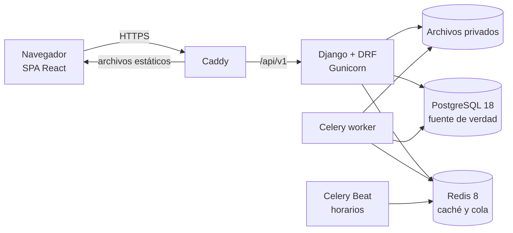

# 01 · Stack tecnológico y arquitectura base

**Estado:** aprobado el 28/09/2026 (decisiones 001–011)
**Versiones:** verificadas hoy en PyPI, npm y endoflife.date. Al iniciar la Fase 1 se fija el último parche de cada una en los archivos de bloqueo (`uv.lock`, `pnpm-lock.yaml`).

**En una frase:** un monolito modular en Django que expone una API REST, una SPA en React que la consume, PostgreSQL como única fuente de verdad, y Redis con Celery para las tareas en segundo plano. Todo corre en Docker bajo un solo dominio.

## 1. Qué exige el sistema

El estudio de la referencia ([hallazgos](../referencia/10-hallazgos-y-mejoras.md)) deja estos requisitos técnicos, que son los que eligen el stack:

| Requisito | Por qué | Qué lo resuelve |
| --- | --- | --- |
| Dinero exacto y conciliable | Defectos #1, #13 y #31: la referencia descuadra caja, recibo y cuenta | `Decimal` + `NUMERIC` en PostgreSQL + libro de movimientos inmutable |
| Tareas programadas | Mora diaria, atrasos, recordatorios y reportes pesados | Celery + Celery Beat + Redis |
| Documentos | 13 documentos PDF/DOCX y reportes (ficha [08](../referencia/08-documentos.md)) | WeasyPrint (PDF), docxtpl (Word), openpyxl (Excel) |
| Archivos privados | Defecto #28: la cédula se descarga sin sesión | Almacenamiento privado y descarga autenticada con enlace temporal |
| Trazabilidad total | Explicar cualquier saldo y quién cambió qué | Auditoría en la base de datos (django-pghistory) |
| Roles, sucursales y aislamiento de IDs | Defectos #24 y #27 | Permisos por rol en la API y validación de alcance en cada ID |
| Pantallas densas en tablas y formularios | Cartera, atrasos, cobro de varias cuotas, simulador | SPA React con tablas y formularios tipados |
| Cobro en la calle | Cobradores con celular (decisión 028: solo web, sin app móvil) | La misma SPA, diseñada primero para el celular, con acceso directo en la pantalla de inicio |
| República Dominicana | Cédula, RNC, RD$ | `es-DO`, `DOP`, `America/Santo_Domingo`, feriados configurables |
| Una sola compañía | Decisión del proyecto | Sin multiempresa: un único registro de empresa y varias sucursales |

## 2. Stack recomendado

### Backend

| Pieza | Tecnología | Versión | Por qué |
| --- | --- | --- | --- |
| Lenguaje | Python | **3.14** (3.14.7) | La 3.13 deja de recibir correcciones el 01/10/2026; la 3.14 las recibe hasta 10/2027 y parches de seguridad hasta 2030 |
| Framework | Django | **6.1** (6.1.1) | Última versión estable; ver [decisión D1](#d1-django-61-ahora-y-62-lts-cuando-salga) |
| API | Django REST framework | **3.18** (3.18.1) | Declara compatibilidad con Django 5.2, 6.0 y 6.1 |
| Contrato de la API | drf-spectacular | 0.30 | Genera OpenAPI 3, del que sale el cliente TypeScript tipado |
| Autenticación | django-allauth, en modo *headless* y con MFA | 65.19 | Sesión por cookie para la SPA, 2FA con TOTP, recuperación de acceso y límite de intentos |
| Filtros | django-filter | 26.1 | Filtros de servidor, coherentes entre tabla y totales (defecto #32) |
| Base de datos | PostgreSQL | **18** (18.6) | `NUMERIC` exacto, transacciones, bloqueo de filas y búsqueda con `pg_trgm` + `unaccent`; soporte hasta 2030 |
| Controlador | psycopg | 3.3 | Controlador moderno de PostgreSQL |
| Caché y cola | Redis | **8** (8.10) | Broker de Celery, caché, límite de peticiones y bloqueos; **nunca guarda saldos**. Valkey 9 lo sustituye sin cambios si se prefiere licencia BSD |
| Tareas | Celery + django-celery-beat | 5.6 + 2.9 | Mora diaria, recordatorios, PDF pesados, exportaciones y respaldos. Horarios editables desde el admin |
| Auditoría | django-pghistory | 3.9 | Disparadores en PostgreSQL: registra todo cambio, incluso los masivos, con usuario y contexto |
| PDF | WeasyPrint | 70 | Plantillas HTML/CSS con nuestro diseño, encabezado y pie, numeración de páginas y QR |
| Word | docxtpl | 0.20 | Documentos editables por el notario (pagaré notarial) |
| Excel | openpyxl | 3.1 | Exportaciones |
| Archivos | django-storages (compatible con S3) o disco privado | 1.14 | Nunca públicos; decisión de proveedor en la fase de despliegue |
| Servidor de aplicación | Gunicorn | 26 | WSGI probado; no necesitamos ASGI por ahora |
| Errores | Sentry SDK | 2.71 | Alertas de errores con contexto; GlitchTip es la opción autoalojada |
| Herramientas | uv, Ruff, mypy + django-stubs, pytest-django, factory-boy, Hypothesis | 0.12, 0.16, 6.1, 4.14, 3.3, 6.168 | Dependencias reproducibles, estilo, tipos y pruebas. Hypothesis prueba el motor financiero con miles de casos aleatorios |

### Frontend

| Pieza | Tecnología | Versión | Por qué |
| --- | --- | --- | --- |
| Lenguaje | TypeScript | 7.0 | Nuevo compilador nativo, mucho más rápido |
| UI | React | **19.3** | Estándar del mercado, gran ecosistema |
| Compilación | Vite + @vitejs/plugin-react | **8.3** + 6.1 | Arranque y recarga instantáneos |
| Rutas | TanStack Router | 1.170 | Rutas y filtros **tipados en la URL**: un enlace reproduce exactamente una cartera filtrada |
| Datos del servidor | TanStack Query | 5.104 | Caché, reintentos, y refresco automático tras pagar o desembolsar |
| Cliente de la API | orval | 8.38 | Genera tipos y *hooks* desde el OpenAPI; el frontend nunca «adivina» la API |
| Tablas | TanStack Table | 9.2 | Orden, columnas, selección y paginación de servidor |
| Formularios | React Hook Form + Zod | 7.89 + 4.6 | Validación inmediata y clara |
| Estilos | Tailwind CSS | **4.3** | Tokens de diseño (morado y verde) en un solo lugar |
| Componentes | shadcn/ui sobre Radix (CLI `shadcn`) | 4.21 | Accesibles por teclado y lector de pantalla; el código es nuestro y se adapta a la marca |
| Íconos | lucide-react | 1.48 | Una sola familia (la referencia mezcla cinco) |
| Avisos | sonner | 2.0 | Notificaciones breves |
| Gráficos | Recharts | 3.10 | Gráficos legibles (defecto #42) |
| Mapas | Leaflet + OpenStreetMap | 1.9 | Sin clave de Google Maps |
| Fechas y dinero | date-fns (es) + `Intl` es-DO | 4.4 | `RD$ 1,250.00`, sin formatos como `97'925.00` |
| Pruebas | Vitest, Testing Library y Playwright | 5.0, —, 1.63 | Unitarias, de componentes y de extremo a extremo |
| Calidad | ESLint + Prettier (con orden de clases Tailwind) | 10.11 + 3.9 | Estilo uniforme |
| Entorno | Node.js LTS + pnpm | 24 LTS (el 26 pasa a LTS el 28/10/2026) + 12.6 | Instalaciones rápidas y deterministas |

### Infraestructura

| Pieza | Tecnología | Por qué |
| --- | --- | --- |
| Contenedores | Docker + Docker Compose | El mismo entorno en tu PC, en pruebas y en producción |
| Proxy y HTTPS | Caddy 2 | Certificados automáticos; sirve la SPA y dirige `/api` a Django |
| Integración continua | GitHub Actions | Estilo, tipos, pruebas y compilación en cada cambio |
| Correo en desarrollo | Mailpit | Ver los correos sin enviarlos a nadie |
| Respaldos | `pg_dump` diario cifrado + copia fuera del servidor | Con restauración probada cada mes |
| Alojamiento | Un servidor virtual (VPS) | Se elige en la fase de salida a producción |

Todo es de código abierto. El costo real es el servidor, el dominio y, más adelante, los envíos por SMS o WhatsApp.

## 3. Decisiones y alternativas descartadas

### D1. Django 6.1 ahora y 6.2 LTS cuando salga

- **Recomendación:** empezar con Django 6.1 y pasar a 6.2 LTS (prevista para abril de 2027) antes o justo después del lanzamiento.
- **Por qué:**
  - DRF, allauth, django-filter y django-stubs ya declaran compatibilidad con 6.1.
  - La 6.1 recibe parches de seguridad hasta el 31/12/2027.
  - Saltar de 6.1 a 6.2 es un cambio pequeño; saltar de 5.2 a 6.2 sería grande.
  - Desde la 6.0, Django trae de serie la política de seguridad de contenido (CSP) y las plantillas parciales.
- **Riesgo:** drf-spectacular, django-celery-beat, django-pghistory y pytest-django declaran hasta 6.0. Suele ser solo una etiqueta desactualizada; se comprueba el primer día de la Fase 1 (ver §6).
- **Plan B:** Django 5.2 LTS, con soporte hasta el 30/04/2028 y compatibilidad total. Cambiarlo al principio es una sola línea.

### D2. SPA con React + Vite, no Next.js

- **Recomendación:** una SPA con React y Vite.
- **Por qué:**
  - Es una aplicación interna detrás de un inicio de sesión: no necesita SEO ni renderizado en servidor.
  - Next.js 16 añade un segundo servidor en Node, con su propia capa de lógica, que duplicaría a Django y complicaría las sesiones.
  - La SPA son archivos estáticos: una sola API, un solo dominio y cookies simples.
- **Portal del cliente (fase 9):** vive en la misma SPA, con su propio acceso. Un sitio público de promoción, si algún día se quiere, sería otra aplicación aparte, en Next.js o Astro.
- **Descartado también, Django con plantillas y HTMX:** es más simple, pero el simulador, el cobro de varias cuotas, los filtros de cartera y «Mi ruta» en el celular salen mejor en React.

### D3. TanStack Router, no React Router

- **Recomendación:** TanStack Router.
- **Por qué:** los filtros viven en la URL con tipos, así que la tabla, los totales y el PDF usan exactamente los mismos filtros (defecto #32). Además se integra con TanStack Query.
- **Cambio:** esto sustituye a React Router, que figuraba en el [plan inicial](../PLAN_PRODUCTO.md).

### D4. Sesión por cookie, no JWT

- **Recomendación:** sesión con cookie `HttpOnly`, `Secure` y `SameSite`, más protección CSRF.
- **Por qué:** la SPA y la API comparten dominio, así que ningún token queda en `localStorage`, donde un XSS podría robarlo.
- **2FA:** obligatorio para los roles de administración y caja.

### D5. Celery, no el marco de tareas nuevo de Django

- **Recomendación:** Celery.
- **Por qué:** Django 6 ya define una API de tareas, pero no incluye un programador periódico ni un backend listo para producción. Celery lleva años haciéndolo, con reintentos, horarios y monitoreo.

### D6. Tailwind + shadcn/ui, no MUI ni Ant Design

- **Recomendación:** Tailwind con shadcn/ui.
- **Por qué:** los componentes son nuestros y conservan la identidad morada y verde sin pelear con un tema ajeno. Son accesibles gracias a Radix y generan un paquete liviano.
- **Lo que se descarta:** MUI y Ant Design arrancan más rápido, pero se ven genéricas y cuestan de adaptar.

### D7. django-pghistory, no django-simple-history

- **Recomendación:** django-pghistory.
- **Por qué:** registra los cambios con disparadores de la base de datos, así que no se le escapan las actualizaciones masivas. En un sistema de dinero, «no se registró» no es aceptable.

### D8. Redis 8

- **Recomendación:** Redis 8, como pediste.
- **Por qué:** desde la versión 8, Redis vuelve a ser de código abierto (AGPL) y lo usamos sin modificarlo como servicio interno. Valkey es un reemplazo directo si algún día conviene.

### D9. Monorepo

- **Recomendación:** un solo repositorio con `backend/`, `frontend/`, `infra/` y `docs/`.
- **Por qué:** un cambio de API y su pantalla van en el mismo commit y la integración continua los prueba juntos.

### D10. Código en inglés, producto en español

- **Recomendación:** identificadores, tablas y *commits* en inglés; interfaz, documentos y esta documentación en español.
- **Por qué:** es la convención de la industria, facilita usar librerías y contratar, y evita mezclar idiomas en el código.

## 4. Arquitectura base



### Principios

1. **Monolito modular.**
   - Un proyecto Django con una *app* por dominio y límites claros entre ellas.
   - Nada de microservicios: para una compañía serían solo costo y complejidad.
2. **La lógica de negocio vive en servicios.**
   - Las vistas de la API solo validan y delegan en una capa de servicios.
   - El **motor financiero** es Python puro, sin Django: calendarios, cuotas, mora, asignación de pagos y liquidación. Es determinista y se prueba con los ejemplos numéricos del documento de reglas y con Hypothesis.
3. **El servidor manda en el dinero.**
   - La SPA nunca calcula importes; el simulador consulta la API mientras se escribe, con una breve espera entre teclas.
   - El simulador no crea borradores en cada pulsación, como hace la referencia (defecto #36).
4. **Libro de movimientos inmutable.**
   - Desembolsos, pagos, gastos de cierre, gastos y transferencias generan asientos balanceados.
   - Caja, ganancia, cartera y recibo salen del mismo libro, así que no pueden contradecirse.
   - Nada se borra: se revierte con un movimiento enlazado, un motivo y un autor.
5. **Operaciones críticas atómicas.**
   - Las transacciones bloquean las filas afectadas.
   - Cada pago y cada desembolso lleva una clave de idempotencia, para que un doble clic no cobre dos veces.
6. **El alcance se valida en cada ID.**
   - Aunque haya una sola compañía, cada ID recibido se comprueba contra la sucursal y los permisos del usuario (la lección del defecto #27).
   - Las pruebas automáticas lo verifican por rol.
7. **Dinero y fechas explícitos.**
   - Importes en `NUMERIC(14,2)` y tasas en `NUMERIC(9,6)`.
   - Redondeo definido por regla, con el residuo en la última cuota (defecto #35).
   - Zona horaria `America/Santo_Domingo` y moneda `DOP`; el campo de moneda queda preparado para USD.
8. **API contractual.**
   - La API vive en `/api/v1/`, con OpenAPI.
   - Paginación, filtros y totales se hacen en el servidor.
   - Las exportaciones y los PDF pesados se generan en segundo plano y avisan cuando están listos.
9. **Una sola compañía.**
   - Un único registro de empresa, sin selector de compañía, registro, licencias ni planes.
   - Hay varias sucursales, y la sucursal es un límite de acceso.

### Módulos del monolito (tentativo)

Se cierran en el paso de modelo de datos.

| App | Contenido |
| --- | --- |
| `core` | Empresa, sucursales, ajustes, feriados, numeraciones |
| `accounts` | Usuarios, roles, permisos, 2FA, sesiones |
| `customers` | Clientes, laborales, referencias, garantes, archivos |
| `lending` | Productos, solicitudes, evaluación, préstamos y calendario; incluye el motor financiero |
| `payments` | Pagos, asignaciones, recibos, reversos, mora, liquidaciones |
| `cash` | Sesiones de caja, arqueo y cierre |
| `collections` | Atrasos, rutas, gestiones y promesas de pago |
| `ledger` | Cuentas, asientos, transferencias y ajustes |
| `expenses` | Gastos, ingresos y cuentas por pagar |
| `documents` | Plantillas y generación de PDF, DOCX y Excel |
| `reports` | Tablero, cartera y reportes |
| `notifications` | Avisos internos y, más adelante, SMS, WhatsApp y correo |
| `audit` | Consulta del historial de cambios y eventos |

### Estructura del repositorio

```text
backend/
  config/             ajustes, urls, celery
  apps/<módulo>/      models, services, api/, tasks, tests/
  engine/             motor financiero en Python puro
frontend/
  src/routes/         pantallas (TanStack Router)
  src/features/       lógica por módulo
  src/components/ui/  componentes base (shadcn)
  src/api/            cliente generado desde OpenAPI (no se edita a mano)
infra/
  compose.yml, compose.prod.yml, caddy/, scripts/
docs/
```

### Entornos

| Entorno | Uso | Datos |
| --- | --- | --- |
| Local | Desarrollo en tu PC con Docker Compose | Ficticios, generados con un comando |
| Pruebas (*staging*) | Revisión de cada entrega y piloto | Ficticios o anonimizados |
| Producción | Operación real | Reales, con respaldo diario |

## 5. Seguridad desde el día uno

- **Transporte y navegador:** HTTPS obligatorio con HSTS, CSP nativa de Django y cookies seguras.
- **Acceso:** límite de intentos de inicio de sesión, 2FA y política de contraseñas.
  - Nadie fija la contraseña de otro: se envía una invitación o un enlace de restablecimiento (defecto #7).
- **Archivos:** privados, con descarga autenticada y enlaces que caducan (defecto #28).
- **Secretos:** en variables de entorno, nunca en el repositorio.
- **Dependencias:** Dependabot y `pip-audit` revisan las vulnerabilidades conocidas.
- **Auditoría:** separada de los logs técnicos. Se conserva y no puede editarse desde la aplicación.
- **Respaldos:** cifrados, fuera del servidor y con restauración ensayada.

## 6. Comprobaciones al iniciar la Fase 1

La Fase 1 empieza con una prueba técnica de medio día. Cada punto tiene un plan B:

| Comprobar | Plan B |
| --- | --- |
| drf-spectacular, django-celery-beat, django-pghistory, pytest-django y django-storages funcionan con Django 6.1 | Django 5.2 LTS |
| WeasyPrint y psycopg instalan sin problemas en Python 3.14 | Python 3.13 |
| ESLint, con reglas de tipos, funciona con TypeScript 7 | Fijar TypeScript 6 solo para el linter |
| Los componentes de tabla de shadcn funcionan con TanStack Table 9 | TanStack Table 8 |
| orval genera *hooks* de TanStack Query válidos desde el esquema de drf-spectacular | openapi-typescript + openapi-fetch |

## 7. Aprobación

Jonas aprobó todas las recomendaciones el 28/09/2026: Django 6.1 con paso a 6.2 LTS, SPA con React + Vite, código en inglés con la interfaz en español, y las decisiones técnicas D3–D9. El proveedor de alojamiento se decide en la fase de salida a producción.
