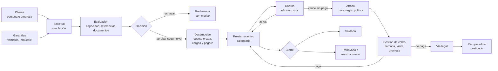

# 02 · Visión, alcance y módulos

**Estado:** aprobado el 28/09/2026 (decisiones 012–020) · **actualizado el 04/10/2026** al alcance SaaS multitenant de **Cobradía** (decisiones 041–046)

## 1. Visión

> **Cobradía** es la plataforma con la que las financieras dominicanas prestan, cobran y controlan su dinero sin hojas de cálculo: cada peso se explica, cada cobro toma segundos y cada decisión queda registrada. Cualquier financiera se registra en línea, prueba gratis y opera el mismo día.

| Objetivo | Cómo se mide |
| --- | --- |
| **Cobrar rápido** | Un cobro, desde la búsqueda o desde la ruta, en menos de 30 segundos y con el desglose visible antes de confirmar |
| **Cero descuadres** | Caja, recibos, cuentas y cartera coinciden al centavo; toda diferencia de caja queda justificada y aprobada |
| **Control interno** | Roles con separación de funciones, aprobaciones por monto, cierre de caja y auditoría de cada cambio |
| **Visibilidad diaria** | Un tablero que dice qué cobrar hoy, quién está en atraso y cuánto dinero hay en cada caja |
| **Profesional** | Documentos correctos, diseño moderno en verde profundo y ámbar (decisión 047), y uso cómodo en escritorio y celular |
| **Comercializable** | Una financiera nueva se registra sola, queda operando en su prueba el mismo día, y sus datos están aislados de las demás; el dueño administra la plataforma sin ver los datos de nadie |

## 2. Perfil de cada empresa cliente (aprobado)

Cobradía se diseña para la financiera que describe la decisión 012; cada empresa registrada (tenant) tiene su propia configuración, sucursales, usuarios y datos.

| # | Definición | Qué implica para el diseño |
| --- | --- | --- |
| 012 | **Compañía mediana:** de 2 a 5 sucursales, de 5 a 30 usuarios y cobradores en ruta | Roles y permisos por sucursal, caja por cajero, rutas por cobrador, aprobaciones por monto y reportes por sucursal. También funciona para una compañía pequeña |
| 013 | **Cuatro tipos de préstamo:** personales sin garantía, con garantía de vehículo, con garantía hipotecaria y microcrédito a negocios | Un motor de productos configurable, un módulo de **garantías** (bienes), clientes que pueden ser personas o empresas, y evaluación de la capacidad de pago de personas y de negocios |
| 028 | **Solo aplicación web**, sin app móvil ni modo sin conexión (reemplaza a la 014) | Los cobradores usan la misma web, adaptada al celular, con internet y un acceso directo en la pantalla de inicio. «Mi ruta» se construye en la fase 4 |
| 015 | **Documentos legales:** los redactamos nosotros y el primer cliente los valida con su abogado | Se construyen en la fase 8 como plantillas editables marcadas «pendiente de validación legal». Cada empresa puede ajustar sus plantillas; las de fábrica no se lanzan sin esa validación |
| 045 | **Registro público con prueba:** cualquier financiera se registra en línea y prueba gratis 30 días; al vencer, queda en solo lectura hasta activar su suscripción | Flujo F19, panel de plataforma para el dueño, y estructura de planes y límites preparada desde la fase 1 |

## 3. Usuarios y roles

Estos roles son plantillas de partida; los permisos finos se definen en el paso 6. Una misma persona puede tener varios roles; en una compañía pequeña, el gerente suele ser también el administrador.

Por encima de las empresas está el **dueño de la plataforma** (Jonas), que no es un rol de empresa: administra Cobradía desde su propio panel (empresas, prueba y suscripción, planes, métricas y modo soporte) y **no ve los datos de negocio de las empresas** (decisión 046).

| Rol | Qué hace | Su pantalla principal |
| --- | --- | --- |
| **Gerente** | Ve todo, aprueba montos altos, castigos y reversos importantes, y revisa resultados | Tablero general |
| **Administrador** | Usuarios, sucursales, productos, políticas y plantillas | Ajustes |
| **Oficial de crédito** | Registra clientes y garantías, arma solicitudes, evalúa y entrega documentos | Solicitudes |
| **Supervisor de sucursal** | Aprueba solicitudes hasta su límite, autoriza reversos y condonaciones, y aprueba el cierre de caja de su sucursal | Tablero de la sucursal |
| **Cajero** | Abre y cierra su caja, cobra en oficina, desembolsa y recibe la rendición de los cobradores | Caja |
| **Cobrador** | Recorre su ruta, cobra, registra gestiones y promesas, y entrega el efectivo | Mi ruta (celular) |
| **Contabilidad** | Gastos, cuentas, cuentas por pagar, conciliación y reportes financieros | Finanzas |
| **Consulta o auditoría** | Solo lectura, incluido el historial de cambios | Reportes |

## 4. Ciclo de vida de un préstamo

Cada flujo se detalla en el paso 4.

**Ciclo diario de la caja:**
1. El cajero abre su caja con un fondo inicial.
2. Durante el día se registran cobros, desembolsos y gastos.
3. Los cobradores rinden el efectivo de su ruta.
4. El cajero hace el arqueo por denominación y cierra.
5. El supervisor aprueba el cierre; si hay diferencias, se justifican.

## 5. Mapa de módulos

La navegación tiene seis grupos: Inicio, Operación, Cobranza, Finanzas, Reportes y Ajustes. **Ajustes** pasa al menú principal; en la referencia estaba escondido en el avatar (defecto #21). La columna «Fase» indica en qué fase de construcción se hace cada módulo (ver §8); todos están en el lanzamiento.

### Inicio

| Módulo | Qué hace | Mejora frente a la referencia | Fase |
| --- | --- | --- | --- |
| **Tablero** | Cobros de hoy, vencimientos, mora por tramos (1–7, 8–30, 31–60, 61–90 y más de 90 días), saldo de cada caja y tareas pendientes, según el rol | Nuevo: en la referencia, el inicio está vacío | 7 |
| **Búsqueda global** (Ctrl+K) | Busca un cliente por nombre, cédula, RNC o teléfono, o un préstamo por número, y ofrece acciones directas como «Cobrar» | Nuevo: la referencia necesita 3 pasos para cobrar | 2, y crece con cada módulo |

### Operación

| Módulo | Qué hace | Mejora frente a la referencia | Fase |
| --- | --- | --- | --- |
| **Clientes** | Personas (cédula) y empresas (RNC); datos laborales o del negocio, familiares, referencias, garantes, archivos, cronología y detección de duplicados | Archivos privados, en PDF o imagen (#28); garantes validados (#27); ciudad de un catálogo (#23); ficha usable (#19) | 2 |
| **Garantías** | Registro de bienes: vehículo (marca, modelo, año, placa, chasis, matrícula), inmueble (título, ubicación, tasación) u otros. Guarda valor, fotos, documentos, estado (en garantía, liberada o ejecutada) y cobertura del préstamo | Nuevo; la referencia no describe el bien (#16) | 2; los contratos, en la 8 |
| **Solicitudes** | Simulador, evaluación de la capacidad de pago (presupuesto personal o del negocio), lista de documentos, y decisión de aprobar, rechazar o condicionar con motivo y nivel de aprobación por monto | La referencia no tiene aprobación ni historial (#22) y crea un préstamo en cada tecla (#36) | 3 |
| **Préstamos** | Productos configurables, desembolso, calendario versionado y expediente con línea de tiempo. Acciones: cambiar fecha con motivo, cambiar cobrador, anular (solo sin pagos) y castigar con aprobación. Permite migrar préstamos ya comenzados | Validación de fechas (#8), confirmación y motivo (#17), historial de cada cambio | 3; renovar y reestructurar, en la 8 |
| **Cobros** | Cobro en un paso con el desglose previo. Permite varias cuotas, abono a capital, liquidación con condonación autorizada, cambio y medios de pago (efectivo, transferencia, cheque o depósito). Recibo en hoja o en impresora térmica de 80 mm. Reverso total o parcial con motivo y permiso | Conciliación exacta (#1, #29) y reverso parcial real (#37) | 4 |

### Cobranza

| Módulo | Qué hace | Mejora frente a la referencia | Fase |
| --- | --- | --- | --- |
| **Mi ruta** (celular) | Lista del día del cobrador en orden y en el mapa, cobro desde el celular y rendición del efectivo al cajero | Nuevo | 4 |
| **Atrasos** | Bandeja por tramos de mora, con filtros coherentes, asignación a gestor y totales que respetan los filtros | Corrige #14 y #39 | 4 la lista, 5 la gestión |
| **Gestiones y promesas** | Registra llamadas, visitas y mensajes con su resultado; promesas de pago con fecha y monto; recordatorios y control de cumplimiento | Nuevo: convierte los atrasos en trabajo | 5 |
| **Legal** | Casos en vía legal, abogado, alguacil, costas y documentos | Plantillas correctas y validadas (#3, #4, #33) | 8 |

### Finanzas

| Módulo | Qué hace | Mejora frente a la referencia | Fase |
| --- | --- | --- | --- |
| **Caja** | Una caja por cajero: apertura con fondo, movimientos, arqueo por denominación, cierre, diferencia justificada y aprobación | Nuevo; en la referencia la caja no cuadra (#13) | 4 |
| **Cuentas y bancos** | Caja general y bancos, transferencias, ajustes con motivo y sin sobregiro | Corrige #30 y #43 | 3 lo básico; 6 la conciliación bancaria |
| **Gastos e ingresos** | Categorías, comprobante adjunto y edición con historial. Separa el negocio de los movimientos del dueño | Corrige #12 y #18 | 6 |
| **Cuentas por pagar** | Obligaciones únicas o recurrentes (serie y cuotas) con pagos parciales | Corrige #10 | 6 |
| **Contabilidad** | Plan de cuentas, libro diario y mayor derivados del libro de movimientos, estado de resultados y balance | El libro inmutable funciona desde la fase 3; aquí se exponen sus reportes | 6 |

### Reportes

| Módulo | Qué hace | Mejora frente a la referencia | Fase |
| --- | --- | --- | --- |
| **Cartera** | Saldos por sucursal, cobrador y producto; antigüedad; cartera en riesgo a más de 30 días (PAR30) | Totales coherentes con los filtros (#11, #32) | 7 |
| **Resultados** | Intereses, mora y cargos cobrados, menos los gastos operativos; separado de los movimientos del dueño | Corrige #12 | 6 |
| **Clasificación de clientes** | Puntuación explicable: por qué un cliente es A, B o C | Corrige #38 | 7 |
| **Comisiones** | De cobradores y oficiales, por cobros o colocación | Reglas claras | 7 |
| **Exportaciones** | Excel y PDF de cada reporte, generados en segundo plano | Totales iguales a la pantalla | 7 |

### Ajustes

| Pantalla | Fase |
| --- | --- |
| Empresa (datos y logo para los documentos), sucursales, usuarios con invitación, roles y permisos, historial de auditoría | 1 |
| Productos de préstamo, política de mora (gracia y tope), cargos (gastos de cierre), feriados de RD y numeraciones (préstamos y recibos) | 3 |
| Plantillas de documentos | 3 las básicas, 8 las legales |
| Abogados, notarios, alguaciles y testigos | 8 |

### Plataforma (solo el dueño de Cobradía)

Estas pantallas no las ve ninguna empresa; son la administración del negocio SaaS (decisiones 045 y 046).

| Módulo | Qué hace | Fase |
| --- | --- | --- |
| **Empresas** | Lista y ficha de cada empresa: estado (en prueba, activa, suspendida, cerrada), días de prueba, sucursales y usuarios; suspender o reactivar con motivo; registrar el pago de la suscripción (manual al inicio) | 1 |
| **Métricas** | Empresas activas y en prueba, conversión de la prueba, usuarios y volúmenes de uso agregados; sin datos de negocio de nadie | 7 |
| **Planes y límites** | Definición de los planes (precio, usuarios, sucursales, préstamos activos) y asignación por empresa; los valores se deciden antes del lanzamiento | 10 |
| **Modo soporte** | Acceso temporal de solo lectura a una empresa, con motivo, visible para ella y auditado | 7 |

### Comunicación (fase 9)

- Recordatorios de pago y recibos por WhatsApp, SMS o correo.
- Plantillas de mensaje y registro de cada envío.
- Portal del cliente: saldo, calendario y recibos, con acceso por invitación y código de un solo uso.

## 6. Lo que la referencia no tiene

| Función nueva | Valor | Fase |
| --- | --- | --- |
| Conciliación exacta entre pago, asignación, movimiento y recibo | Confianza total en las cifras | 4 |
| Tablero por rol y búsqueda global con acciones | El trabajo del día a la vista | 2 y 7 |
| Caja por cajero con arqueo, cierre y rendición de cobradores | Control del efectivo | 4 |
| Aprobaciones por monto con motivo | Separación de funciones | 3 |
| Registro de garantías con cobertura | Préstamos de vehículo e hipotecarios | 2 |
| Empresas como clientes y evaluación de negocios | Microcrédito | 2 y 3 |
| Política de mora con gracia, tope y vista previa | Justicia con el cliente y cumplimiento legal | 4 |
| Calendario versionado y auditoría completa | Explicar cualquier saldo | 1 y 3 |
| Migración de cartera existente desde Excel | Arrancar sin volver a digitar | 3 y 10 |
| Inicio de sesión con 2FA e invitaciones en vez de contraseñas fijadas por otro | Seguridad | 1 |
| Recibo térmico de 80 mm en oficina y recibo digital por WhatsApp en ruta | Comprobante inmediato en cualquier lugar | 4 |
| Gestiones y promesas de pago | Recuperación ordenada | 5 |
| Clasificación explicable | Decidir mejor el siguiente préstamo | 7 |
| Plantillas legales editables, con estado de validación | Documentos correctos y fáciles de corregir | 8 |
| Documentos con código QR de verificación | Evitar recibos y cartas falsificados | 9 |
| WhatsApp y portal del cliente | Menos llamadas, menos atrasos | 9 |
| Aislamiento real entre empresas (RLS en la base de datos) | La referencia dejaba elegir garantes de otra empresa (#27) | 1 |
| Modo soporte auditado en lugar de acceso libre del proveedor | Confianza para entregarle los datos a la plataforma | 7 |

## 7. Principios de experiencia de uso

1. **La acción más frecuente, a un paso:** cobrar, buscar y ver el saldo.
2. **Confirmar mostrando el efecto:**
   - Antes de guardar se ven el desglose y el saldo resultante.
   - Las acciones delicadas (reverso, castigo, anulación, condonación) piden motivo y, según el monto, aprobación.
3. **Filtros en la dirección de la página:** la tabla, los totales, el PDF y el Excel usan exactamente los mismos filtros, y el enlace se puede compartir.
4. **Estados legibles:**
   - Cada estado tiene un color y un texto (al día, en atraso, en gestión, legal, saldado).
   - Las pantallas vacías explican qué hacer.
5. **Escritorio para la oficina y celular para la calle:**
   - Todo funciona en ambos.
   - «Mi ruta» y el cobro se diseñan primero para el celular.
6. **Presentación correcta:**
   - Formato `RD$ 1,250.00` y fechas `28/09/2026`.
   - Ortografía cuidada y una sola familia de íconos.
   - Navegable por teclado y accesible.

## 8. Estrategia de construcción y lanzamiento (aprobada)

**Decisión 016:** no habrá MVP. Se construye la **versión completa** y se lanza una sola vez.

Las fases son etapas internas de construcción, ordenadas por dependencias: cada una usa lo que construyó la anterior. El detalle se aprueba en el paso 10.

| Fase | Qué se construye |
| --- | --- |
| 1 · Cimientos | Repositorio, Docker, integración continua, multitenancy (empresas, RLS, registro público con prueba y panel de plataforma básico), inicio de sesión con 2FA, usuarios, roles, sucursales, ajustes de la empresa, auditoría y el esqueleto visual |
| 2 · Clientes y garantías | Personas y empresas, garantes, referencias, archivos privados, garantías y búsqueda global |
| 3 · Originación | Productos, motor financiero, simulador, solicitud → evaluación → aprobación, cuentas, desembolso, calendario y documentos básicos |
| 4 · Cobros y caja | Pagos, recibos, reversos, mora, liquidación, caja por cajero, Mi ruta en la web y lista de atrasos |
| 5 · Cobranza | Gestiones, promesas de pago y bandeja de trabajo |
| 6 · Finanzas | Gastos e ingresos, cuentas por pagar, conciliación, contabilidad y resultados |
| 7 · Tablero y reportes | Tablero por rol, cartera, clasificación, comisiones y exportaciones |
| 8 · Renovación y legal | Renovación, reestructuración, castigo, contratos prendario e hipotecario y documentos legales |
| 9 · Comunicación y portal | WhatsApp, SMS y correo; portal del cliente; QR de verificación |
| 10 · Aceptación y lanzamiento | Pruebas de aceptación con el cliente, migración de datos, validación legal, endurecimiento, respaldos, capacitación y salida a producción |

**Cómo reducimos el riesgo de un solo lanzamiento:**
- **Demostración al cierre de cada fase:** el primer cliente la ve en el entorno de pruebas y los ajustes se hacen en ese momento, no al final.
- **Pruebas automáticas acumulativas:** cada fase deja pruebas que protegen a las anteriores.
- **Migración ensayada:** la migración de datos se ensaya al menos dos veces antes del día real.
- **Condiciones para lanzar:**
  - Recorrido completo aprobado por el cliente.
  - Cálculos y reversos correctos en todos los ejemplos del paso 3.
  - Permisos verificados por rol y por sucursal.
  - Plantillas legales validadas por su abogado.
  - Respaldo y restauración probados.
  - Cero diferencias sin explicar entre pagos, caja y cartera.

## 9. Fuera de alcance y asesoría externa

- **No se hará (por ahora):**
  - Buró de crédito compartido entre las empresas de la plataforma (existe en la referencia; exige asesoría legal propia).
  - Pasarela de pago para la suscripción (Azul, CardNet o similar): el cobro inicial es manual y la pasarela se integra después del lanzamiento (decisión 045).
  - Subdominios por empresa y marca blanca (decisión 043: un solo dominio; queda como opción futura).
  - Aplicación móvil nativa o de tiendas y modo sin conexión: todo es web (decisión 028).
- **Requiere asesoría antes del lanzamiento:**
  - Tasas y mora máximas permitidas.
  - Protección de datos personales (Ley 172-13) y consentimiento del cliente.
  - Comprobantes fiscales (NCF / e-CF) sobre intereses y cargos.
  - Contenido de los contratos.

  El primer cliente lo consultará con su abogado y su contador; cada empresa que se registre es responsable de su propia configuración legal y fiscal, y Cobradía lo deja claro en sus términos de servicio. Además, operar la plataforma exige asesoría propia del dueño: términos de servicio, acuerdo de tratamiento de datos (Ley 172-13) y facturación de la suscripción (NCF). El sistema se diseña para poder configurarlos, sin asumir la respuesta.

## 10. Decisiones de este paso

| # | Decisión | Estado |
| --- | --- | --- |
| 012 | Compañía mediana: 2–5 sucursales, 5–30 usuarios, cobradores en ruta | Aprobada |
| 013 | Cuatro tipos de préstamo: personal, vehículo, hipotecario y microcrédito | Aprobada |
| 014 | Cobrador: web del celular y después app sin conexión | Reemplazada por 028 |
| 028 | Solo aplicación web adaptada al celular, con internet; sin app móvil ni modo sin conexión | Aprobada |
| 015 | Documentos legales: los redactamos nosotros y el cliente los valida con su abogado antes del lanzamiento | Aprobada |
| 016 | Sin MVP: versión completa, construida en 10 fases internas y lanzada una sola vez | Aprobada |
| 017 | Módulos nuevos: garantías, tablero, búsqueda global, caja por cajero, Mi ruta, gestiones y promesas, portal del cliente | Aprobada |
| 018 | Ajustes en el menú principal, organizado en seis grupos | Aprobada |
| 019 | Clientes personas y empresas | Aprobada |
| 020 | Orden de fases por dependencias (§8), decidido por el responsable técnico | Aprobada |
| 041 | Giro a SaaS multitenant bajo la marca Cobradía; Jonas es el dueño de la plataforma | Aprobada |
| 045 | Registro público con prueba de 30 días; suspensión en solo lectura al vencer; cobro manual de la suscripción al inicio | Aprobada |
| 046 | El dueño ve métricas agregadas, no datos de negocio; modo soporte temporal y auditado | Aprobada |
