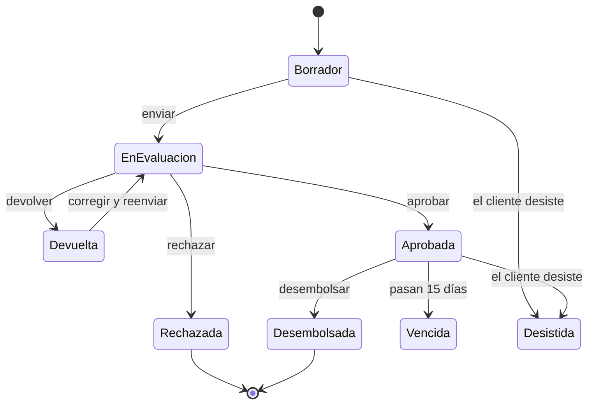
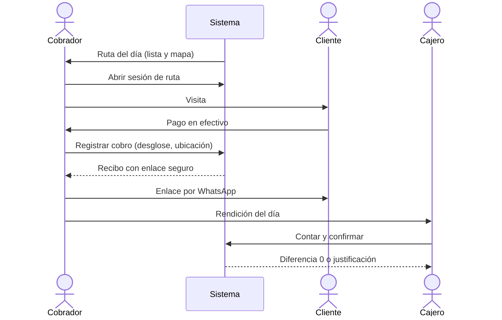
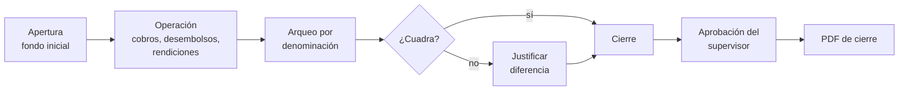
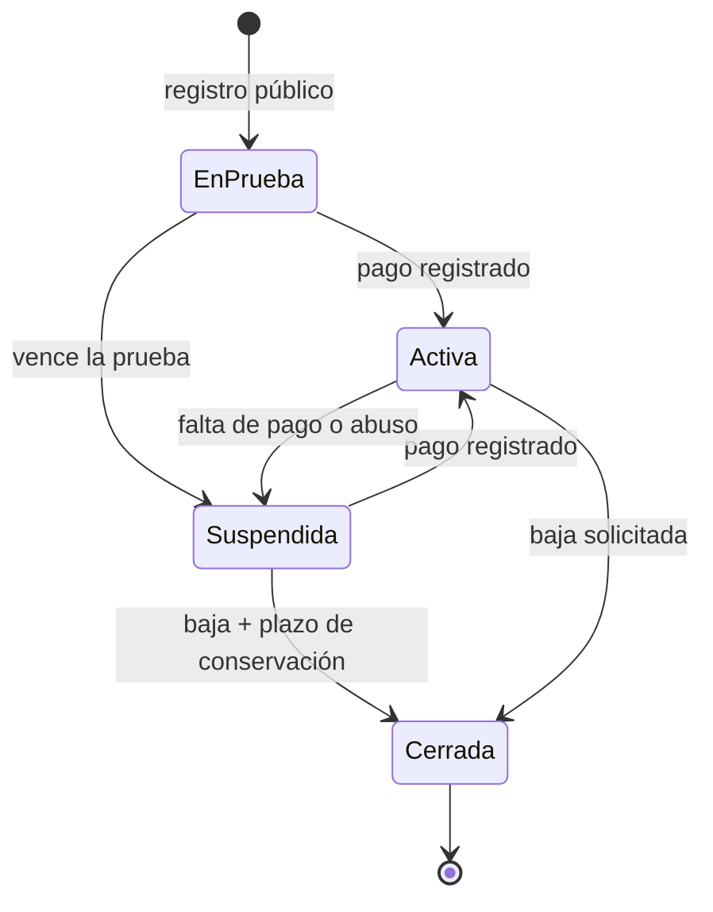

# 04 · Flujos del sistema

**Estado:** aprobado el 28/09/2026 (decisiones 023–028) · **actualizado el 04/10/2026** al alcance multitenant: todos los flujos ocurren dentro de una empresa (tenant) y se añade el F19, el ciclo de vida de la empresa en la plataforma (decisiones 041, 045 y 046)

**Cómo leer este documento:** cada flujo indica quién lo hace y cuándo, sus pasos, las validaciones, qué queda registrado y las excepciones. Los importes siguen las reglas del [paso 3](03-reglas-de-negocio.md) y los permisos finos se definen en el paso 6. Los números que aparecen como «por defecto» son configurables.

## 1. Definiciones de operación (aprobadas)

| # | Definición |
| --- | --- |
| 023 | **Aprobación por límites de rol:** - El supervisor aprueba hasta su límite y el gerente por encima. - **Nadie aprueba una solicitud que creó.** |
| 024 | **Recibo del cobro en la calle:** un enlace seguro que el cobrador comparte por WhatsApp desde su celular. La impresora térmica se usa en la oficina; en la calle el recibo es digital (solo web, decisión 028) |
| 025 | **Caja estricta:** - Cierre diario obligatorio por cajero. - Rendición diaria obligatoria de cada cobrador. - No se abre una caja nueva sin cerrar la anterior. |
| 026 | **Buró externo:** el oficial consulta DataCrédito o TransUnion por fuera y adjunta el reporte y la puntuación a la solicitud |

## 2. Mapa de flujos

| # | Flujo | Actores | Fase |
| --- | --- | --- | --- |
| F1 | Alta de cliente | Oficial | 2 |
| F2 | Garantes y garantías | Oficial | 2 |
| F3 | Solicitud, evaluación y decisión | Oficial, supervisor, gerente | 3 |
| F4 | Desembolso | Cajero o contabilidad | 3 |
| F5 | Cobro en oficina | Cajero | 4 |
| F6 | Cobro en ruta y rendición | Cobrador, cajero | 4 |
| F7 | Caja diaria | Cajero, supervisor | 4 |
| F8 | Atraso y gestión de cobro | Sistema, gestor, cobrador, supervisor | 4 y 5 |
| F9 | Vía legal | Gerente, abogado | 8 |
| F10 | Liquidación anticipada y carta de saldo | Cajero, oficial | 4 |
| F11 | Renovación y reestructuración | Oficial, aprobador, cajero | 8 |
| F12 | Reverso y corrección de pagos | Cajero, supervisor | 4 |
| F13 | Castigo y recuperación | Gerente | 8 |
| F14 | Anulación de un préstamo | Supervisor | 3 |
| F15 | Finanzas y cierre de mes | Contabilidad, gerente | 6 |
| F16 | Migración inicial | Administrador, Claude | 3 y 10 |
| F17 | Usuarios y acceso | Administrador, usuario | 1 |
| F18 | Comunicación automática | Sistema | 9 |
| F19 | Registro y ciclo de vida de una empresa | Visitante, dueño de la plataforma | 1 |

**Un día típico:**
- **Mañana:** el tablero muestra los cobros del día, las promesas que vencen hoy y las solicitudes por aprobar. Cada cobrador recibe su ruta.
- **Durante el día:** cobros en oficina y en ruta, solicitudes y desembolsos.
- **Tarde:** los cobradores rinden el efectivo, los cajeros hacen arqueo y cierran, y el supervisor aprueba los cierres.
- **Noche:** el sistema recalcula atrasos y mora y prepara la bandeja del día siguiente.

## F1 · Alta de cliente

1. **Buscar primero.**
   - El oficial busca por cédula, RNC, nombre o teléfono.
   - Si el cliente existe, se abre su ficha.
   - **Duplicados:**
     - Un documento igual bloquea el alta.
     - Un nombre parecido con el mismo teléfono muestra un aviso con los posibles duplicados.
2. **Tipo de cliente.**
   - **Persona:** cédula, con validación del formato y del dígito verificador.
   - **Empresa:** RNC, más su representante legal, que se registra como persona.
3. **Datos del cliente.**
   - Contacto.
   - Dirección de catálogo: provincia, municipio y sector.
   - Datos laborales, o datos del negocio (ventas y gastos) si es microcrédito.
   - Familiares y referencias.
4. **Archivos privados:** cédula por ambas caras, comprobantes de ingreso y fotos del negocio, en PDF o imagen.
5. **Consentimiento:** autorización para usar sus datos y consultar el buró, con fecha y documento firmado adjunto. **Validar con el abogado** (Ley 172-13).

**Qué queda:**
- El cliente, en estado **activo**, con su historial de auditoría.

**Excepción:**
- **Cliente bloqueado.** Un supervisor puede marcarlo «no prestar», con motivo.
  - Cualquier solicitud nueva muestra el aviso.
  - La solicitud no puede aprobarse sin quitar antes el bloqueo.

## F2 · Garantes y garantías

- **Garante:**
  - Es una persona registrada como en F1, así que se reutiliza y no se duplica.
  - Se vincula a la solicitud con el rol «garante».
  - Solo se pueden elegir personas de nuestra propia base (lección del defecto #27).
- **Garantía (bien):**
  - Se elige el tipo:
    - **Vehículo:** marca, modelo, año, color, placa, chasis y matrícula.
    - **Inmueble:** título, designación catastral, ubicación y área.
    - **Otro:** descripción libre.
  - Se agregan fotos, documentos y la tasación (valor, fecha y tasador).
  - Estados del bien: **registrado → en garantía** (al desembolsar) **→ liberado** (al saldar) **o ejecutado** (por la vía legal).
- **Cobertura:**
  - Se calcula como valor de la garantía ÷ monto del préstamo.
  - Si el producto exige una cobertura mínima y no se cumple, la solicitud no pasa a aprobación.

## F3 · Solicitud, evaluación y decisión

1. **Armar la solicitud.**
   - El oficial elige el cliente y el producto.
   - Fija el monto, la frecuencia, el plazo y la tasa, siempre dentro de los rangos del producto, y agrega los cargos.
   - El simulador del servidor muestra el calendario, las tasas equivalentes y los totales a medida que se escribe.
2. **Evaluar.**
   - **Capacidad de pago:** ingresos menos gastos, personales o del negocio. El sistema indica qué porcentaje de lo disponible se va en la cuota; por defecto avisa si supera el 40 %.
   - **Buró externo:** se adjunta el reporte, la puntuación y la fecha (decisión 026).
   - **Historial interno:** préstamos anteriores, atrasos y clasificación.
   - **Referencias verificadas:** quién llamó, cuándo y con qué resultado.
   - **Garantías y cobertura.**
   - **Documentos requeridos:** lista de verificación del producto.
3. **Enviar a aprobación.**
   - El sistema asigna al aprobador según el monto y su límite: el de **menor límite suficiente** (el supervisor antes que el gerente) y, entre iguales, el que tiene menos solicitudes pendientes (decisión 057).
   - Nunca asigna a quien creó la solicitud (decisión 023). Si no hay nadie más con límite suficiente, el envío se detiene y explica que hay que invitar a un supervisor o gerente.
   - No se envía sin el garante o el bien que exige el producto, ni con cobertura insuficiente.
   - Cualquier aprobador elegible (rol, sucursal y límite) puede decidir, aunque no sea el asignado; queda registrado quién decidió.
   - La solicitud pertenece a la sucursal del cliente.
4. **Decidir.** Para aprobar, los documentos requeridos deben estar verificados y el cliente no puede estar bloqueado; el aprobador también puede verificar documentos durante la evaluación. El aprobador puede:
   - **aprobar**, incluso con condiciones ajustadas, como un monto menor o un garante adicional; cada ajuste queda registrado;
   - **rechazar**, con un motivo de catálogo y una nota;
   - **devolver**, para que el oficial corrija.
5. **Vigencia.** Una solicitud aprobada queda **pendiente de desembolso**.
   - Vale 15 días por defecto (ajuste por empresa); una tarea nocturna marca las vencidas, y una vencida se reevalúa enviándola de nuevo a aprobación.

Todas las solicitudes quedan en el historial del cliente con su decisión. En la referencia, las procesadas desaparecían (defecto #22).

## F4 · Desembolso

1. **Elegir la solicitud.** El cajero (si es efectivo) o contabilidad (si es transferencia o cheque) abre la bandeja «Por desembolsar».
2. **Verificar y confirmar.**
   - Se verifica la identidad del cliente.
   - Se elige el origen: la caja abierta del cajero o una cuenta bancaria (en la fase 3, la caja general de la sucursal o un banco; decisión 055).
   - La pantalla muestra el monto, los cargos, el **neto a entregar** y la primera fecha de pago.
3. **Firmar documentos (decisión 056).**
   - Al confirmar se emiten el pagaré y la tabla de pagos **con el número definitivo del préstamo**; en la fase 8, también el contrato de garantía.
   - El cliente y sus garantes firman **antes de recibir el dinero**.
4. **Operación atómica.** Al confirmar, en una sola operación:
   - el préstamo queda **activo**, con su número y la versión 1 del calendario;
   - se registran los movimientos, los cargos y los asientos;
   - se generan los documentos;
   - las garantías pasan a **en garantía**.
5. **Subir el pagaré firmado.** El expediente muestra «pagaré firmado pendiente» hasta que se sube escaneado.

**Validaciones:**
- La solicitud está aprobada y vigente.
- Quien desembolsa no es quien aprobó (paso 6, §4).
- La caja está abierta (desde la fase 4; en la fase 3, la cuenta de origen está activa y es de la sucursal o de toda la empresa).
- Hay fondos suficientes.
- Las garantías exigidas están registradas.
- Clave de idempotencia (paso 3, §6).

## F5 · Cobro en oficina

1. **Buscar.** El cajero pulsa Ctrl+K, busca el cliente o el préstamo y elige **Cobrar**.
2. **Ver lo exigible hoy:** cuotas vencidas, mora al día y cuota en curso.
   - **Accesos rápidos:** pagar lo vencido, pagar la cuota actual, liquidar, monto libre o abono a capital.
3. **Registrar el pago.**
   - El cajero escribe el monto y el medio de pago.
   - El sistema muestra **el desglose de la asignación y el saldo posterior**.
   - Si es efectivo, también lo recibido y el cambio.
4. **Condonar mora, si hace falta.**
   - El cajero puede condonar hasta su límite.
   - Por encima de su límite, pide autorización al supervisor desde la misma pantalla.
5. **Confirmar.**
   - Se hace el registro atómico.
   - El recibo sale en hoja o en impresora térmica, y hay un botón para **enviarlo por WhatsApp**.

**Validaciones:**
- La caja del cajero está abierta.
- El préstamo queda bloqueado mientras se registra, así que nadie lo cobra a la vez.
- Clave de idempotencia.

> **Fase 4 (decisiones 065, 066 y 069):** la pantalla de cobro (P33) muestra lo exigible, montos rápidos (vencido, vencido + cuota actual, liquidar, abono a capital) y el desglose real antes de confirmar; el efectivo entra en la caja abierta del cajero; una condonación o un descuento por encima del límite se piden desde la misma pantalla y se usan una vez que otra persona los aprueba. Sin caja abierta solo se registran transferencias, depósitos o cheques.

## F6 · Cobro en ruta y rendición

1. **Ruta del día.** Cada mañana el sistema genera la ruta de cada cobrador:
   - Qué incluye: sus préstamos con cuotas vencidas o que vencen hoy, más las promesas de pago del día.
   - Cómo se ordena: por sector o en el orden que él fijó, y se ve en lista y en mapa.
2. **Sesión de ruta.** El cobrador la abre; funciona como una caja pequeña a su nombre.
3. **En cada visita:**
   - **Si paga:** cobra con el mismo desglose que en oficina.
   - **Si no paga:** registra la gestión (no estaba, prometió pagar, se negó u otro resultado). Queda con la hora y la ubicación del celular.
4. **Recibo.** El botón «Enviar por WhatsApp» abre el WhatsApp del cobrador con un mensaje listo y **un enlace seguro al recibo** (decisión 024).
   - **Seguridad del enlace:**
     - El enlace no se puede adivinar.
     - Solo muestra ese recibo, con la cédula enmascarada.
     - Se puede revocar.
5. **Rendición** (obligatoria el mismo día, decisión 025):
   - El cajero ve el efectivo que el cobrador debe entregar.
   - Lo cuenta y lo confirma.
   - Si hay diferencia, se justifica y se avisa al supervisor.
   - Los cobros por transferencia no entran en la rendición: van directo a la cuenta bancaria.

**Controles:**
- El cobrador solo ve sus clientes.
- Hay un **límite de efectivo en mano**: si lo supera, el sistema avisa al supervisor.
- Los cobros fuera de su ruta quedan marcados.

> **Fase 4 (decisión 072):** la ruta del día se arma al abrirla con la cartera vencida o que vence hoy del cobrador (conserva su orden); abrirla exige aceptar una vez el registro de ubicación. El celular envía la ubicación cada 5 minutos con «Mi ruta» en pantalla; cada cobro y visita guarda la suya. El cobrador no condona ni reversa. Al superar el límite de efectivo en mano se avisa una vez al supervisor; un cobro fuera de la ruta del día queda marcado. La rendición la recibe un cajero en su caja abierta; la diferencia exige motivo y avisa al supervisor. Las promesas con fecha y monto llegan en la fase 5.

> **Decisión 075:** el cobrador puede dejar parte del efectivo en la caja de un cajero sin cerrar su ruta (entrega parcial, contada en el acto); lo que queda se rinde al final como siempre. El límite (RD$ 25,000 por defecto) se ajusta en Ajustes → Empresa.

## F7 · Caja diaria

1. **Apertura.**
   - El cajero abre su caja con un fondo inicial, que se le traslada desde la caja general.
   - Si tiene una sesión anterior sin cerrar, no puede abrir (decisión 025).
2. **Operación del día:**
   - cobros y desembolsos en efectivo;
   - rendiciones de los cobradores;
   - gastos menores (fase 6);
   - depósitos al banco y traslados a la caja general.
3. **Arqueo.** Se cuenta por denominación: billetes de 2,000, 1,000, 500, 200, 100 y 50, y monedas de 25, 10, 5 y 1.
4. **Cierre.**
   - El sistema compara lo **esperado** con lo **contado**.
   - Si hay diferencia, se registra el motivo.
   - El efectivo que queda se guarda como fondo o se traslada.
5. **Aprobación del supervisor.**
   - **Faltante:** cuenta por cobrar al cajero, hasta que la reponga o el gerente la asuma como pérdida (nunca por nómina).
   - **Sobrante:** pasivo por aclarar durante 30 días; luego, otro ingreso.
   - Tratamientos validados en la decisión 075 ([03 §16.1](03-reglas-de-negocio.md#161-faltantes-y-sobrantes-de-caja)); la resolución se construye en la fase 6.
6. **Reporte.** Se genera el PDF de cierre de caja.

> **Fase 4 (decisión 065):** cada cajero tiene su caja contable por sucursal; el esperado sale del libro. La diferencia del arqueo se asienta al cerrar (faltante a «Faltantes de caja por cobrar», sobrante a «Sobrantes de caja») y lo que no se traslada queda como fondo del día siguiente. Una caja de un día anterior solo se cierra: hasta entonces no cobra, no desembolsa ni recibe rendiciones, entregas, traslados o gastos menores (decisión 108). El supervisor aprueba hasta su límite de diferencia (el gerente, sin límite) y nunca su propia caja; al aprobar se emite el PDF del cierre.

## F8 · Atraso y gestión de cobro

1. **Cálculo nocturno** (00:30). El sistema recalcula los días de atraso, la mora y los tramos. Genera tareas y pone al día la bandeja de cada gestor.
2. **Bandeja de atrasos.**
   - Se organiza por tramos: 1–7, 8–30, 31–60, 61–90 y más de 90 días.
   - Los filtros y los totales siempre coinciden.
3. **Gestiones.**
   - Cada llamada, visita o mensaje queda registrado con su resultado.
   - El historial se ve en la ficha del cliente.
4. **Promesa de pago.**
   - Tiene una fecha y un monto, y aparece ese día en la ruta y en el tablero.
   - Si el cliente paga al menos el monto prometido, se marca **cumplida**.
   - Si no, pasa sola a **incumplida**.
5. **Escalamiento** (configurable):
   - con más de 30 días, al supervisor;
   - con más de 60, se prepara la intimación;
   - con más de 90, se propone la vía legal, con aprobación del gerente.
6. **Cambio de cobrador o gestor.** Queda en el historial, con motivo.

En la fase 4 se construyen los pasos 1 y 2 y el cálculo de mora; en la 5, los pasos 3 a 6.

> **Fase 5 (decisiones 076–079).**
> - **Gestión (P42):** llamada, visita o mensaje, con uno de estos resultados: prometió pagar, habló sin compromiso, no contestó, no estaba, número equivocado, se negó u otro (con nota). Puede programar el siguiente seguimiento (hasta 60 días), y cerrar una gestión responde a los seguimientos vencidos de esa persona en ese préstamo.
> - **Promesa:**
>   - Va de hoy a 30 días, por un monto que no supera lo que debe, y hay una sola pendiente por préstamo: la nueva reemplaza a la anterior.
>   - Se cumple sola en cuanto los pagos hechos desde que se dio alcanzan el monto en su fecha o antes. Un reverso la vuelve a dejar pendiente, o incumplida si su día ya pasó.
>   - La tarea nocturna marca las vencidas como incumplidas y deja un seguimiento en la agenda del gestor, con un aviso.
>   - La promesa del día entra en la ruta del cobrador.
> - **Escalamiento:** reglas editables en Ajustes → Empresa. Con más de 30 días de atraso, «revisar el caso» le toca al supervisor de la sucursal; con más de 60, «preparar la intimación» al gerente; con más de 90, «proponer la vía legal» también al gerente.
>   - Cada regla salta una sola vez por episodio de atraso (desde el último día al día).
>   - La tarea va al rol y no a una persona: la cierra quien tenga ese rol en la sucursal, escribiendo qué se decidió.
>   - Si el préstamo se pone al día o se cierra, se cancela sola.
>   - Los documentos de la intimación y el caso legal llegan en la fase 8.
> - **Gestor:** cada préstamo puede tener un gestor (oficial, supervisor, gerente o cobrador) distinto de su cobrador. Sin gestor, gestiona el cobrador. Lo asignan el supervisor o el gerente desde Atrasos, con motivo, y queda en el historial.

## F9 · Vía legal (fase 8)

1. **Abrir el caso.** El gerente aprueba enviar el préstamo a legal y se abre un **caso legal** con el abogado asignado.
2. **Documentos.** Se generan desde plantillas validadas por el abogado del cliente (decisión 015):
   - **Intimación de pago:** solo con atraso real y por el monto exigible correcto (defecto #33).
   - **Mandamiento de pago:** con el alguacil.
   - **Acto de entrega voluntaria:** con la descripción del bien tomada de Garantías (defecto #16).
   - **Pagaré notarial:** con los datos reales del cliente (defecto #3).
3. **Costas y gastos legales.** Se registran y se cargan al préstamo si el contrato lo permite.
4. **Salidas posibles:**
   - **Pago o acuerdo:** si hay acuerdo, se reestructura (F11) y el caso se cierra.
   - **Ejecución de la garantía:** el bien se recibe, se valora y se vende, y lo obtenido se aplica al saldo.
   - **Castigo** (F13).

## F10 · Liquidación anticipada y carta de saldo

- **Carta de saldo.** Calcula el saldo para saldar a una fecha (paso 3, §9) e indica hasta cuándo es válido.
  - Se genera en PDF, con QR de verificación a partir de la fase 9.
- **Liquidar.** Desde la pantalla de cobro, con la opción **Liquidar**:
  - El sistema aplica la condonación del interés futuro que fija el producto.
  - Cualquier descuento adicional requiere autorización.
  - El préstamo queda **saldado**.
  - Se liberan las garantías, con una lista de verificación de devolución (matrícula, título) y una carta de saldo final.

## F11 · Renovación y reestructuración (fase 8)

- **Renovación.** Se inicia con **Renovar** desde el préstamo.
  - Crea una solicitud prellenada que pasa por la evaluación y la aprobación normales.
  - Al desembolsar, liquida internamente el préstamo anterior y entrega el neto (ejemplo E15).
- **Reestructuración.**
  - Se solicitan nuevas condiciones, que requieren aprobación.
  - Al aprobarse, se crea una nueva versión del calendario y el préstamo queda marcado como «reestructurado».

## F12 · Reverso y corrección de pagos

1. **Solicitar.** El cajero elige el pago, pide **Reversar** o **Corregir pago** y escribe el motivo.
2. **Ver el efecto.** El sistema muestra cómo quedan las cuotas, la caja y el saldo.
3. **Autorizar.** El supervisor autoriza, desde la misma pantalla o de forma remota.
4. **Registrar.** El reverso queda enlazado al pago original.
   - Si la caja del pago ya cerró, el ajuste entra en la caja abierta.
   - En el recibo original aparece la marca «Reversado».

> **Fase 4 (decisiones 066 y 069):** solo se reversa el último pago vigente; la vista previa del efecto corre la operación real y la deshace. Aprobar el reverso exige el código 2FA de quien autoriza. Si la caja del pago ya cerró (o la ruta ya se rindió), el dinero vuelve por la caja abierta de quien lo pidió. El reverso de una liquidación reabre el préstamo y vuelve a poner en garantía sus bienes; el de un abono a capital restaura el calendario anterior en una versión nueva.

## F13 · Castigo y recuperación (fase 8)

- **Sugerencia.** A partir de 180 días de atraso (por defecto), el sistema sugiere castigar el préstamo.
- **Aprobación.** El gerente lo aprueba con motivo.
- **Efecto.** El préstamo queda **castigado** y sale de la cartera activa. La cobranza continúa: lo que se cobre después es **recuperación** y se reporta aparte.

## F14 · Anulación de un préstamo

- **Cuándo se puede:** solo si el préstamo no tiene pagos, y con permiso de supervisor.
- **Efecto:**
  - Se revierten el desembolso y los cargos (defecto #31).
  - El dinero vuelve a su origen.
  - Las garantías se liberan.
  - Nada se borra: el préstamo queda **anulado**, con motivo.

## F15 · Finanzas y cierre de mes (fase 6)

- **Gasto:**
  - Se registra con categoría, origen (caja o cuenta) y comprobante del proveedor, con su NCF.
  - Por encima de un monto requiere aprobación.
- **Cuentas por pagar:** obligaciones únicas o recurrentes, con pagos parciales y su saldo.
- **Transferencias:** entre cuentas, depósitos de caja al banco y fondos para las cajas.
- **Conciliación bancaria:** cada mes se importa el extracto (CSV o Excel) y se emparejan los movimientos.
- **Cierre de mes:**
  - Una lista de verificación comprueba que:
    - todas las cajas estén cerradas;
    - las conciliaciones estén hechas;
    - las comisiones estén calculadas;
    - los reportes estén generados.
  - Después, el período se **bloquea**: nadie registra movimientos con fecha de un mes cerrado sin un permiso especial.

> **Fase 6 (decisiones 080–085):**
> - **Gasto:** un mismo registro sirve para un gasto o un ingreso. Lleva categoría operativa o del dueño (lo del dueño va al patrimonio), NCF o e-NCF, RNC o cédula validados, el ITBIS incluido para el 606 y los comprobantes adjuntos. El comprobante de un proveedor se registra **una sola vez**: el mismo NCF del mismo RNC no entra dos veces, ni como gasto ni como cuenta por pagar (decisión 109).
>   - El gerente y contabilidad lo registran sin límite; el supervisor y el cajero, hasta su límite. Por encima, lo aprueba otra persona y solo entonces se mueve el dinero.
>   - El cajero puede registrar un gasto menor desde su caja abierta.
>   - Lo anula el gerente, con un asiento inverso fechado hoy.
> - **Cuentas por pagar:** se registran por devengo. Una factura entra con su fecha; las cuotas de una serie entran al vencer o al pagarse antes. Admiten pagos parciales, y cancelar lo pendiente revierte su parte del gasto. Llevan NCF, RNC e ITBIS como un gasto; la cuota de una serie (el alquiler de cada mes) recibe su comprobante cuando llega la factura. Las que tienen NCF y RNC salen en el **606** del mes de su factura, pagadas o no («04 · compra a crédito» si al cierre del mes se deben) (decisión 109).
> - **Conciliación:** el extracto en CSV o Excel se empareja automáticamente (mismo monto y hasta 3 días de diferencia) o a mano, y los cargos del banco se registran desde su línea. Se cierra cuando todo cuadra.
> - **Cierre de mes:**
>   - Lista de verificación: meses anteriores cerrados, mes terminado, cajas cerradas, rutas rendidas, bancos conciliados, ningún gasto por aprobar y, si hay reglas de comisión activas, las comisiones del mes aprobadas (fase 7, decisión 089).
>   - Al cerrar se asienta el devengo y su reverso, se bloquea el mes (también en la base de datos) y se emite el PDF del cierre.
>   - Se reabre solo el último mes cerrado, con motivo, y eso anula su devengo.

## F16 · Migración inicial

1. **Plantillas de Excel.** Hay una para cada tipo de dato: clientes, préstamos con sus calendarios, pagos históricos y saldos de las cuentas.
2. **Validación.** Se carga el archivo y el sistema devuelve un reporte de errores fila por fila.
3. **Carga de prueba.** Los datos se cargan en el entorno de pruebas y los saldos se **cuadran** con el sistema anterior.
4. **Ensayos.** El proceso se repite al menos dos veces.
5. **Día del lanzamiento.** La carga final entra en producción con la aprobación del cliente.

Los pagos migrados no mueven la caja (paso 3, §11).

> **Fase 4 (decisión 074):** migración básica con el comando `migrar_prestamos` (CSV que se ensaya por defecto); la fase 10 agrega las plantillas de Excel, los clientes y los ensayos con el cliente.
>
> **Fase 10 (decisión 107):** `plantillas_migracion`, `migrar_clientes` y la lectura de Excel están hechos; los saldos de las cuentas se cargan desde Cuentas y bancos. Los ensayos con el cliente dependen de tener su cartera ([lista de lanzamiento](../operacion/lanzamiento.md)).
>
> **Desde la app (decisión 131, 26/10/2026):** el gerente hace la migración solo en **Ajustes → Importar cartera** (P82): descarga las plantillas, sube la de clientes y luego la de préstamos; cada subida es un ensayo fila por fila que no guarda nada, y «Aplicar» guarda todo o nada. Los comandos de consola siguen existiendo sobre el mismo servicio (`apps/core/importing.py`).

## F17 · Usuarios y acceso

1. **Invitación.** El administrador invita por correo e indica el rol y la sucursal.
2. **Activación.**
   - El usuario crea su propia contraseña; nadie más la conoce (defecto #7).
   - Activa el 2FA, obligatorio para los roles que manejan dinero o aprueban.
3. **Recuperación:**
   - de la contraseña, por correo;
   - del 2FA, con códigos de respaldo o con el administrador.
4. **Bloqueo por intentos:** se bloquea temporalmente la cuenta tras varios intentos fallidos.
5. **Baja.** Los usuarios se **desactivan**, no se borran, para conservar su historial.

## F18 · Comunicación automática (fase 9)

- **Mensajes automáticos:** recordatorio el día antes del vencimiento, aviso de atraso, confirmación de pago y envío del recibo.
- **Plantillas:** las edita el administrador.
- **Registro:** cada envío queda registrado, con su estado.
- **Baja de mensajes:** el cliente puede pedir que no le escriban.
- Requiere contratar un proveedor de WhatsApp Business o de SMS.

> **Fase 9 (decisión 097):** el correo ya sale; WhatsApp y SMS quedan listos para Twilio y, hasta contratarlo, cada mensaje se registra sin enviarse. **Depende de Jonas:** contratar el proveedor (WhatsApp Business y SMS) y entregar sus credenciales.

## F19 · Registro y ciclo de vida de una empresa

El único flujo que ocurre **fuera** de una empresa: es cómo una financiera entra a Cobradía y cómo el dueño administra la plataforma (decisiones 045 y 046).

1. **Registro** (`/registro`, público).
   - El visitante da su nombre y apellido, su correo, una contraseña y el nombre de su financiera (decisión 119: cinco campos y los términos). El RNC, el teléfono y el resto de los datos de la empresa se completan después en «Mi empresa».
   - Verifica el correo con un código.
   - En una sola operación se crean: la **empresa** en estado **en prueba** (15 días desde la decisión 126; antes 30), su **sucursal principal**, el usuario **administrador** (quien se registró, con el rol de gerente y administrador) y los catálogos sembrados: productos de ejemplo, política de mora por defecto, motivos, categorías y los feriados de RD.
   - Protecciones del registro: límite por IP, verificación del correo y aviso al dueño de cada registro nuevo. Sin CAPTCHA de terceros al inicio; se añade si llega abuso.
2. **Durante la prueba.**
   - La empresa opera completa, con límites de prueba configurables (por defecto: 1 sucursal, 5 usuarios y 100 préstamos activos).
   - Un banner permanente muestra los días restantes y el botón «Activar mi suscripción».
3. **Vencimiento de la prueba.**
   - La empresa pasa a **suspendida**: sus usuarios pueden entrar, ver y exportar sus datos, pero no registrar operaciones.
   - Avisos automáticos 7, 3 y 1 día antes (correo; WhatsApp en la fase 9).
4. **Activación.**
   - La empresa paga por transferencia o depósito a las cuentas que muestra «Suscripción», elige el plan y sube el comprobante desde ahí (decisión 125).
   - El dueño lo confirma con un clic desde la ficha de la empresa (o lo rechaza con motivo): se registra el pago, se aplica el plan y la empresa pasa a **activa** hasta el fin del período pagado; también puede registrar un pago a mano. La pasarela de pago con tarjeta se revisará al llegar a 25–30 clientes (045, 125).
5. **Suspensión y reactivación manuales.** El dueño puede suspender (falta de pago, abuso) o reactivar, siempre con motivo; la empresa ve el motivo al entrar.
   - **Renovación (decisión 136):** 7, 3 y 1 día antes de que termine el período pagado, los gerentes reciben un correo con el precio del mes y del año; 3 días después de vencer sin pago, la empresa pasa sola a suspendida (solo lectura) y vuelve a activa al confirmar la transferencia.
6. **Baja (decisión 132, 26/10/2026).**
   - El gerente la pide desde **Suscripción → Cancelar la suscripción**, con el motivo y su segundo factor (o contraseña donde no hay 2FA). La empresa pasa a **cerrada**: solo lectura, suscripción cancelada, accesos de soporte revocados; sus gerentes y el dueño reciben un correo; queda en la auditoría.
   - **Descargar la copia completa** (también disponible en cualquier momento, sin cancelar): un solo Excel con una hoja por tabla (usuarios, sucursales, productos, clientes, préstamos, cuotas, pagos, caja, rutas, cobranza, legal, gastos, cuentas por pagar, libros, comprobantes, documentos, mensajes, comisiones y auditoría). Los adjuntos se piden aparte.
   - Los datos se conservan **90 días** (lo que prometen los términos) y una tarea nocturna los elimina después (`purge_closed_companies`: las tablas de la empresa por SQL en su contexto, con los disparadores de solo-anexar ignorados, luego sus usuarios y la empresa). El dueño puede reactivarla antes desde su panel.
> **Fase 10 (decisión 104):** los límites del plan se aplican al invitar o reactivar usuarios, al crear o reactivar sucursales y al desembolsar; los avisos de 7, 3 y 1 día antes salen cada mañana por correo y el dueño recibe un correo por cada registro nuevo. La aceptación de los términos y del aviso de privacidad queda registrada al registrarse (decisión 103). La baja con exportación completa y el borrado a los 90 días están construidos (decisión 132).

7. **Modo soporte (046).** Para ayudar a una empresa, el dueño activa un acceso temporal de **solo lectura**, con motivo y duración (72 horas por defecto); la empresa lo ve activo en su pantalla de Ajustes y todo queda auditado.

## 3. Decisiones de este paso

| # | Decisión | Estado |
| --- | --- | --- |
| 023 | Aprobación por límites de rol; nadie aprueba lo suyo | Aprobada |
| 024 | Recibo del cobro en ruta: enlace seguro por WhatsApp; impresión térmica solo en oficina | Aprobada |
| 025 | Cierre de caja y rendición de cobradores diarios y obligatorios | Aprobada |
| 026 | Buró externo: reporte adjunto a la solicitud | Aprobada |
| 027 | Los 18 flujos de este documento, con sus valores por defecto: vigencia de 15 días, alerta al 40 % de la capacidad de pago, escalamiento a 30, 60 y 90 días, castigo sugerido a los 180 días y bloqueo de período al cerrar el mes | Aprobada |
| 045 | F19: registro público con prueba de 30 días, suspensión en solo lectura, activación con pago manual y baja con exportación | Aprobada |
| 046 | Modo soporte de solo lectura, temporal, con motivo, visible para la empresa y auditado | Aprobada |
