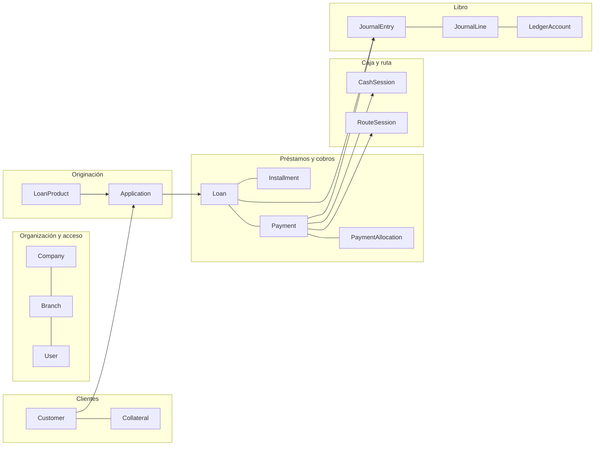
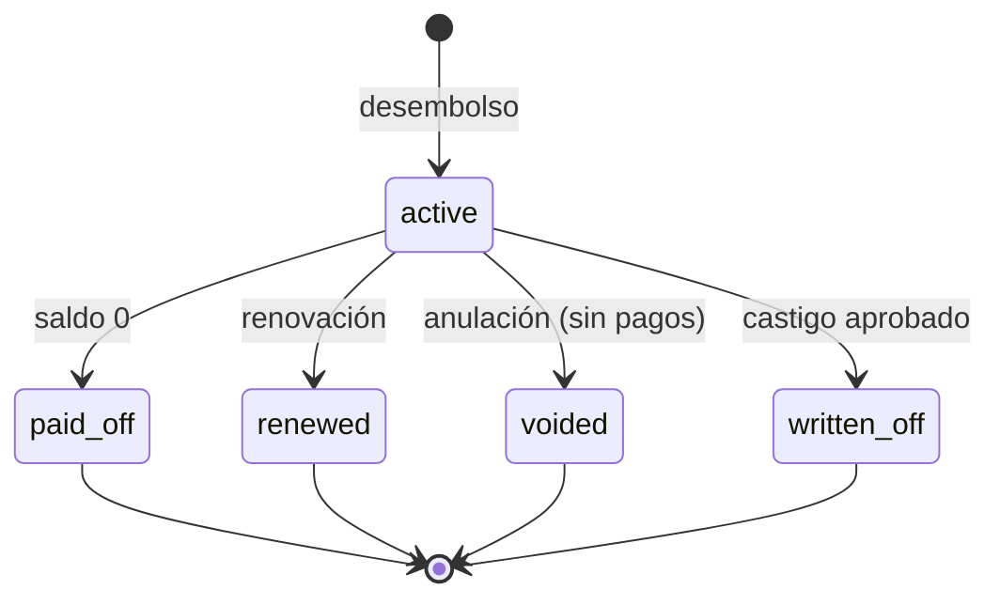
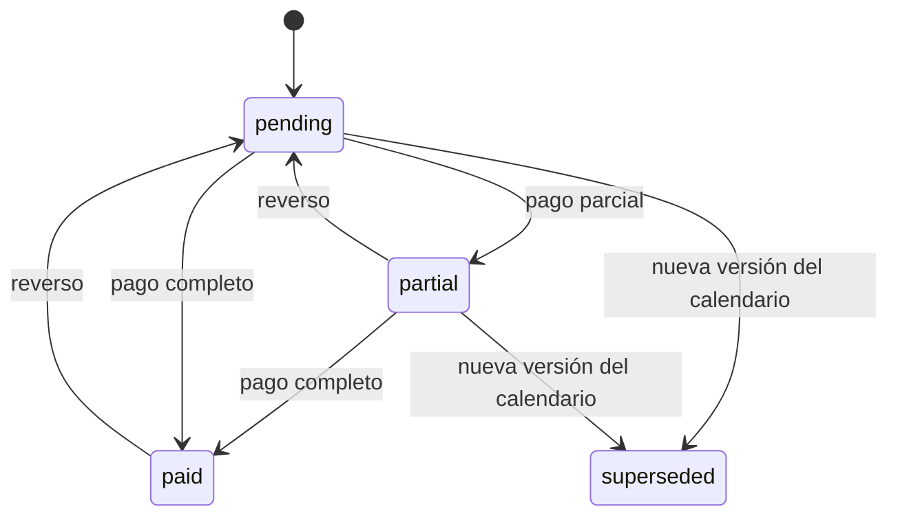
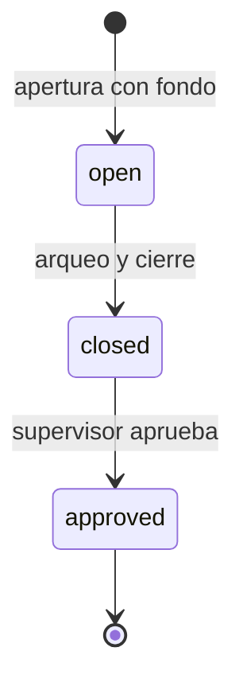

# 05 · Modelo de datos y estados

**Estado:** aprobado el 28/09/2026 (decisiones 029–032) · **actualizado el 04/10/2026** al alcance multitenant (decisiones 041, 042, 045 y 046)

Aquí se describe **qué se guarda y cómo se relaciona**. Los nombres de modelos y campos van en inglés (decisión 010) y la explicación, en español. Este documento es la guía de las migraciones de la Fase 1 en adelante: si algo cambia durante la construcción, se actualiza aquí primero.

## 1. Definiciones de este paso (aprobadas)

| # | Definición | Efecto en los datos |
| --- | --- | --- |
| 029 | **Solo pesos, preparado para dólares** | Cada importe lleva su moneda (`currency`, `DOP` por defecto). Activar `USD` no obliga a migrar |
| 030 | **Numeración por sucursal con prefijo** | Por ejemplo, préstamo `SD-000125` y recibo `SD-R-004512`: una secuencia sin saltos por sucursal y por tipo de documento |
| 031 | **Seguimiento continuo del cobrador en horario laboral** | Mientras la sesión de ruta está abierta, el celular envía su ubicación cada pocos minutos, además de la ubicación de cada cobro y gestión. Ver §6 |
| 041–042 | **Multiempresa con base compartida y RLS** | Todo registro operativo lleva `company`; PostgreSQL aplica Row-Level Security con la empresa de la sesión; numeraciones, catálogos y ajustes son por empresa |

## 2. Convenciones

| Tema | Regla |
| --- | --- |
| Identificadores | Cada registro tiene una clave **UUID v7**: ordenada en el tiempo, eficiente en índices y difícil de adivinar. Las personas usan los números legibles (`SD-000125`) |
| Alcance | La API comprueba **siempre** la sucursal y los permisos de cada ID que recibe; que el ID sea difícil de adivinar no sustituye ese control |
| Dinero | `NUMERIC(14,2)` más `currency CHAR(3)` |
| Tasas | `NUMERIC(9,6)` |
| Fechas | Las fechas de negocio (vencimiento, fecha valor, fecha contable) son `DATE` en hora de Santo Domingo. Los instantes (creado, cobrado) son `timestamptz` |
| Trazabilidad | `created_at`, `created_by`, `updated_at` y `updated_by` en todo lo editable; historial completo con pghistory |
| Borrado | **Nunca** se borra un registro financiero. Lo operativo se desactiva (`is_active`) o cambia de estado |
| Versionado | Las condiciones del préstamo y su calendario se versionan; una versión nunca se modifica, solo se reemplaza por otra |
| Sucursal | Todo registro operativo lleva `branch` |
| Empresa (tenant) | Todo registro operativo lleva `company` además de `branch`. En cada petición, la API fija la empresa de la sesión en la conexión (`SET app.current_company`) y las políticas RLS de PostgreSQL solo dejan ver filas de esa empresa: el ORM filtra primero y RLS es la barrera si el código falla. Las tareas de Celery hacen lo mismo. Son globales (sin `company`) solo los catálogos de la plataforma: geografía, planes y las propias empresas |

## 3. Mapa general

## 4. Entidades por módulo

### 4.0 `platform` · La plataforma Cobradía (solo el dueño)

| Modelo | Qué guarda | Campos clave | Reglas |
| --- | --- | --- | --- |
| `Plan` | Un plan comercial | Nombre, precio mensual, límites (usuarios, sucursales, préstamos activos), `is_active` | Los valores se definen antes del lanzamiento (045); la prueba usa un plan especial |
| `Subscription` | La suscripción de una empresa | `company`, `plan`, estado, inicio, pagada hasta | Una vigente por empresa |
| `SubscriptionPayment` | Un pago de suscripción | Suscripción, período cubierto, monto, medio, referencia, quién lo registró, comprobante | Manual al inicio; la pasarela se integra después (045) |
| `SupportAccessGrant` | Modo soporte (046) | `company`, quién, motivo, desde, hasta, revocado | Solo lectura; visible para la empresa; 72 horas por defecto |

Estas tablas no llevan RLS por empresa: solo las ve el dueño de la plataforma, salvo la suscripción propia, que cada empresa ve en «Ajustes › Suscripción».

### 4.1 `core` · Empresas, sucursales y utilidades comunes

| Modelo | Qué guarda | Campos clave | Reglas |
| --- | --- | --- | --- |
| `Company` | Una empresa (tenant) | Razón social, nombre comercial, RNC, dirección, teléfonos, correo, logo; `status` (en prueba, activa, suspendida, cerrada), `trial_ends_on`; ajustes de operación: `application_validity_days` (15) y `capacity_alert_ratio` (0.40) | La crea el registro público (F19) con su sucursal principal y sus catálogos sembrados; alimenta el encabezado de los documentos de esa empresa |
| `Branch` | Sucursal | `code` (prefijo, p. ej. `SD`), nombre, dirección, teléfono, `is_active` | El código es único y no cambia |
| `Holiday` | Feriado (por empresa) | Fecha, nombre, `is_confirmed` | Se siembran al crear la empresa; los de fecha fija se generan cada año y los trasladables los confirma cada empresa |
| `Sequence` | Numeración | `company`, `branch`, `doc_type` (préstamo, recibo, solicitud, caja, carta de saldo, gasto), `prefix`, `next_value`, relleno de ceros | Se toma con bloqueo de fila, dentro de la misma transacción que el documento: sin saltos ni duplicados |
| `ApprovalRequest` | Autorización en el momento | Tipo (condonar, reversar, descuento, castigo, anular, reestructurar, diferencia de caja), objeto, monto, motivo, solicitante, estado, quién decidió, cuándo, nota | Un mecanismo único para todas las autorizaciones |
| `Province`, `Municipality`, `Sector` | Catálogo geográfico (global de la plataforma) | Nombre y jerarquía | Corrige las ciudades en texto libre (#23); lo mantiene la plataforma, no cada empresa |
| `Reason` | Catálogo de motivos (por empresa) | Tipo (rechazo, reverso, castigo, anulación, bloqueo…) y texto | Se siembra al crear la empresa; además del motivo de catálogo, siempre hay una nota libre |

### 4.2 `accounts` · Usuarios y acceso

| Modelo | Qué guarda | Campos clave | Reglas |
| --- | --- | --- | --- |
| `User` | Persona que usa el sistema | `company` (su empresa), correo (para entrar), nombre, teléfono, `is_active`, `is_platform_admin` y el consentimiento de ubicación (§6) | Pertenece a una sola empresa; el dueño de la plataforma es el único sin empresa (`is_platform_admin`). El correo es único en toda la plataforma. Se desactiva, nunca se borra |
| `Role` | Plantilla de permisos (paso 6) | Nombre y permisos | Basado en los grupos de Django |
| `Membership` | Rol de un usuario en una sucursal | `user`, `branch`, `role` | Un usuario puede tener roles en varias sucursales |
| `ApprovalLimit` | Hasta cuánto aprueba cada quien | `role` o `user`, operación, `max_amount` (vacío = sin límite) | Lo usan la aprobación de solicitudes (023) y las autorizaciones. Sin fila para una operación, no se aprueba; la fila del usuario prevalece sobre las de sus roles. Los valores de ejemplo del paso 6 §5 se siembran al registrarse |
| `Invitation` | Alta de usuario | Correo, rol, sucursal, código de un solo uso, vencimiento | Nadie fija la contraseña de otro (#7) |

El 2FA, las sesiones y los códigos de respaldo los guarda django-allauth en sus propias tablas.

### 4.3 `customers` · Clientes y garantías

| Modelo | Qué guarda | Campos clave | Reglas |
| --- | --- | --- | --- |
| `Customer` | Persona o empresa | `kind` (persona o empresa); tipo de documento (cédula, RNC, pasaporte) y número; nombres o razón social; nacimiento, género, estado civil, ocupación; teléfonos, correo; dirección con provincia, municipio, sector y coordenadas; `home_branch`, oficial asignado; `status` (activo o bloqueado) con motivo; consentimiento con fecha y archivo | Documento único. Si es empresa, `legal_representative` apunta a un `Customer` persona |
| `Employment` | Datos laborales | Empleador, cargo, fecha de ingreso, sueldo, teléfono, dirección | El sueldo alimenta la evaluación |
| `Business` | Negocio (microcrédito) | Nombre, actividad, dirección, antigüedad, ventas y gastos mensuales | Alimenta la evaluación |
| `Relative` | Familiar | Nombre, parentesco, teléfono, dirección | — |
| `Reference` | Referencia personal o comercial | Nombre, teléfono, relación; quién la verificó, cuándo y con qué resultado | La verificación queda registrada |
| `CustomerFile` | Archivo privado | Tipo (cédula frente, cédula dorso, ingresos, foto, otro), clave del archivo, tipo MIME, tamaño, `sha256`, quién lo subió | Se descarga con sesión y enlace temporal (#28) |
| `Collateral` | Bien en garantía | Dueño (`Customer`), tipo (vehículo, inmueble, otro), descripción, `status` (registrado, en garantía, liberado, ejecutado), valor tasado, fecha de tasación, tasador, moneda | El bien existe una vez y puede respaldar varios préstamos a lo largo del tiempo |
| `VehicleDetail` | Datos del vehículo | Marca, modelo, año, color, placa, chasis, matrícula | Relación 1:1 con `Collateral` |
| `PropertyDetail` | Datos del inmueble | Título, designación catastral, ubicación, área | Relación 1:1 con `Collateral` |
| `CollateralFile` | Fotos y documentos del bien | Igual que `CustomerFile` | Privados |

### 4.4 `lending` · Productos, solicitudes y préstamos

| Modelo | Qué guarda | Campos clave | Reglas |
| --- | --- | --- | --- |
| `LoanProduct` | Configuración de un producto | Todos los parámetros de la sección 1 del paso 3 | Editarlo no altera los préstamos existentes |
| `ProductCharge` | Cargos del producto | Nombre, base (porcentaje o fijo), valor, modalidad (descontado, financiado o en caja), cuenta de ingreso | — |
| `LateFeePolicy` | Política de mora | Gracia, método, tasa o monto fijo, tope, desde cuándo cuenta | Se copia al préstamo al desembolsar |
| `Application` | Solicitud | Número; sucursal, cliente, producto; monto, moneda, frecuencia, cuotas, tasa y su unidad, primera fecha; `status` (§5.1); `created_by`, aprobador asignado, quién decidió, cuándo, motivo, nota; condiciones aprobadas; `valid_until`; evaluación (ingresos, gastos, relación cuota/ingreso); buró (proveedor, puntuación, fecha, reporte adjunto) | Nadie decide sobre lo que creó (023) |
| `ApplicationBudgetItem` | Presupuesto | Tipo (ingreso, gasto o activo), categoría, descripción, monto | Reemplaza la «Calculadora» de la referencia |
| `ApplicationGuarantor` | Garantes propuestos | `application`, `customer` | Solo clientes de nuestra base (#27) |
| `ApplicationCollateral` | Bienes propuestos | `application`, `collateral`, valor considerado | Se calcula la cobertura |
| `ApplicationRequirement` | Documentos exigidos | Requisito, archivo (opcional), quién lo verificó y cuándo | La lista sale de `LoanProduct.required_documents`; todos verificados para aprobar |
| `ApplicationFile` | Archivos de la solicitud | Tipo (reporte de buró, documento), descripción y los campos de `CustomerFile` | Privados, con enlace de 5 minutos y descarga auditada |
| `Loan` | Préstamo | Número (`SD-000125`); sucursal, cliente, solicitud, producto; `status` (§5.2); capital, moneda; fecha de desembolso; cobrador y oficial; `current_terms`; `renewed_from`; marcas de reestructurado y migrado; fechas de cierre, castigo y anulación; pagaré firmado adjunto | Se crea al desembolsar |
| `LoanTerms` | Condiciones congeladas (versionadas) | `loan`, `version`, vigencia, motivo; método, frecuencia, tasa, unidad, tasa por período, cuotas, redondeo, orden de aplicación, liquidación, copia de la política de mora; quién la creó y quién la aprobó | Inmutable. La versión 1 nace en el desembolso; las siguientes, por abono a capital, cambio de fecha o reestructuración |
| `Installment` | Cuota | `loan`, `terms_version`, número; `due_date` y `original_due_date` (antes del corrimiento por feriado); lo debido y lo pagado de capital, interés y cargos; mora pagada, mora condonada y `late_fee_accrued` (en caché); `status` (§5.3); fecha de pago completo | Cuando entra una versión nueva, las cuotas no pagadas de la anterior quedan como reemplazadas y se crean las nuevas |
| `LoanCharge` | Cargos del préstamo | `loan`, `product_charge`, nombre, monto, modalidad, estado | Una anulación los revierte (#31) |
| `LoanGuarantor`, `LoanCollateral` | Garantes y bienes del préstamo | Se copian de la solicitud al desembolsar | El bien pasa a «en garantía» |
| `CollectorAssignment` | Historial de cobradores | `loan`, `collector`, desde, hasta, motivo | Sirve para las comisiones y la trazabilidad |
| `Disbursement` | Desembolso | `loan`, fecha, origen (sesión de caja o cuenta financiera), medio, bruto, cargos descontados, financiados y en caja, **neto**, cuenta del cargo en caja, referencia, `idempotency_key` (único), asiento y asiento de anulación | Uno por préstamo; `neto = bruto − descontados` (restricción) |
| `LoanFile` | Archivos del préstamo | Tipo (pagaré firmado, otro) y los campos de `CustomerFile` | Al subir el pagaré firmado se marca `promissory_note_signed_at` |

**Saldos en caché del préstamo:**
- Campos: capital pendiente, interés pendiente, mora pendiente, días de atraso, tramo, próximo vencimiento y último pago.
- Se actualizan en la misma transacción de cada operación y se recalculan cada noche.
- La **conciliación nocturna** compara estas cachés con el libro y avisa de cualquier diferencia.

### 4.5 `payments` · Cobros

| Modelo | Qué guarda | Campos clave | Reglas |
| --- | --- | --- | --- |
| `Payment` | Cobro (el recibo) | Número (`SD-R-004512`); sucursal, préstamo, cliente; cuándo se cobró y fecha valor; medio (efectivo, transferencia, depósito, cheque) con su referencia; monto recibido, cambio y **monto aplicado**; moneda; `kind` (regular, liquidación, abono a capital, migrado); sesión de caja o cuenta bancaria; sesión de ruta y ubicación, si se cobró en la calle; quién cobró; `status` (§5.4); `idempotency_key` (único); `receipt_token` (enlace de WhatsApp, revocable) | La suma de sus asignaciones es igual al monto aplicado |
| `PaymentAllocation` | Desglose del cobro | `payment`, `installment`, componente (cargo, mora, interés, capital), monto | Es la base del recibo y del asiento |
| `PaymentReversal` | Reverso | `payment`, motivo, solicitante, autorizador, asiento inverso, `replacement_payment` (en «Corregir pago») | Un pago tiene como máximo un reverso |
| `LateFeeWaiver` | Condonación de mora | Cuota, monto, motivo, autorizador, pago asociado | Solo reduce la mora, nunca la aumenta |
| `PayoffQuote` | Carta de saldo | Número, `loan`, fecha de cálculo, válida hasta, desglose, total, `verification_token` | Es el mismo cálculo que usa la liquidación |

### 4.6 `cash` · Caja y ruta

| Modelo | Qué guarda | Campos clave | Reglas |
| --- | --- | --- | --- |
| `CashSession` | Sesión de caja de un cajero | Número, sucursal, cajero; apertura (cuándo y fondo); `status` (§5.5); cierre (cuándo, esperado, contado, diferencia y motivo); aprobación (quién y cuándo) | **Una sola sesión abierta por cajero** (restricción en la base de datos) y ninguna nueva sin cerrar la anterior (025) |
| `CashCount` | Arqueo | `session`, denominación, cantidad, subtotal | La suma es lo contado |
| `RouteSession` | Sesión de ruta de un cobrador | Cobrador, fecha, `status` (abierta o rendida), efectivo esperado, efectivo entregado, diferencia y motivo, sesión de caja que la recibió, quién la recibió | Una sola abierta por cobrador; se rinde el mismo día (025) |

**Movimientos de caja:** no tienen tabla propia. Son las líneas del libro que llevan la dimensión `cash_session` o `route_session` (§4.9). Así el esperado de una caja sale del libro y no puede discrepar de él.

### 4.7 `collections` · Cobranza, ruta y legal

| Modelo | Qué guarda | Campos clave | Reglas |
| --- | --- | --- | --- |
| `RouteStop` | Parada de la ruta del día | Cobrador, fecha, préstamo, orden, motivo (vence hoy, vencida o promesa), visitada a tal hora, resultado | Se genera cada mañana; el orden lo puede cambiar el cobrador |
| `CollectionAction` | Gestión | Préstamo, cliente, usuario, tipo (llamada, visita, mensaje), resultado, nota, cuándo, ubicación | — |
| `PaymentPromise` | Promesa de pago | Préstamo, gestión de origen, fecha y monto prometidos, `status` (pendiente, cumplida, incumplida, cancelada), cuándo se resolvió | La tarea nocturna marca las incumplidas |
| `DelinquencySnapshot` | Foto diaria del atraso | Fecha, préstamo, días de atraso, tramo, capital, interés y mora vencidos | Permite ver la cartera en riesgo en el tiempo |
| `EscalationRule` | Reglas de escalamiento | Días de atraso, acción y destinatario | Por defecto: 30, 60 y 90 días (F8) |
| `LocationPing` | Ubicación del cobrador (031) | Usuario, sesión de ruta, instante, latitud, longitud, precisión | Solo con la sesión de ruta abierta; se conserva 90 días por defecto |
| `LegalCase` | Caso legal (fase 8) | Préstamo, `status` (abierto, en acuerdo, en ejecución, cerrado), abogado, alguacil, fechas, motivo de cierre | — |
| `LegalProfessional` | Abogados, notarios, alguaciles y testigos | Tipo, nombre, documento, matrícula profesional, teléfono, dirección, `parent` (el testigo apunta a su abogado) | Corrige los catálogos sueltos de la referencia |
| `LegalCost` | Costas y gastos legales | Caso, descripción, monto, si se cobra al cliente | — |

### 4.8 `expenses` · Gastos, ingresos y cuentas por pagar (fase 6)

| Modelo | Qué guarda | Campos clave | Reglas |
| --- | --- | --- | --- |
| `ExpenseCategory` | Categoría | Nombre, naturaleza (operativo o del dueño), cuenta contable | Separa el negocio de lo personal (#12) |
| `Expense`, `Income` | Gasto o ingreso | Número, fecha, sucursal, categoría, descripción, monto, origen o destino (caja o cuenta), proveedor con su RNC, NCF, comprobante, `status` (registrado o anulado), aprobador | Se editan con historial (#18) y se anulan con asiento inverso |
| `PayableSeries` | Serie recurrente | Periodicidad, cantidad, fecha inicial | Cada ocurrencia es una `Payable` |
| `Payable` | Cuenta por pagar | Proveedor, descripción, categoría, monto original, vencimiento, serie, **pagado** y **pendiente**, `status` (abierta, parcial, pagada, cancelada); RNC o cédula, NCF e ITBIS incluido para el 606 (109) | Un pago parcial no la cierra (#10); el NCF de un proveedor no se repite (109) |
| `PayablePayment` | Pago de una obligación | `payable`, monto, fecha, origen, asiento | — |

### 4.9 `ledger` · Libro de movimientos

| Modelo | Qué guarda | Campos clave | Reglas |
| --- | --- | --- | --- |
| `LedgerAccount` | Plan de cuentas | Código, nombre, tipo (activo, pasivo, patrimonio, ingreso, gasto), cuenta padre, `is_system`, `allows_negative`, `is_active` | Las cuentas del sistema (Cartera, Intereses, Mora, Cargos) no se borran |
| `FinancialAccount` | Caja general o banco | Cuenta contable propia (`1101-NN` cajas, `1102-NN` bancos), tipo, banco, últimos 4 dígitos, sucursal (vacía = toda la empresa), moneda | No permite sobregiro (#30). Al registrarse, cada empresa recibe su «Caja general» |
| `AccountBalance` | Saldo en caché | Cuenta y saldo **en su lado natural** (débito para activos y gastos, crédito para el resto), copia de `allows_negative` | Se bloquea y actualiza en la misma transacción, en orden de cuenta (sin bloqueos cruzados); `CHECK` contra el sobregiro; se verifica cada noche |
| `JournalEntry` | Asiento | Número, fecha contable, sucursal, descripción, origen (tipo e ID), `reversal_of`, período, quién lo creó | **Siempre balanceado** (restricción diferida en la base) |
| `JournalLine` | Línea del asiento | Asiento, cuenta, débito, crédito, moneda. Dimensiones: sucursal, sesión de caja, sesión de ruta, préstamo, cliente | Las tablas del libro **no permiten UPDATE ni DELETE** (disparador) |
| `AccountingPeriod` | Mes contable | Mes, `status` (abierto o cerrado), quién lo cerró | Un mes cerrado no admite asientos sin permiso especial |
| `BankReconciliation` | Conciliación bancaria (fase 6) | Cuenta, período, extracto, líneas emparejadas | — |

### 4.10 `documents`, `reports`, `notifications` y `audit`

| Modelo | Qué guarda | Campos clave | Reglas |
| --- | --- | --- | --- |
| `DocumentTemplate` | Plantilla | Tipo (pagaré, recibo, recibo térmico, estado de cuenta, carta de saldo, cierre de caja, contratos, legales), versión, motor (HTML o DOCX), contenido, `legal_status` (pendiente o validada), quién la validó y cuándo | Las plantillas legales no se usan en producción sin validar (015) |
| `GeneratedDocument` | Documento emitido | Tipo, versión de plantilla, `legal_status` al emitir, objeto relacionado, folio, archivo, `sha256`, quién lo emitió; su QR apunta a un enlace público del índice `PublicLink` (decisión 098) | Solo admite inserciones (disparador); se reimprime idéntico y se verifica con QR (fase 9) |
| `ExportJob` | Exportación en segundo plano | Usuario, reporte, filtros, formato, estado, archivo | Usa los mismos filtros que la pantalla |
| `CustomerScore` | Clasificación (fase 7) | Cliente, puntuación, grado, factores, cuándo | Explicable (#38) |
| `CommissionRule`, `CommissionRun`, `CommissionLine` | Comisiones (fase 7) | Regla por rol o persona (base, porcentaje, meta), cálculo del mes, aprobación | Al aprobar, cada monto pasa a cuentas por pagar (089) |
| `Notification` | Aviso interno | Usuario, tipo, texto, enlace, leído | — |
| `MessageTemplate`, `OutboundMessage`, `OptOut` | Mensajería (fase 9) | Canal, destinatario, texto, estado, proveedor, error | Registro de cada envío |
| `PortalCode` | Código de acceso al portal del cliente (fase 9) | Cliente, código cifrado, vence, intentos, usado | Un solo uso; la invitación es un `PublicLink` de tipo portal (decisión 099) |
| `DomainEvent` | Hecho de negocio | Tipo (`loan.disbursed`, `payment.posted`…), objeto, actor, datos, cuándo | Alimenta la cronología del cliente y del préstamo |
| `LoginEvent` | Inicio de sesión (fase 7) | Usuario, hora, IP, navegador, dispositivo nuevo, fuera de horario | Alimenta las alertas antifraude (decisión 090) |
| `FraudRule`, `FraudAlert` | Alertas antifraude (fase 7) | Patrón, umbral, ventana; alerta por persona con su revisión | Revisión nocturna; no se repite dentro de la ventana (090) |

pghistory guarda, además, cada cambio de cada modelo editable, con el usuario, la IP y el motivo.

### 4.11 Lo que agregó la fase 4 (decisiones 065–074)

| Dónde | Qué | Para qué |
| --- | --- | --- |
| `FinancialAccount` | Tipos **caja de cajero** (`1103-NN`) y **efectivo de cobrador** (`1104-NN`), con `holder` (una por persona y sucursal) | El efectivo de cada quien tiene su cuenta, sin sobregiro, y solo se mueve desde su sesión (065) |
| Plan de cuentas | «Faltantes de caja por cobrar» (`1301`), «Sobrantes de caja» (`4201`) y «Saldos de apertura (migración)» (`3201`) | Diferencias del arqueo y de la rendición; cartera migrada (074) |
| `CashSession`, `CashCount`, `RouteSession` | Lo que quedó de la caja anterior, el fondo, el traslado al cerrar; el aviso del límite de efectivo en la ruta | §4.6; el esperado sigue saliendo del libro |
| `Payment` | Capital y saldo **posteriores**, congelados en el recibo; mora condonada, interés futuro condonado y descuento aparte | El recibo no cambia con pagos posteriores (066) |
| `Installment` | `interest_waived` (interés que la liquidación no cobra); lo pagado de interés nunca supera lo debido menos lo condonado | Liquidación (068) |
| `LoanTerms` | `replaced_installments`: las cuotas que cada versión reemplazó | Restaurar exactamente el calendario al reversar un abono (068) |
| `Loan`, `Disbursement` | `legacy_number` del sistema anterior; la sesión de caja del desembolso en efectivo | Migración (074); anulación con el dinero de vuelta por una caja abierta |
| `CollectorAssignment` | Quién cobró cada préstamo y desde cuándo | Comisiones (fase 7) y trazabilidad |
| `ApprovalRequest` (core) | Condonación, descuento, reverso y corrección: quién pidió, quién decidió, cuándo se usó | Un solo mecanismo de autorización (069) |
| `PublicLink` (plataforma, sin empresa) | Índice de los enlaces públicos: token → empresa y objeto, revocable | El recibo de WhatsApp, el QR de los documentos (098) y la invitación al portal (099) se resuelven sin sesión y dentro de la empresa correcta (066) |
| `Branch`, `HoursExtension`, `User` | Horario y días laborables de la sucursal; extensiones temporales; consentimiento de ubicación con fecha y texto | Horario de cajeros y cobradores (071); ruta (072) |
| `BranchAccessGrant` | Acceso del día a un cliente de otra sucursal, con motivo | Alcance por sucursal en clientes (070) |
| `Company` | `collector_cash_limit` (RD$ 25,000 por defecto, validado en 075) y `max_effective_annual_rate` (tope propio de costo anual efectivo, opcional) | Aviso al supervisor (072); tope de costo (075) |
| `RouteHandover` | Entrega parcial del cobrador a la caja de un cajero: monto, caja, quién recibió y su asiento (solo se agrega) | El cobrador baja del límite sin cerrar la ruta (075) |
| `Notification` | Avisos de la campana | Autorizaciones, diferencias, cierres, límite de efectivo y conciliación |
| `RouteStop`, `CollectionAction`, `LocationPing`, `DelinquencySnapshot` | §4.7, construidos en esta fase (la promesa de pago llega en la 5) | Ruta, visitas, ubicación y foto diaria del atraso |

### 4.12 Lo que agregó la fase 5 (decisiones 076–079)

| Dónde | Qué | Para qué |
| --- | --- | --- |
| `CollectionAction` | Resultados nuevos: habló sin compromiso, no contestó y número equivocado | P42 |
| `PaymentPromise` | Préstamo, gestión de origen, fecha, monto, estado, lo pagado al resolverse y quién la registró; una sola pendiente por préstamo (índice único parcial) | F8 paso 4 (076) |
| `CollectionTask` | Seguimiento en la agenda: tipo (seguimiento, promesa incumplida, escalamiento), fecha, asignado a una persona **o** a un rol (restricción en la base), regla y episodio del escalamiento (único por préstamo, regla y episodio), cierre con nota | P44 y F8 paso 5 (077, 078) |
| `EscalationRule` | Días mínimos, acción (revisar, intimar, legal), rol que actúa, activa; sembradas 31, 61 y 91 días | F8 paso 5 (077) |
| `Loan.agent`, `AgentAssignment` | El gestor del préstamo y el historial de cambios con motivo | F8 paso 6 (079) |
| `RouteStop` | Motivo nuevo «promesa de hoy» | La promesa del día entra en la ruta |

### 4.13 Lo que agregó la fase 6 (decisiones 080–085)

| Dónde | Qué | Para qué |
| --- | --- | --- |
| `LedgerAccount` | `parent` (agrupación opcional); cuentas del sistema nuevas: intereses por cobrar `1105`, cuentas por pagar `2101`, ITBIS por pagar `2102`, sobrantes por aclarar `2103`, retiros del dueño `3102`, otros ingresos `4202`, pérdidas por faltantes `5301`; gastos operativos sembrados `5201`–`5299` | Estados financieros y operaciones nuevas (080) |
| `AccountingPeriod` | Mes, estado, quién y cuándo cerró, la lista verificada y el devengo, motivo de reapertura; **disparador en la base** que rechaza asientos con fecha de un mes cerrado | Cierre de mes (084) |
| `Expense` (un solo modelo con `kind`: gasto o ingreso), `ExpenseCategory` (`nature`: operativo o del dueño; `dgii_type` del 606), `ExpenseFile` | Lo que el doc 4.8 llamaba `Expense` e `Income`: mismo registro, misma aprobación y misma pantalla | P54 (081) |
| `PayableSeries`, `Payable`, `PayablePayment` | Como en 4.8, con `recognized_entry` (devengo al registrar la factura o al vencer) y cancelación con asiento | P55 (082) |
| `BankReconciliation`, `BankStatementLine` | Mes y cuenta, saldo del extracto, líneas importadas y su emparejado con una línea del libro | Conciliación (083) |
| `CashDifference`, `CashDifferenceAction` | Faltantes y sobrantes con su saldo pendiente y las acciones que los resuelven | Decisión 075 |
| `ProductCharge.taxed`, `LoanCharge.taxed` | El cargo incluye 18 % de ITBIS | Decisión 075 |
| `FiscalDocument` | Comprobante E31, E32 o E34 por emitir o emitido, con montos exento, gravado e ITBIS, su origen y su e-NCF | e-CF y formatos 606 y 607 (085) |

## 5. Ciclos de vida

### 5.1 Solicitud

Estados: `draft → in_review → approved | rejected | returned`; luego `approved → disbursed | expired | withdrawn` (diagrama en [F3](04-flujos.md#f3--solicitud-evaluación-y-decisión)).

### 5.2 Préstamo

Sobre `active` se calculan, sin ser estados, estas condiciones:
- al día o en atraso (con días y tramo);
- reestructurado;
- en gestión (hay una promesa pendiente: se ve en Atrasos, en la agenda y en el préstamo);
- en vía legal (hay un caso abierto).

Un préstamo `written_off` sigue recibiendo pagos, que cuentan como recuperación.

### 5.3 Cuota

«Vencida» no es un estado: es una condición (fecha de vencimiento anterior a hoy y cuota sin pagar completa). Un reverso devuelve la cuota al estado que corresponda según lo que quede pagado.

### 5.4 Pago

`posted → reversed`. El reverso no cambia el pago original: crea un `PaymentReversal` y un asiento inverso.

### 5.5 Caja y ruta

- **`RouteSession`:** `open → settled`, cuando el cajero confirma la rendición.
- **`PaymentPromise`:** `pending → kept | broken | cancelled`.
- **`Collateral`:** `registered → pledged → released | executed`.
- **`LegalCase`:** `open → agreement | execution → closed`.

## 6. Ubicación de los cobradores (decisión 031)

- **Cuándo se registra:**
  - Mientras la sesión de ruta está abierta, el celular envía su ubicación cada 5 minutos (configurable).
  - Además, la ubicación queda en cada cobro y en cada gestión.
- **Límite de la web:**
  - El navegador solo envía la ubicación mientras «Mi ruta» está abierta y en pantalla.
  - Si el cobrador bloquea el teléfono o cambia de aplicación, el envío se pausa y el mapa muestra el hueco.
  - Es la consecuencia de ser solo web (decisión 028).
- **Consentimiento:**
  - El empleado acepta el seguimiento al activar su usuario de cobrador, con fecha y texto aceptado.
  - Solo se registra en horario laboral y con la ruta abierta; nunca fuera de ella.
- **Conservación:**
  - Los puntos se borran automáticamente a los 90 días.
  - Es el único dato que se elimina, porque no es un registro financiero.
- **Quién lo ve:** solo el supervisor y el gerente, en el mapa de la sucursal.
- **Validar con el abogado:** el seguimiento de empleados.

## 7. Reglas de integridad en la base de datos

Estas reglas se aplican en PostgreSQL, además de en el código, para que ni un error de programación pueda romperlas:

1. Todo asiento está balanceado: la suma de débitos es igual a la de créditos (restricción diferida).
2. Las tablas del libro no admiten UPDATE ni DELETE (disparador).
3. La suma de las asignaciones de un pago es igual a su monto aplicado.
4. Lo pagado de cada componente de una cuota nunca supera lo debido.
5. Hay a lo sumo una sesión de caja abierta por cajero y una sesión de ruta abierta por cobrador (índices únicos parciales).
6. Cada número de documento es único por empresa, sucursal y tipo, sin saltos.
7. Cada cliente tiene un único número de documento **dentro de su empresa** (la misma persona puede ser cliente de dos financieras distintas).
8. Las claves de idempotencia de pagos y desembolsos son únicas.
9. Ninguna cuenta con `allows_negative = false` queda en negativo (la verificación se hace con la fila del saldo bloqueada).
10. Los importes llevan `CHECK >= 0` donde corresponde; el signo lo da el débito o el crédito, nunca un importe negativo.
11. **Row-Level Security activo en toda tabla con `company`, incluidas las copias de historial de pghistory (decisión 058):** la política compara con la empresa de la sesión (`app.current_company`); una conexión sin empresa fijada no ve ninguna fila. Las relaciones entre tablas exigen además la misma empresa en ambos lados (claves compuestas o `CHECK` de coherencia en las uniones críticas).

La **conciliación nocturna** compara las cachés con el libro: saldos de préstamos y de cuentas, y el esperado de cada caja. Cualquier diferencia genera una alerta al administrador.

## 8. Rendimiento y búsqueda

- **Búsqueda de clientes:** índices de trigramas (`pg_trgm`) con `unaccent` sobre nombres, documento y teléfono; así «jose perez» encuentra «José Pérez».
- **Índices frecuentes:** empiezan por `company` (y sucursal), más estado, fecha de vencimiento, cobrador, y préstamo más fecha en asientos y pagos.
- **Volumen esperado:** una financiera mediana (decenas de miles de préstamos y cientos de miles de cuotas) es un volumen pequeño para PostgreSQL, y cientos de empresas así siguen siéndolo. No hace falta particionar; si algún día conviene, se particiona por empresa sin cambiar el modelo.

## 9. Decisiones de este paso

| # | Decisión | Estado |
| --- | --- | --- |
| 029 | Solo pesos, con la moneda guardada en cada importe | Aprobada |
| 030 | Numeración por sucursal con prefijo y sin saltos | Aprobada |
| 031 | Seguimiento continuo del cobrador con la ruta abierta, con consentimiento y 90 días de conservación | Aprobada |
| 032 | Modelo de datos de este documento: UUID v7, libro inmutable como fuente de saldos, calendario versionado, cachés verificadas cada noche y reglas de integridad en la base | Aprobada |
| 041–042 | `company` en todo registro operativo, RLS como segunda barrera, catálogos y numeraciones por empresa, y el módulo `platform` (planes, suscripciones, modo soporte) | Aprobada |
