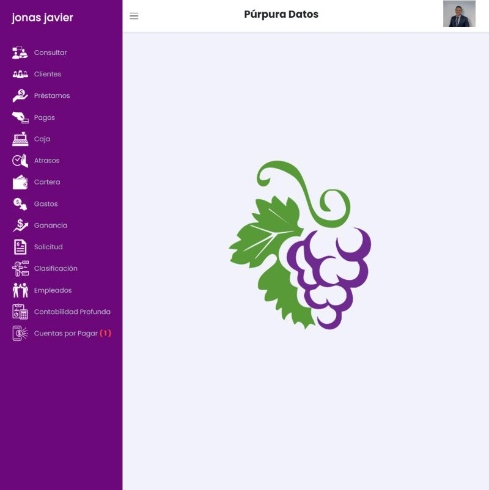
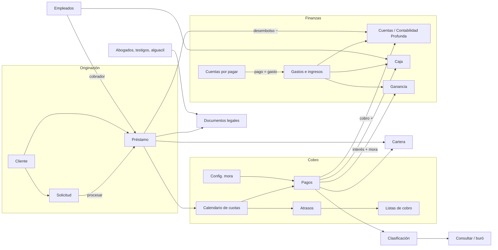
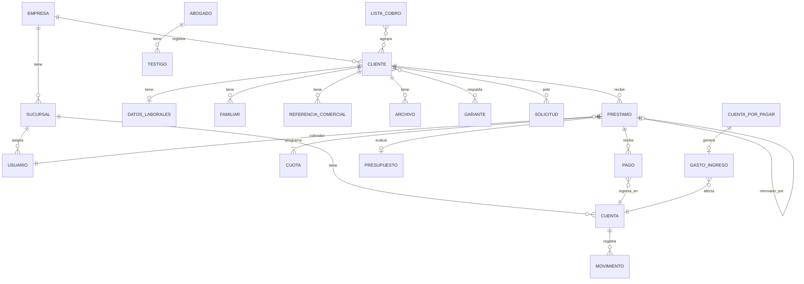

# 01 · Mapa general de Púrpura Datos

Observado el 28/09/2026 en la cuenta de pruebas (licencia de prueba: 7 días, 3 personas). Todo lo marcado como *observado* se vio en la interfaz o en el HTML servido; lo marcado como *inferido* se deduce del comportamiento y debe confirmarse.

## 1. Qué es el producto

Púrpura Datos es un SaaS dominicano para prestamistas pequeños y medianos (cédula, RNC, RD$, Código de Procedimiento Civil dominicano en los documentos). Combina cuatro cosas:

1. **Operación de préstamos**: clientes, solicitud, préstamo, calendario, cobro, renovación, mora.
2. **Finanzas del negocio**: cuentas (cajas), gastos e ingresos, cuentas por pagar, reportes de caja y ganancia.
3. **Cobro legal**: pagaré, pagaré notarial, acto de intimación, mandamiento de pago, acto de entrega voluntaria.
4. **Buró de crédito compartido** (*inferido, con evidencia fuerte*): `Consultar` muestra deudas del cliente con el encabezado de la **empresa prestamista** («Deuda #1 JJSolucion»), el pagaré dice «Al firmar acepto compartir esta información crediticia en Púrpura Datos» y hay «Calificación Total». Es decir, una cédula consultada puede revelar deudas registradas por otras empresas que usan la plataforma.

> **Nuestro alcance:** una sola compañía. Registro de empresas, licencias, planes y buró compartido son propios del SaaS de la referencia y quedan fuera; ver la tabla de equivalencias en [07](07-administracion.md).

Además existe una **app móvil** (*inferido*): el cliente puede recibir una «Clave de Acceso», los empleados tienen un mapa de ubicaciones por fecha y hay permisos «Limitado» pensados para cobradores de calle.

## 2. Stack técnico observado

| Capa | Tecnología |
| --- | --- |
| Backend | Laravel (PHP), sesiones con cookie y token CSRF |
| Interactividad | Livewire 3 (`wire:model.live`, `wire:click`) mezclado con jQuery y formularios clásicos POST |
| UI | Bootstrap 4, plantilla administrativa con `metisMenu`, `perfect-scrollbar`, `toastr` |
| Tablas | DataTables (búsqueda, paginación 8/10/25/50/75/100) |
| Tipografía e iconos | Poppins (Google Fonts), Material Icons, Feather, Font Awesome, Themify, Line Awesome, iconos PNG propios en el menú |
| Documentos | PDF generados en servidor (tamaño carta 612×792 pt); pagaré notarial en **.docx** |

Consecuencia: cinco librerías de iconos, lógica duplicada entre jQuery y Livewire, y varios errores de integración (HTTP 405, acordeones que no abren, descargas corruptas). Ver [10-hallazgos-y-mejoras.md](10-hallazgos-y-mejoras.md).

## 3. Estructura de navegación

### Menú lateral (operación diaria)

| # | Etiqueta | Ruta | Permiso que lo habilita |
| --- | --- | --- | --- |
| 1 | Consultar | `/consultar` | Consultar |
| 2 | Clientes | `/cliente` | Nuevos Clientes / Editar Clientes |
| 3 | Préstamos | `/prestamo` | Préstamos |
| 4 | Pagos | `/pagos` | Pagos / Pagos Limitado |
| 5 | Caja | `/caja` | Caja Todos / Caja Limitado |
| 6 | Atrasos | `/atrasos` | Atrasos Todos / Atrasos Limitado |
| 7 | Cartera | `/cartera` | Cartera / Cartera Limitado |
| 8 | Gastos | `/gastos` | Gastos |
| 9 | Ganancia | `/ganancia` | Ganancia |
| 10 | Solicitud | `/solicitud` | Solicitud |
| 11 | Clasificación | `/clasificacion` | Clasificación |
| 12 | Empleados | `/empleados` | Empleados |
| 13 | Contabilidad Profunda | `/Contabilidad` | Contabilidad Profunda / Limitada |
| 14 | Cuentas por Pagar **(n)** | `/cuentasporpagar` | Cuentas por Pagar |

El contador rojo de «Cuentas por Pagar» muestra obligaciones vencidas. El ítem activo se pinta verde. El nombre del usuario encabeza el menú y enlaza a `/home`, que solo muestra el logotipo (no hay tablero).

### Menú del avatar (administración, oculto)

| Etiqueta | Ruta | Documentado en |
| --- | --- | --- |
| Información de licencia | `/licencia` | [07](07-administracion.md) |
| Editar Empresa | `/empresa` | [07](07-administracion.md) |
| Configurar Mora | `/mora` | [04](04-cobros-mora-y-atrasos.md) |
| Configurar Gastos de Cierre | `/closingexpense` | [03](03-solicitud-y-prestamos.md) |
| Permisos | `/permisos`, `/permisos/{usuario}` | [07](07-administracion.md) |
| Datos Abogados (+ Testigos) | `/notar`, `/Testigo/{abogado}` | [07](07-administracion.md) |
| Datos Alguacil | `/algualcil` | [07](07-administracion.md) |
| Exportar Datos | `/exportardatos` (descarga directa) | [07](07-administracion.md) |
| Sucursales | `/sucursales` | [07](07-administracion.md) |
| Renovar licencia | `/licencia/renovar` | [07](07-administracion.md) |
| Cambia la contraseña | `/password` | [07](07-administracion.md) |
| Editar Usuario | `/perfil` | [07](07-administracion.md) |
| Salir | `/logout` | — |

**Problema:** la configuración que cambia el dinero (mora, gastos de cierre) está escondida en el menú del avatar junto a «Editar Usuario».

## 4. Catálogo completo de rutas observadas

| Ruta | Pantalla | Tipo |
| --- | --- | --- |
| `/login` | Inicio de sesión (nombre + contraseña, enlace «Regístrate») | Página |
| `/home` | Logotipo centrado | Página |
| `/consultar` | Consulta por cédula (abre modal de búsqueda al entrar) | Página + modal |
| `/cliente` | Lista de clientes | DataTable |
| `/cliente/create` | Alta de cliente | Formulario POST |
| `/cliente/{id}/show` | Ficha del cliente | Página |
| `/cliente/{id}/edit` | Edición de cliente | Formulario |
| `/cliente/{id}/editDatosLaborales` | Datos laborales | Formulario |
| `/cliente/{id}/show/clave` | **Genera** clave de acceso del cliente (GET con efecto) | Acción |
| `/cliente/{id}/archivo` | Subida de archivo del cliente | POST multipart |
| `/garante`, `/garante/{cliente}/create` | Catálogo de garantes / alta | DataTable / formulario |
| `/familiares/{cliente}/create` | Alta de familiar | Formulario |
| `/comerciales/{cliente}/create` | Alta de referencia comercial | Formulario |
| `/prestamo` | Préstamos: buscar cliente | DataTable |
| `/prestamo/{cliente}/show` | Nuevo préstamo del cliente | Formulario |
| `/prestamo/{cliente}/show/{prestamo}` | Expediente del préstamo | Página + 10 modales |
| `/prestamo/{prestamo}/print` | Pagaré PDF | Descarga |
| `/prestamo/{prestamo}/notarial` | Pagaré notarial .docx | POST → descarga |
| `/prestamo/mora` | Mora por préstamo (**responde 405**) | POST roto |
| `/pagos` | Pagos: buscar cliente | DataTable |
| `/pagos/{cliente}/show/{prestamo}` | Cobro del préstamo | Página + modales |
| `/pagos/{cliente}/{prestamo}/recibo` | Recibo (POST) | Descarga |
| `/pagos/{cliente}/{prestamo}/cartasaldo` | Carta de saldo PDF | Descarga |
| `/caja`, `/caja/pdf` | Reporte de caja | Livewire + PDF |
| `/atrasos`, `/atrasos/pdf` | Reporte de atrasos | Livewire + PDF |
| `/cartera`, `/cartera/pdf` | Reporte de cartera | Livewire + PDF |
| `/gastos` | Registro de gasto/ingreso | Livewire |
| `/ganancia`, `/ganancia/pdf` | Reporte de gastos e ingresos | Livewire + PDF |
| `/solicitud` | Solicitud y simulador | Livewire |
| `/clasificacion` | Clasificación de clientes | Livewire |
| `/empleados` | Ficha de empleado | Página + modales |
| `/Contabilidad` | Cuentas financieras | Livewire |
| `/cuentasporpagar` | Obligaciones | Livewire |
| `/NavMenu` | Refresco AJAX del menú | POST interno |
| `/register` | Registro público: usuario con licencia o empresa nueva con plan | Formulario |
| `/notification` | Avisos de atraso en JSON (toasts) | GET en cada página |
| `/prestamo` (POST) · `/prestamo/{c}/{p}/Header` | Borrador y cálculo del préstamo en cada cambio de campo | AJAX |
| `/prestamo/{id}` (DELETE) | Borrar préstamo sin pagos | Formulario |
| `/prestamo/{c}/show/{p}/solicitud` | Préstamo creado desde una solicitud | Página |
| `/solicitud/{token}` · `/cliente/create/{token}` | Solicitud guardada · alta de cliente precargada | Página |
| `/WCalc/{préstamo}/show` | Presupuesto («Calculadora») | Página |
| `/datosprestamo/{id}/pdf` | Estado de cuenta | PDF |
| `/pagos/{c}/{p}/pdf` · `/pagos/{c}/{p}/deshacer` | Recibo del último pago · reverso | PDF · POST |
| `/cliente/{id}/garante` (PUT/DELETE) | Asignar o quitar garante | POST |
| `/App/Archive/show/{token}` | Imagen de archivo del cliente (**sin autenticación**) | GET |
| `/empleados/{id}/comision` · `/empleados/{id}/{n}/{fecha}` | Comisiones · puntos GPS | JSON |
| `/Testigo/{abogado}` · `/Testigo/{abogado}/-/create` | Testigos por abogado | Página |

Patrones de URL: el ID del cliente precede al del préstamo; las redirecciones de guardado usan sufijos como `/saved` o `/true` (por ejemplo `/notar/saved`, `/mora/saved`, `/Testigo/273/true`). Hay rutas con mayúscula inicial (`/Contabilidad`, `/Testigo`) y errores ortográficos (`/algualcil`).

## 5. Cómo se relacionan los módulos

### Efectos cruzados verificados

| Acción | Módulos que cambian |
| --- | --- |
| Guardar préstamo | Cuenta elegida (−capital), Cartera, Consultar, Clasificación |
| Cobrar cuota | Préstamo (cuotas), Cuenta (+efectivo), Caja, Ganancia (interés + mora), Cartera, Atrasos, Clasificación |
| Revertir pago | Préstamo, Caja (fila negativa), Cuenta; no borra el pago original |
| Liquidar préstamo | Préstamo cerrado, Cuenta, Caja, Carta de saldo disponible |
| Renovar | Cierra el préstamo anterior con un pago interno y crea uno nuevo; Cuenta registra +saldo y −nuevo monto; Caja cuenta «Renovaciones» |
| Registrar gasto/ingreso | Cuenta, Caja (Gastos / Ingreso personal), Ganancia |
| Pagar cuenta por pagar | Crea un **Gasto Negocio** con la categoría de la obligación; Cuenta, Caja, Ganancia |
| Borrar gasto | Borrado lógico («Borrados»); la cuenta recupera el saldo |
| Transferir entre cuentas | Dos movimientos opuestos; saldo total igual |
| Cambiar configuración de mora | La mora propuesta en Pagos para **todos** los préstamos |

## 6. Modelo de datos inferido

Campos clave por entidad en las fichas de cada módulo. Los nombres internos de los campos (`Dirrecion`, `Cuidad`, `Correro`, `Parantesco`) tienen errores de ortografía que no deben heredarse.

## 7. Índice de fichas

| Ficha | Módulos |
| --- | --- |
| [02-clientes-y-consulta.md](02-clientes-y-consulta.md) | Consultar, Clientes, ficha, laborales, garante, familiares, referencias, archivos, clave de acceso |
| [03-solicitud-y-prestamos.md](03-solicitud-y-prestamos.md) | Solicitud, Préstamos, productos, calendario, expediente, renovación, incobrable, presupuesto, gastos de cierre |
| [04-cobros-mora-y-atrasos.md](04-cobros-mora-y-atrasos.md) | Pagos, terminar préstamo, reverso, recibo, mora, Atrasos, listas de cobro, notificaciones |
| [05-finanzas.md](05-finanzas.md) | Caja, Gastos, Ganancia, Contabilidad Profunda, Cuentas por Pagar |
| [06-cartera-y-clasificacion.md](06-cartera-y-clasificacion.md) | Cartera, Datos Importantes, Clasificación, mensajes |
| [07-administracion.md](07-administracion.md) | Empleados, Permisos, Sucursales, Empresa, Licencia, Abogados, Testigos, Alguacil, Exportar, Perfil |
| [08-documentos.md](08-documentos.md) | Todos los PDF y DOCX |
| [09-sistema-de-diseno.md](09-sistema-de-diseno.md) | Colores, tipografía, componentes, patrones y UX |
| [10-hallazgos-y-mejoras.md](10-hallazgos-y-mejoras.md) | Errores, riesgos y cómo lo haremos mejor |
