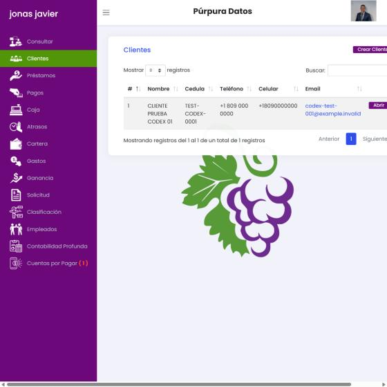
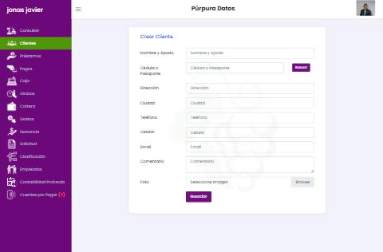
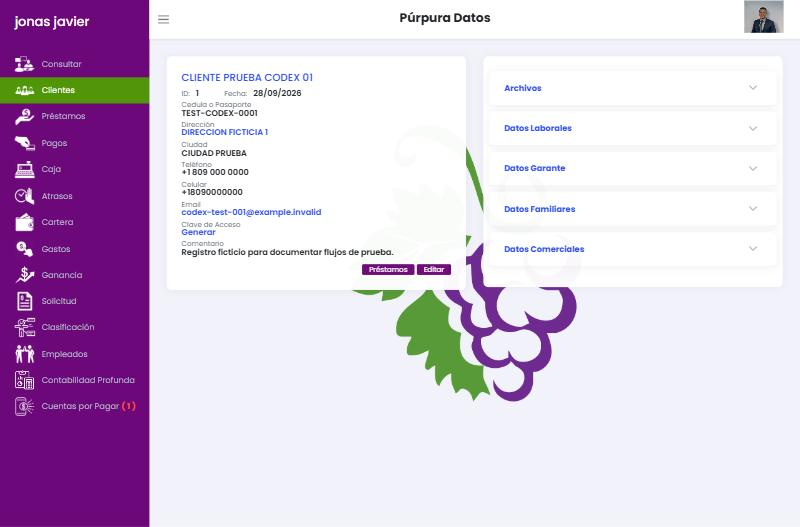
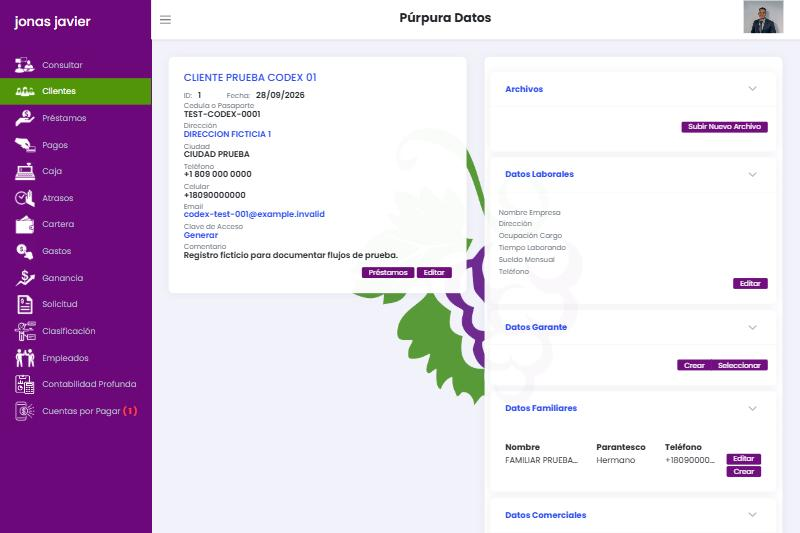

# 02 · Clientes y Consulta

## 2.1 Consultar (`/consultar`)

**Propósito:** buscar a una persona por cédula o pasaporte y ver su historial de deudas. Funciona como **buró compartido** entre empresas que usan Púrpura Datos (ver [01](01-mapa-general.md#1-qué-es-el-producto)).

**Flujo**
1. Al entrar se abre automáticamente el modal **Buscar Persona** con un único campo «Cédula o Pasaporte» y botón **Buscar**.
2. El resultado se pinta en una tarjeta central:
   - Banda púrpura «**Deuda #n {Empresa prestamista}**» con dirección, ciudad, teléfono, email y logo de esa empresa.
   - Datos del cliente: nombre, documento, dirección (enlace a mapa), ciudad, teléfono, email.
   - Lugar de trabajo + teléfono; familiares + teléfono.
   - Tabla de préstamos: Fecha · Monto inicial · Cuota · Pendiente.
   - Totales: Monto total, Monto pendiente, Monto atrás(ado), Cuotas/Días atrasados, Fecha y monto del último pago, **Calificación** (p. ej. «Bueno 95.0%»).
   - Barra fija inferior: «Calificación Total: Bueno 95%».
3. Botones: **Buscar Persona** (reabre el modal) e **Imprimir Consulta** (`window.print`).

**Modales:** `searchModal` (búsqueda), `MapModal` (mapa de la dirección), `imageModal` (foto).

**Observaciones**
- «Monto último Pago» puede mostrar un reverso negativo (−250) como si fuera el último pago.
- «Monto Pendiente» es capital pendiente, no balance contractual; no se explica.
- La calificación cambió de vacía a «Bueno 95%» después de un cobro con 3 días de atraso. La fórmula no es visible.
- No se registra quién consultó ni con qué propósito, algo crítico si el dato cruza empresas.

**Para nuestro sistema:** búsqueda global (Ctrl+K) por nombre, documento, teléfono o ID de préstamo sobre nuestros propios clientes. Si en el futuro se comparte información entre empresas, debe haber consentimiento explícito, registro de consultas y base legal (Ley 172-13 de protección de datos en RD). Fase 3.

## 2.2 Clientes — lista (`/cliente`)

| Elemento | Detalle |
| --- | --- |
| Título | «Clientes» + botón **Crear Cliente** (`/cliente/create`) |
| Tabla (DataTables) | # · Nombre · Cédula · Teléfono · Celular · Email (mailto) · botón **Abrir** |
| Controles | «Mostrar 8/10/25/50/75/100 registros», búsqueda de texto libre, paginación Anterior/Siguiente |
| Carga | AJAX tras un «Loading…» de pantalla completa |

La misma tabla de clientes se reutiliza como paso previo en **Préstamos** (botón *Seleccionar*) y **Pagos** (más filtro de sucursal). Se pierde un clic en cada operación diaria.

## 2.3 Crear / editar cliente (`/cliente/create`, `/cliente/{id}/edit`)

| Campo (etiqueta) | `name` interno | Tipo | Validación observada |
| --- | --- | --- | --- |
| Nombre y Apodo | `Nombre` | texto | — |
| Cédula o Pasaporte | `Cedula` | texto + botón **Buscar** | El botón consulta «Cédula Información» (fuente externa, *inferido* padrón). No encontró documentos ficticios. |
| Dirección | `Dirrecion` | texto | — |
| Ciudad | `Cuidad` | texto libre | Alimenta los filtros «Ciudad» de todos los reportes |
| Teléfono | `Telefono` | texto | Exige código de país (+1…) |
| Celular | `Celular` | texto | Idem |
| Email | `Correro` | email | — |
| Comentario | `Comment` | textarea | — |
| Foto | `file` | archivo | — |

Botón **Guardar**. Sin detección de duplicados visible antes de guardar. Ciudad es texto libre, lo que fragmenta los filtros («Bonao» vs «bonao»).

## 2.4 Ficha del cliente (`/cliente/{id}/show`)

**Columna izquierda (tarjeta de identidad):** nombre (título azul), ID interno por empresa y fecha de alta, documento, dirección (enlace a mapa), ciudad, teléfono, celular, email, **Clave de Acceso** («Generar»), comentario. Botones **Préstamos** (va a `/prestamo/{id}/show`) y **Editar**.

**Columna derecha — 5 acordeones:**

| Sección | Contenido | Alta |
| --- | --- | --- |
| Archivos | Galería; botón **Subir Nuevo Archivo** (sube al elegir el archivo). El modal de vista permite **Borrar**. | POST `/cliente/{id}/archivo` |
| Datos Laborales | Nombre empresa, Dirección, Ocupación/Cargo, Tiempo laborando, Sueldo mensual, Teléfono (todos texto) | `/cliente/{id}/editDatosLaborales` |
| Datos Garante | **Crear** (formulario) o **Seleccionar** (modal con catálogo global de garantes: Nombre, Cédula, Teléfono) | `/garante/{id}/create` |
| Datos Familiares | Tabla Nombre · Parentesco · Teléfono + Editar; **Crear** | `/familiares/{id}/create` |
| Datos Comerciales (referencias) | Tabla Nombre · Teléfono + Editar; **Crear** | `/comerciales/{id}/create` |

**Formulario de garante:** Nombre y Apodo, Cédula, Dirección, Teléfono, Lugar del Trabajo, Dirección Trabajo, Teléfono Trabajo, Sueldo Mensual, Datos Comerciales (texto), Datos Familiares (texto). El garante es una entidad reutilizable entre clientes.

**Verificado:** se crearon un familiar y una referencia comercial ficticios; ambos quedaron en la ficha tras guardar. Cada fila tiene *Editar* (`/familiares/{cliente}/{id}/edit`, `/comerciales/{cliente}/{id}/edit`).

### Archivos (verificado)

- Solo acepta imágenes `.png`, `.jpeg`, `.jpg` y `.gif` (validación jQuery; si falla muestra SweetAlert «Debe ser una imagen»). No admite PDF.
- Se sube al elegir el archivo, sin botón de confirmar. Aparece como un enlace con el nombre del archivo; al abrirlo muestra la imagen en un modal con **Borrar**, que pide confirmación («¿Estás seguro?»).
- **Riesgo de seguridad:** la imagen se sirve en `/App/Archive/show/{token de 60 caracteres}` y **se descarga sin iniciar sesión**. Quien obtenga la URL (reenviada, en el historial o en registros) ve la foto de una cédula sin autenticarse. Al borrar, la URL deja de servir la imagen.

### Datos laborales (verificado)

Guardado desde `/cliente/{id}/editDatosLaborales`; todos los campos son texto libre (sueldo incluido). El sueldo mensual **se importa automáticamente** como ingreso «Salario» en el presupuesto del préstamo (ver [03](03-solicitud-y-prestamos.md#37-presupuesto-calculadora)). Consultar también muestra el lugar de trabajo.

### Garante (verificado, con incidente)

- **Un solo garante por cliente.** *Crear* abre el formulario y lo asocia al guardar. Una vez asignado, la sección muestra todos sus datos con *Editar* (`/garante/{cliente}/{id}/edit`) y **Quitar** (sin confirmación).
- Los garantes forman un **catálogo** reutilizable (`/garante`, DataTable con Nombre · Cédula · Teléfono). Cada garante tiene un número interno por empresa (`GarantId`) y un ID global.
- **Incidente de seguridad (crítico):** el botón *Seleccionar* del catálogo envía el número interno por empresa (1) al endpoint `PUT /cliente/{id}/garante`, pero el servidor lo interpreta como ID global. En la prueba, el cliente ficticio quedó vinculado al **garante de otra empresa**: una persona real cuyo nombre apareció en nuestro pagaré. Se desvinculó de inmediato y no se registraron sus datos. Enviar el ID global propio devolvió 403. Conclusión: seleccionar un garante existente está roto y además **expone datos de otras empresas**.

### Edición del cliente

`/cliente/{id}/edit` reutiliza el mismo formulario del alta (con *Buscar* de cédula). No existe opción para borrar o desactivar clientes.

### Mapa

El enlace de la dirección abre un iframe de Google Maps construido con el texto de la dirección (`maps.google.com/maps?q=…`), sin geocodificación guardada.

**Defecto:** el clic en la cabecera del acordeón no abre la sección (el `card-body` queda `display:none`). Solo abre haciendo clic en la flecha pequeña o no abre en absoluto; el contenido existe en el DOM.

## 2.5 Clave de acceso del cliente

El enlace «Generar» apunta a `GET /cliente/{id}/show/clave`. Al visitarlo se genera y se muestra **en texto plano** una clave de 8 caracteres alfanuméricos (formato tipo `ab12cd34`). *Inferido:* sirve para que el cliente entre a una app o portal y vea su préstamo.

Problemas: una acción con efecto mediante GET (se dispara con un enlace precargado o un rastreador), la clave queda visible para cualquier empleado y se guarda de forma recuperable.

**Para nuestro sistema:** portal del cliente en fase 3 con invitación por enlace de un solo uso y contraseña elegida por el cliente, o acceso OTP por SMS/WhatsApp. Nunca mostrar credenciales al personal.

## 2.6 Propuesta de expediente del cliente

- Encabezado persistente: nombre, documento, calificación, saldo total, atraso y acciones rápidas (**Nuevo préstamo**, **Cobrar**, **Llamar/WhatsApp**).
- Pestañas: Resumen · Préstamos · Pagos · Documentos · Referencias y garantes · Historial (auditoría).
- Ciudad y sector como catálogo con autocompletado; teléfono con máscara RD por defecto.
- Detección de duplicados por documento, teléfono y nombre similar antes de guardar.
- Adjuntos con tipo (cédula frente/dorso, comprobante de ingresos, contrato), PDF e imágenes, vista previa y borrado lógico con motivo. **Siempre** servidos detrás de autenticación y permisos (URL firmadas de corta duración), nunca públicos.
- Garantes y codeudores como personas del expediente con relación N:M a préstamos (no al cliente), búsqueda por documento y verificación de que pertenecen a nuestra empresa. Todo acceso por ID se valida contra la compañía y los permisos del usuario.
