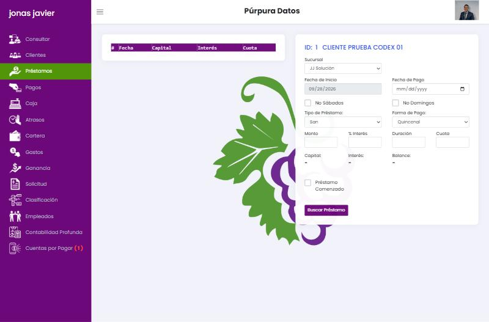
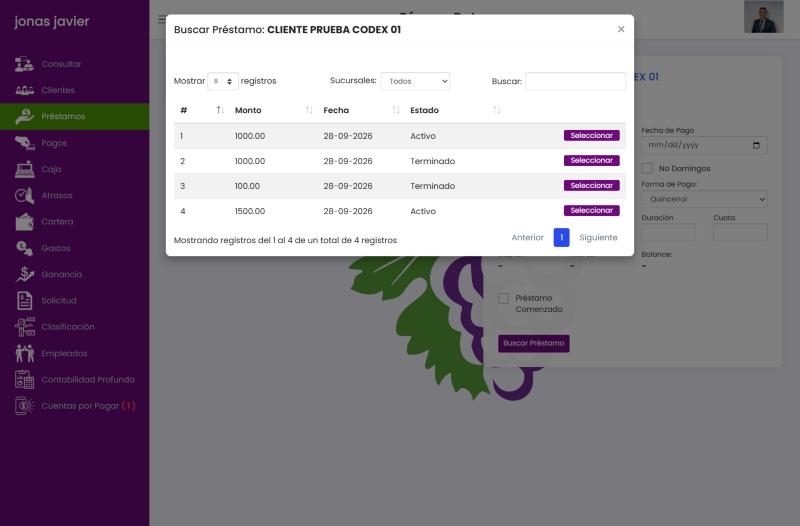
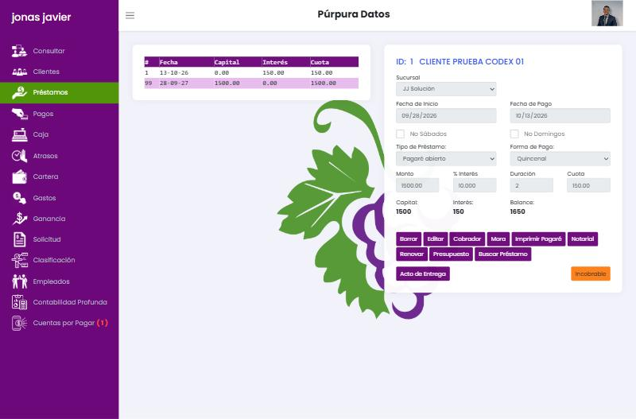
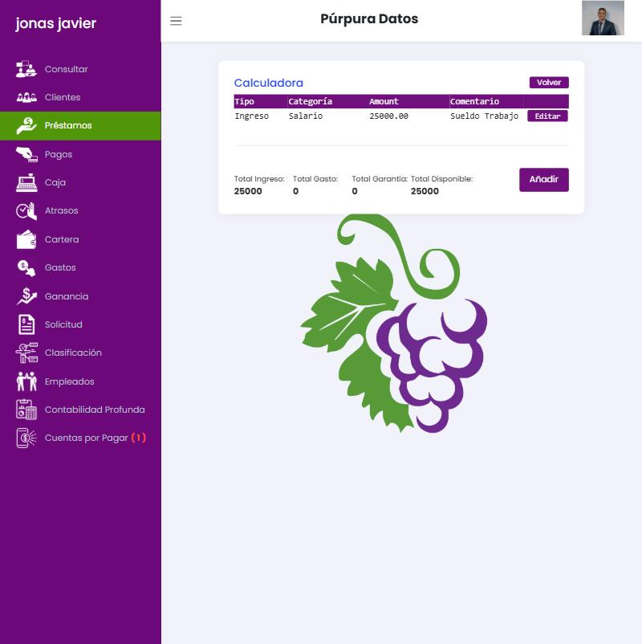

# 03 · Solicitud y Préstamos

## 3.1 Solicitud (`/solicitud`)

**Propósito:** captar a un prospecto y simular el préstamo sin crear cliente todavía. Pantalla Livewire (`wire:model.change`).

| Bloque | Campos |
| --- | --- |
| Identificación | Nombre y Apodo, Celular, Cédula o Pasaporte (+ **Buscar** → modal «Cédula Información»: Cédula, Nombre, Ciudad), Teléfono, Email, Dirección, Ciudad |
| Simulación | Tipo de Préstamo (San · A Rédito · Amortizado · Pagaré abierto), Forma de Pago (Diario · Interdiario · Semanal · Quincenal · Mensual), Monto, % Interés, Duración, Cuota |
| Resultado | Capital · Interés · Balance (se recalculan al cambiar campos) |

**Acciones:** Guardar solicitud; **Buscar Solicitud** (modal: # · Nombre · Celular · Monto); procesar la solicitud → modal **Cliente** para crear uno nuevo o usar uno existente (modal *Buscar Cliente*). Al procesar se abre el préstamo con los términos precargados.

**Observado:** una solicitud procesada desaparece de «Buscar Solicitud» (no queda historial de solicitudes rechazadas o aprobadas). No existe evaluación, aprobación ni motivo de rechazo.

**Flujo completo verificado (caso 18):**
1. Guardar → toast «Guardado»; la solicitud recibe un número (#2) y aparece en *Buscar Solicitud*.
2. *Seleccionar* abre `/solicitud/{token de 40 caracteres}` con los botones **Procesar** y **Borrar**.
3. *Procesar* → modal **Cliente**: «Crear nuevo Cliente» (`/cliente/create/{token}`) o «Buscar Cliente».
4. El alta de cliente llega **precargada** con los datos de la solicitud; al guardar se crea el cliente y se abre `/prestamo/{cliente}/show/{préstamo}/solicitud` con el préstamo en borrador y los términos copiados (San semanal 800 al 5 % en 4 cuotas → 240 = 200 + 40).

## 3.2 Productos y fórmulas observadas

Ejemplo base: capital 1,000 · 10 % · 4 cuotas · quincenal.

| Producto | Cuota | Interés total | Balance | Regla inferida |
| --- | --- | --- | --- | --- |
| **San** | 350 | 400 | 1,400 | Interés plano: capital × tasa × nº cuotas. Cuota = (capital + interés) / nº. Cada cuota lleva la misma proporción capital/interés (250/100). |
| **A Rédito** | 100 | 400 | 1,400 | Cuotas solo de interés (capital × tasa); el capital se devuelve al final (*inferido*). |
| **Amortizado** | 315.47 | 261.88 | 1,261.88 | Cuota fija francesa con tasa por período sobre saldo insoluto. |
| **Pagaré abierto** | 100 | 100 | 1,100 | La duración se fuerza a 2: fila #1 de interés en la primera fecha y fila **#99** con todo el capital a un año. Se renueva o se liquida. |

- La tasa se interpreta **por período de pago** (10 % quincenal), no anual. En el pagaré notarial aparece literalmente «10 % de interés Quincenal».
- **No Sábados / No Domingos:** casillas que saltan esos días al generar fechas. No hay feriados.
- **Préstamo Comenzado** + **Pago Hecho:** registra un préstamo que ya venía pagándose (migración). Ver 3.4.2.

### Batería de calendarios verificada (inicio lunes 28/09/2026)

| Caso | Resultado |
| --- | --- |
| San, **Semanal**, 500 al 10 %, 4 cuotas | 175 = 125 + 50; primera cuota a los 7 días (05/10), luego semanal |
| San, **Diario**, 600 al 5 %, 8 cuotas, **No Domingos** | 105 = 75 + 30; salta el domingo 04/10 (… 03/10, **05/10**, 06/10) |
| Igual con **No Sábados + No Domingos** | Salta 03/10 y 04/10 (… 02/10, **05/10** …) |
| San, **Interdiario**, 600 al 5 %, 6 cuotas, No Domingos | 130 = 100 + 30; cada 2 días; cuando cae en domingo pasa al lunes y **continúa desde la fecha desplazada** (30/09, 02/10, 05/10, 07/10, 09/10, 12/10) |
| San, **Mensual**, 1,000 al 10 %, 3 cuotas | 433.33 = 333.33 + 100; **capital total 999.99 y balance 1,299.99: se pierde 1 centavo por redondeo** |
| **Amortizado** mensual, 1,000 al 10 %, 3 cuotas | Cuota fija 402.11; interés 100 → 69.79 → 36.56; total 206.35 (sistema francés con tasa por período) |
| **A Rédito** semanal, 1,000 al 10 %, 3 cuotas | Cuotas 100 de solo interés; **la última trae el capital** (1,100) |

No hay feriados. La primera fecha se calcula como inicio + un período.

## 3.3 Préstamos — selección de cliente (`/prestamo`)

Misma tabla de clientes con botón **Seleccionar** → `/prestamo/{cliente}/show`.

## 3.4 Nuevo préstamo (`/prestamo/{cliente}/show`)

Diseño en dos columnas: **izquierda** calendario (# · Fecha · Capital · Interés · Cuota, cabecera púrpura en tipografía monoespaciada); **derecha** formulario.

| Campo | `name` | Notas |
| --- | --- | --- |
| Sucursal | `sucursal` | Select |
| Fecha de Inicio | `FechaDeInicio` | Bloqueada = hoy |
| Fecha de Pago | `FechaDePago` | Primera cuota; se calcula según frecuencia |
| No Sábados / No Domingos | `noSabados`, `noDomingos` | Casillas |
| Tipo de Préstamo | `TipoDePrestamo` | 4 productos |
| Forma de Pago | `FormaDePago` | 5 frecuencias |
| Monto · % Interés · Duración · Cuota | `monto`, `interes`, `duracion`, `cuota` | Numéricos; el cálculo se dispara con `keyup`/`focusout` (jQuery). Cuota editable → recalcula tasa (*inferido*). |
| Préstamo Comenzado | `presComenzado` | Muestra `pagoHecho` |
| Resumen | Capital · Interés · Balance | Texto |

**Guardar** → modal Livewire **Guardar Préstamo** (`prestamo.savemodal`) con: cuenta de desembolso (lista de cuentas con saldo) y, si están activados, **Gastos de Cierre** (`cierre_porcent`, `cierre_value`, `cierre_total`). Al confirmar, la cuenta baja por el capital.

### 3.4.1 Cómo calcula (verificado en el código de la página)

Cada cambio de campo (salir del campo, Enter o cambiar un select) llama a `saveServer()`, que hace `POST /prestamo` con todos los valores. El servidor **crea o actualiza un préstamo en borrador** (`PrestamoId`) y **borra y recrea todas las filas del calendario** (los IDs de cuota aumentan en cada tecla). Después `getHeader()` lee `GET /prestamo/{cliente}/{préstamo}/Header` y repinta la pantalla. Si falta la fecha de pago, el servidor responde **HTTP 500**. Consecuencias: borradores huérfanos, carga innecesaria y cálculo imposible sin conexión.

### 3.4.2 Préstamo Comenzado (verificado, caso 16)

San quincenal 1,000 al 10 %, 4 cuotas, **Pago Hecho 700**:
- Al guardar, las 2 primeras cuotas quedaron **pagadas** (350 + 350) con capital e interés en 0 y `datePaid` igual a su **vencimiento futuro** (13/10 y 28/10), no la fecha real.
- Resumen: capital 500, interés 200, balance 700.
- **No se registró desembolso** en la cuenta elegida (coherente con una migración, pero la interfaz no lo explica). El préstamo cuenta en Cartera.
- El botón *Borrar* desaparece porque el préstamo «tiene pagos».

### 3.4.3 Gastos de cierre al guardar (verificado, casos 16 y 17)

El modal **Guardar Préstamo** muestra *Seleccionar Cuenta* y, si está activado, *Gastos de Cierre* con **Porcentaje** (2.0) y **Valor** calculado (20 para 1,000; 2 para 100), ambos editables. Al guardar:
- La cuenta registra un movimiento **«Gastos de Cierre» +20** (ingreso), además del desembolso −capital.
- Los gastos de cierre **no aparecen en Caja ni en Ganancia**.
- No se descuentan del desembolso ni se suman al calendario: se cobran aparte, sin recibo.

### 3.4.4 Sobregiro de cuentas (verificado, caso 17)

Se desembolsaron 100 desde `CUENTA PRUEBA CODEX` con saldo 10: el sistema lo permitió y la cuenta quedó en **−88** (10 − 100 + 2). No hay validación de fondos.

### 3.4.5 Borrar préstamo (verificado, caso 17)

- El botón **Borrar** solo aparece si el préstamo **no tiene pagos**.
- Pide confirmación SweetAlert («Borrar? ¿Estás seguro?») y envía `DELETE /prestamo/{id}`.
- La cuenta recibe un movimiento **«Prestamo» +100** (no se identifica como anulación) y **conserva los 2 de gastos de cierre**. El préstamo deja de contar en Cartera.

**Buscar Préstamo** abre el modal con los préstamos del cliente: # · Monto · Fecha · Estado (Activo/Terminado) · *Seleccionar*, con filtro de sucursal.

## 3.5 Expediente del préstamo (`/prestamo/{cliente}/show/{prestamo}`)

Los términos quedan bloqueados. Barra de acciones (todas botones púrpura del mismo peso, salvo Incobrable en naranja):

| Acción | Qué hace | Verificación |
| --- | --- | --- |
| **Borrar** | Elimina el préstamo; solo visible sin pagos | Verificado (3.4.5) |
| **Editar** | Habilita **solo** «Fecha de Pago» de la próxima cuota pendiente; al guardar desplaza todas las pendientes | Verificado. Acepta fechas anteriores al inicio y anteriores a cuotas previas. Sin motivo ni historial. |
| **Cobrador** | Modal «Cambiar Cobrador?»: select de usuarios + Guardar | Parcial (un solo usuario) |
| **Mora** | Modal por préstamo: % a cobrar, días por cuota atrasada | **HTTP 405** al guardar |
| **Imprimir Pagaré** | PDF | Ver [08](08-documentos.md) |
| **Notarial** | Modal: abogado, testigo 1, testigo 2 → .docx | Verificado |
| **Renovar** | Modal: aviso «Este cliente tiene retrasos!», *Balance para cubrir*, *Va a recibir efectivo* (monto nuevo − balance), Monto, Cuenta → **Renovar** | Verificado ([FLUJOS caso 9](../FLUJOS_VERIFICADOS.md)) |
| **Presupuesto** | Garantías, ingresos, gastos y disponible del cliente vinculado al préstamo | Verificado |
| **Buscar Préstamo** | Cambia de préstamo del mismo cliente | Verificado |
| **Acto de Entrega** | Modal Livewire: abogado + testigo → PDF de entrega voluntaria | Verificado |
| **Incobrable** | Marca/desmarca incobrable sin confirmación ni motivo | Verificado |

Modales adicionales cargados en la página: **Acto de Intimación de Pago** (abogado) y **Mandamiento de Pago** (abogado + alguacil); también se abren desde Pagos.

## 3.6 Configurar Gastos de Cierre (`/closingexpense`)

- Casilla **Gastos de Cierre Activado**; al marcarla aparecen «Valor predeterminado Porcentaje» y «Valor predeterminado».
- Validación: «Debe definir el porcentaje o el valor y no ambos».
- Verificado: se guardó 2 % (persistió tras recargar). El efecto al desembolsar está en 3.4.3.

## 3.7 Presupuesto (calculadora)

El botón *Presupuesto* navega a `/WCalc/{préstamo}/show`, titulada **«Calculadora»**:
- Tabla Tipo · Categoría · **Amount** (en inglés) · Comentario · *Editar*.
- Totales: Ingreso, Gasto, Garantía y **Disponible** (= ingresos − gastos).
- *Añadir* → modal: Tipo (**Garantía**: Inmueble, Mueble, Vehículo, Otro · **Gasto**: Ahorro, Alimentación, Alquiler casa, Ayuda, Compras, Deudas, Educación, Entretenimiento, Higiene, Hijos, Hogar, Inversiones, Salud, Servicios, Transporte, Otro · **Ingreso**: Alquilar inmueble, Salario, Otro ingreso), Valor, Comentario.
- **Se rellena sola** con el sueldo de *Datos Laborales* como ingreso «Salario».
- Sin imprimir, sin relación con la decisión de aprobar y sin uso en el acto de entrega (que deja vacía la descripción del bien).

## 3.8 Relaciones

- **Lee:** Cliente, Sucursal, Cuentas (saldo), Configuración de gastos de cierre, Abogados/Testigos/Alguacil, Usuarios (cobrador).
- **Escribe:** Préstamo, Cuotas, Movimiento de cuenta (desembolso), Presupuesto, marca de incobrable, préstamo renovado.
- **Alimenta:** Pagos, Atrasos, Cartera, Clasificación, Consultar, Caja (renovaciones), Documentos.

## 3.9 Qué haremos mejor

1. **Flujo en pasos** (*wizard*): Cliente → Producto y términos → Calendario (vista previa) → Garantías/garante → Revisión → Aprobación → Desembolso. La solicitud es el mismo objeto con estados (borrador, en evaluación, aprobada, rechazada, desembolsada), no una pantalla aparte que se pierde.
2. **Productos configurables** con fórmula explícita, tasa por período y equivalente mensual/anual, redondeo y política de días no laborables (incluidos feriados RD).
3. **Gastos de cierre y cargos** como conceptos del préstamo, visibles en el calendario y en el contrato, con opción de descontarlos del desembolso o financiarlos.
4. **Reprogramación con versión:** cambiar fechas crea una nueva versión del calendario con motivo, autor y comparación antes/después; validación cronológica.
5. **Acciones peligrosas** (borrar, incobrable, renovar) con confirmación proporcional, motivo obligatorio y permisos.
6. Vínculo explícito préstamo anterior ↔ renovación, visible en ambos expedientes.
7. **Simulación en el cliente, persistencia al confirmar:** el calendario se calcula al instante (misma función en servidor para validar), sin crear borradores por cada tecla. Redondeo con ajuste en la última cuota para que el total cuadre al centavo.
8. **Migración explícita:** un asistente «Importar préstamo existente» que registre pagos históricos con fecha real y sin desembolso, claramente etiquetado.
9. **Control de fondos:** no desembolsar más que el saldo de la cuenta salvo permiso de sobregiro; anulación de préstamo como movimiento inverso identificado que también revierte los cargos cobrados.
10. **Evaluación de capacidad de pago** conectada al flujo: el presupuesto alimenta un indicador (cuota / disponible) y queda en el expediente de la solicitud.
