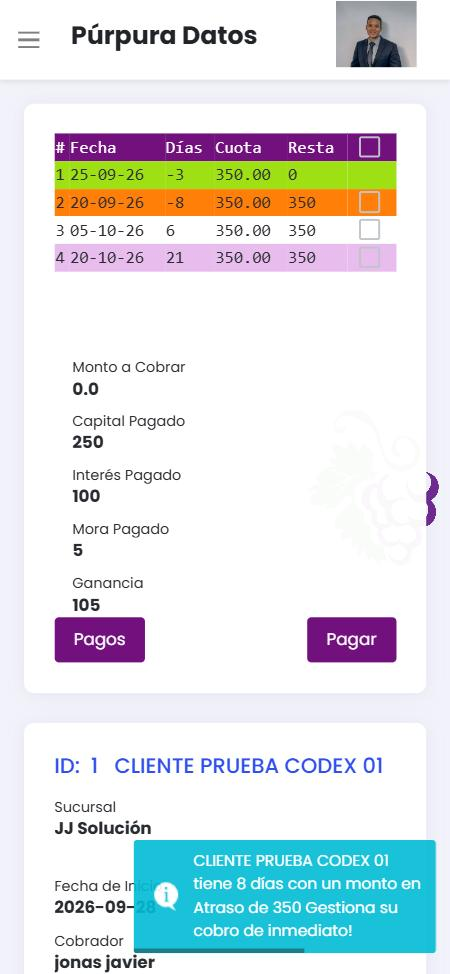
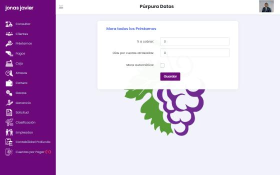

# 04 · Cobros, mora y atrasos

## 4.1 Pagos — selección (`/pagos`)

Tabla de clientes con filtro **Sucursales** y botón **Seleccionar** → `/pagos/{cliente}/show`, que abre de inmediato el modal *Buscar Préstamo* del cliente. Hacen falta **tres pasos** para llegar a la cuota (cliente → préstamo → cuota).

## 4.2 Pantalla de cobro (`/pagos/{cliente}/show/{prestamo}`)



**Tarjeta 1 — Cuotas**

| Columna | Significado |
| --- | --- |
| # | Número de cuota |
| Fecha | Vencimiento |
| Días | Días hasta el vencimiento; **negativo = atrasado** (−8) |
| Cuota | Importe programado |
| Resta | Pendiente de la cuota |
| ☐ | Selección (hay casilla «seleccionar todo» en la cabecera) |

Color de fila: **verde** pagada, **naranja** vencida, blanco/lila alterno pendiente.

Debajo: *Monto a Cobrar* (suma de lo seleccionado), *Capital Pagado*, *Interés Pagado*, *Mora Pagado*, *Ganancia* (interés + mora cobrados). Botones **Pagos** (historial) y **Pagar**.

**Tarjeta 2 — Datos del préstamo:** Sucursal, Fecha de inicio, Cobrador, Tipo, Forma de pago, Duración, Monto, Interés, Cuota. Botones **Imprimir Pago** y **Terminar Préstamo**.

**Historial de pagos** (tabla): Fecha · Cobrado · Capital · Interés · Mora · Deshacer (casilla).

**Notificación:** al abrir un préstamo atrasado aparece un *toast* cian: «{Cliente} tiene 8 días con un monto en Atraso de 350 Gestiona su cobro de inmediato!» (permiso *Notificación Atrasos*).

### Modal «Pagar Préstamo»

| Campo | Comportamiento |
| --- | --- |
| Monto a Cobrar | Precargado con lo seleccionado; editable (pago parcial) |
| Mora | Precargado con la **mora automática** calculada; editable |
| Efectivo | Lo entregado por el cliente |
| A Devolver | Cambio = efectivo − (monto + mora) |
| Cuenta | Cuenta destino con su saldo |

**Guardar** → la página recarga en `/pagos/{c}/show/{p}/true` y abre el modal **Recibo De Pago** con casillas *Imprimir*, *Enviar Email*, *Enviar Mensaje* y botón **Continuar**. Con *Imprimir* marcado, el POST a `/pagos/{c}/{p}/recibo` redirige a una página que abre `/pagos/{c}/{p}/pdf` en otra pestaña. El botón **Imprimir Pago** reabre ese modal (siempre para el **último** pago). El botón **Pagos** alterna la tarjeta entre la tabla de cuotas y el historial.

**Cobro de varias cuotas con mora automática (caso 15):** se marcaron las cuotas #2 (vencida 8 días) y #3. El modal propuso *Monto 700* y *Mora 140*; con efectivo 1,000 calculó *A Devolver 160*. Resultado: una **sola fila** en el historial (700 · capital 500 · interés 200 · mora 140), ambas cuotas en verde con Resta 0, cuenta +840. El recibo detalló cada cuota y la mora, pero con «Total Pagado: 700». La calificación pasó de «Bueno 95 %» a **«Bueno 96.3 %»**, subió pese a pagar con 8 días de atraso.

Reparto de un pago parcial: proporcional a la mezcla capital/interés de la cuota (100 de una cuota 250/100 → 71.43 / 28.57).

### Modal «Terminar Préstamo» (liquidación anticipada)

Capital a Cobrar (bloqueado) · Pagar Interés (editable, permite condonar) · Mora · Efectivo · A Devolver · Cuenta → **Pagado**. Luego aparece **Carta Saldo**. Discrepancias de importe documentadas en [FLUJOS caso 8](../FLUJOS_VERIFICADOS.md).

### Modal «Deshacer este Pago?» (reverso)

Se abre al marcar la casilla *Deshac.* de una fila del historial. Muestra *Cantidad para corregir* y *Mora para corregir*, pero ambos campos están **deshabilitados**: solo informan lo que se va a revertir. Se escribe la *Razón* → **Confirmar** (POST `/pagos/{c}/{p}/deshacer` con `KorrekturId` y `Comment`).

**El reverso siempre es total** (verificado en el caso 15: se intentó corregir solo 100 + 40 y se revirtieron 700 + 140; la cuenta devolvió 840). Crea una fila negativa en el historial y en Caja y no borra el original. Las cuotas vuelven a quedar pendientes y la mora automática se recalcula. La calificación bajó a 94 %.

## 4.3 Configurar mora

### Global (`/mora`, menú del avatar)



«Mora todos los Préstamos»: **% a cobrar**, **Días por cuotas atrasadas**, **Mora Automática** (casilla) → Guardar (POST `/mora`, redirige a `/mora/saved`). **Verificado:** 5 %, 1 día, automática — persistió.

### Por préstamo (modal *Mora* en el expediente)

Mismos dos campos; el guardado termina en **HTTP 405 Method Not Allowed** (ratón y teclado). No es posible fijar una mora distinta por préstamo.

### Fórmula verificada (caso 12)

Cuota 350, vencida hace 8 días, configuración 5 % / 1 día:

```
mora = cuota × % × floor(días_de_atraso / días_por_período)
     = 350 × 0.05 × floor(8 / 1) = 17.50 × 8 = 140
```

- Es **acumulativa sin tope**: en 8 días la mora ya es el 40 % de la cuota; a los 20 días igualaría la cuota.
- Se calcula sobre la **cuota completa** (*inferido*: falta probar con una cuota parcialmente pagada).
- No hay días de gracia.
- La mora pendiente **no** aparece en Atrasos, Cartera, Consultar ni en el PDF de estado de cuenta; solo se ve en el modal de pago y en el modal *Datos Préstamo* («Mora Pendiente 140»). El cajero puede sobrescribirla sin registrar motivo.

## 4.4 Atrasos (`/atrasos`)

| Filtro | Opciones |
| --- | --- |
| Sucursal | Todos / sucursales |
| Cobrables | Todos · Cobrables · Incobrables |
| Desde / Hasta | Fechas (por defecto 01/01/2000 → hoy) |
| Forma de Pago | Todos + 5 frecuencias |
| Usuario | Cobrador |
| Ciudad | Ciudades de clientes |
| Lista de cobro | Todos + listas; botón **Editar** |

Tabla: **Cliente · Monto · Tiempo** (días, negativo). Totales: *Total Monto Atraso*, *Total Capital Atraso*, *Total Interés Atraso*. **Imprimir Atrasos** → PDF. Clic en la fila → modal **Datos Préstamo** (resumen del préstamo con enlaces a imprimir y pagar, mapa, renovar).

**Verificado (caso 12):** cuota completa atrasada 350 → capital 250 e interés 100 correctos. Con una cuota **parcialmente** pagada (caso 10) los totales de capital e interés mostraron 0: la división no contempla pagos parciales.

**Filtro Cobrables (verificado, caso 19):** con el préstamo marcado como incobrable, *Incobrables* y *Todos* lo muestran y *Cobrables* lo oculta. **Defecto:** al cargar la página (valor por defecto «Cobrables») la tabla sí muestra el préstamo incobrable mientras el total dice 0; se corrige al volver a elegir el filtro.

### Modal «Datos Préstamo»

Se abre al hacer clic en una fila de Caja, Cartera, Atrasos o Clasificación. Muestra contacto; monto inicial, cuota y estado de cuotas (1/4); fechas de inicio y vencimiento; tipo, frecuencia y tasa; comentario; capital e interés pendientes y atrasados; montos pendiente y atrasado; **mora cobrada y mora pendiente**; calificación; cuotas atrasadas; último pago; cobrador; próximo pago. Acciones: **Renovar**, **Imprimir** (estado de cuenta en PDF, `/datosprestamo/{id}/pdf`) y **Pago** (va a cobrar). Es el único lugar con una vista completa del préstamo.

### Listas de cobro (verificado)

Modal **Lista de Cobro**: select de listas + *Nueva Lista*; al elegir una lista aparece su nombre **editable en vivo** (se guarda al escribir), *Borrar* la lista, «Clientes seleccionados» con *Borrar* por cliente (inmediato, sin confirmación) y un buscador de clientes para añadir. Borrar la lista pide confirmación en línea (*Cancelar* / *Borrar !*) y la quita del filtro. La lista sirve de filtro en Atrasos. Es la base de una **ruta de cobrador**, pero sin orden, fecha, resultado de visita ni promesa de pago.

### Notificaciones

`GET /notification` (llamado en cada página) devuelve en JSON los avisos de atraso que se muestran como toast («{Cliente} tiene 8 días con un monto en Atraso de 350 Gestiona su cobro de inmediato!»), según los permisos *Notificación Atrasos*.

## 4.5 Relaciones

- Pagos **lee** Préstamo, Cuotas, Configuración de mora, Cuentas.
- Pagos **escribe** Pago (capital, interés, mora), Cuota (resta), Movimiento de cuenta, y afecta Caja, Ganancia, Cartera, Atrasos, Clasificación y Consultar.
- Atrasos **lee** Cuotas vencidas, Listas de cobro, Usuarios, Ciudades.

## 4.6 Qué haremos mejor

1. **Cobro en un paso:** buscador global → préstamo → pantalla de cobro con la deuda exigible ya calculada (cuotas vencidas + mora + cargos). Atajo de teclado y botón «Cobrar» desde cualquier lista.
2. **Desglose antes de confirmar:** cuota(s), capital, interés, mora, cargos, efectivo recibido, cambio y saldo posterior. El recibo coincide al centavo con el movimiento de caja (*invariante*).
3. **Política de mora configurable y explicable:** base (cuota, saldo vencido o capital vencido), tasa por día/semana/período, días de gracia, **tope** (p. ej. % máximo de la cuota), redondeo. Vista previa en la configuración con un ejemplo.
4. **Condonación y ajuste de mora** como acción con permiso, motivo y auditoría, no como un campo libre.
5. **Orden de aplicación configurable** (cargos → mora → interés → capital) en lugar de un reparto proporcional implícito.
6. **Gestión de cobro:** listas con orden de ruta, resultado de visita, promesa de pago con fecha y monto, recordatorio y seguimiento de cumplimiento.
7. **Recibo digital** (PDF + enlace por WhatsApp) con número correlativo.
8. Reverso restringido por permiso, con motivo obligatorio y el vínculo visible entre pago y reverso.
