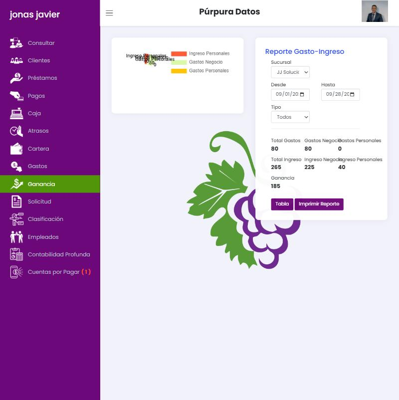
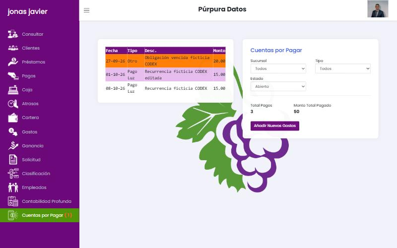

# 05 · Finanzas: Caja, Gastos, Ganancia, Contabilidad Profunda y Cuentas por Pagar

## 5.1 Caja (`/caja`)

Reporte Livewire, **no** una sesión de caja: no se abre ni se cierra, no hay arqueo.

| Filtro | Opciones |
| --- | --- |
| Sucursal | Todos / sucursales |
| Desde · Hasta | Fechas (por defecto hoy) |
| Usuario | Cobrador |
| Ciudad | Ciudades de clientes |

**Tabla:** Fecha · Cliente · Monto (cobros y reversos negativos; nombre truncado «CLIENTE PRUEBA CODEX 0.»). Clic → modal *Datos Préstamo*.

**Indicadores** (valores del día de prueba):

| Indicador | Valor | Qué suma (observado) |
| --- | --- | --- |
| Monto | 1,550 | Cobros de cuotas y renovaciones, sin mora |
| Capital | 1,350 | Capital de esos cobros |
| Interés | 220 | Interés cobrado |
| Mora | 5 | Mora cobrada |
| Ganancia | 225 | Interés + mora |
| Gastos | 80 | Gastos de negocio + personales (los borrados no cuentan) |
| Renovaciones | 1,100 | Saldo cancelado por renovación |
| Ingreso Personal | 40 | Ingresos personales |
| **Efectivo neto en Caja** | 415 | Fórmula no documentada; excluye desembolsos y el efecto neto de las renovaciones |

**Imprimir Caja** → PDF de 2 páginas (resumen + detalle). Ver [08](08-documentos.md).

**Problemas:** no incluye desembolsos, así que el «efectivo neto» no representa el efectivo físico; mezcla dinero personal con el del negocio; no hay cierre ni diferencias justificadas.

**Verificado en la segunda pasada:** los filtros Desde, Ciudad y Usuario recalculan en vivo. Un cobro de 700 + 140 de mora sumó 700 a *Monto*, 140 a *Mora* y 840 a *Efectivo neto*; su reverso añadió una fila −700 y devolvió todo. Los **gastos de cierre (+20) no aparecen** en ningún indicador de Caja, aunque sí entraron en la cuenta.

## 5.2 Gastos (`/gastos`)

Formulario **Gasto-Ingreso** (Livewire):

| Campo | Opciones |
| --- | --- |
| Fecha | Hoy (texto, no editable) |
| Sucursales | Sucursales |
| Tipo | Gasto Negocio · Gasto Personales · Ingreso Personales |
| Categoría | Depende del tipo (abajo) |
| Monto | Número |
| Cuenta | Cuentas con saldo |
| Descripción | Textarea |

**Categorías**
- *Gasto Negocio:* Pago Alquiler Local, Comprar inmobiliario, Deudas, Material Gastable, Materiales Limpieza, Nómina, Pago Agua, Pago Luz, Pago Internet, Servicios, Transporte, Otro.
- *Gasto Personales:* Ahorro, Alimentación, Alquiler casa, Ayuda, Compras, Deudas, Educación, Entretenimiento, Higiene, Hijos, Hogar, Inversiones, Salud, Servicios, Transporte, Otro.
- *Ingreso Personales:* Comisiones, Prestación de servicios, Utilidades, Otro.

**Buscar** → modal: filtros Sucursal, Tipo, **Activos/Borrados**; tabla # · Monto · Fecha · Tipo · Estado · *Seleccionar*. Al seleccionar se carga el gasto **en solo lectura** con botón **Borrar** (pide un texto de motivo, campo `borrarText`). No se puede editar un gasto; se borra y se vuelve a crear.

**Verificado:** el gasto personal de 10 del caso 11 aparece como «Borrado»; la cuenta recuperó el saldo y Caja/Ganancia dejaron de contarlo. **Defecto:** al abrir un gasto existente, Tipo y Categoría se muestran como «Elegir» (no reflejan el valor guardado).

**Alta y borrado completos (caso 20):** se registró un *Gasto Negocio · Material Gastable · 15* desde Caja Chica (toast «Guardado»; la cuenta bajó 15). Al abrirlo desde *Buscar* y pulsar **Borrar** aparecen «Razón de Borrar», **Borrar!** y **Cancelar**; sin razón muestra «Debe introducir una razón». **Defecto:** hay dos campos de razón; el visible con `name=borrarText` está deshabilitado y el que funciona es otro (`delete_comment`). Tras confirmar, la cuenta recuperó los 15 y el gasto pasó a «Borrados». En el libro de la cuenta, el borrado del gasto personal del caso 11 aparece como dos movimientos (−10 y +10).

## 5.3 Ganancia (`/ganancia`)

«Reporte Gasto-Ingreso». Filtros: Sucursal, Desde, Hasta (mes en curso), Tipo. Tabla Fecha · Tipo · Categoría · Monto. Botones **Gráfico** (modal) e **Imprimir Reporte**.

| Indicador | Valor observado | Cálculo inferido |
| --- | --- | --- |
| Total Gastos | 80 | Negocio + personales |
| Gastos Negocio / Personales | 80 / 0 | — |
| Total Ingreso | 265 | Ingreso negocio + personal |
| Ingreso Negocio | 225 | **Interés + mora cobrados** (no aparece en la tabla) |
| Ingreso Personales | 40 | — |
| Ganancia | 185 | Total ingreso − total gastos |

Mezcla utilidad operativa con aportes y retiros personales; los decimales se redondean a enteros. Los **gastos de cierre no cuentan** como ingreso del negocio.

**Gráfico** (Chart.js + datalabels) sustituye la tabla por un gráfico circular diminuto con etiquetas superpuestas e ilegibles; el botón cambia a «Tabla». Al hacer clic en una fila de la tabla se abre un modal con Categoría y Descripción.

## 5.4 Contabilidad Profunda (`/Contabilidad`)

«Sus cuentas»: filtro de sucursal, **Nueva Cuenta**, tabla Nombre · Balance · **Abrir**, *Saldo Total*. Formato de miles con apóstrofo (`97'925.00`).

Dentro de una cuenta: libro de movimientos (tipo, monto, saldo antes y después, usuario, razón), detalle del movimiento, **Transferencia** entre cuentas y **Ajuste** con motivo. Ver [FLUJOS caso 6](../FLUJOS_VERIFICADOS.md). Tipos de movimiento vistos: *Préstamo* (−), *Pago* (+), *Gasto*, *Ingreso*, *Transferencia*, *Ajuste*.

Las cuentas son el único registro de dinero; todo cobro y desembolso exige elegir una. Es un «libro de caja por cuenta», no una contabilidad de partida doble.

**Verificado en la segunda pasada:**
- *Editar* cuenta solo permite **renombrarla** (modal «Nuevo Nombre de la cuenta»). No hay borrar, desactivar ni cerrar cuenta.
- Tipos de movimiento vistos en el libro: *Balance inicial, Prestamo, Pago, Gasto Negocio, Gasto Personales, Ingreso Personales, Cuentas por Pagar, Transferencia, Ajuste, **Gastos de Cierre***.
- La cuenta **admite saldo negativo** (−88) y la anulación de un préstamo aparece como otro movimiento «Prestamo» positivo, sin referencia al original.

## 5.5 Cuentas por Pagar (`/cuentasporpagar`)

Filtros: Sucursal · Tipo (Pago Luz, Pago Agua, Pago Alquiler Local, Pago Internet, Deudas, Transporte, Servicios, Nómina, Otro) · Estado (Todos, Abierto, Tarde, Pagado). Tabla Fecha · Tipo · Desc. · Monto; fila **naranja** si está vencida. Totales *Total Pagos* y *Monto Total Pagado* (la etiqueta es incorrecta: muestra el monto abierto).

**Añadir Nuevos Gastos** → modal: sucursal, fecha de pago, tipo, importe, descripción, **Repite** (forma de pago + cuántas veces). Detalle → editar, borrar, **pagar** (monto + cuenta). Pagar genera un **Gasto Negocio** en `/gastos`.

Comportamientos verificados: repetición crea N ocurrencias independientes; un pago parcial marca la obligación como pagada y **pierde el saldo** (80 → pagado 30). Ver [FLUJOS casos 4, 5 y 7](../FLUJOS_VERIFICADOS.md).

**Detalle de una obligación (modal):** sucursal, fecha de pago, tipo, monto y descripción; **Editar**, **Borrar** y el bloque de pago (Monto, Cuenta, **Pagar**). *Borrar* pide confirmación en línea (*Borrar ?* / *X*) y elimina **solo esa ocurrencia**: la otra ocurrencia de la misma serie semanal siguió abierta (caso 20).

## 5.6 Qué haremos mejor

1. **Sesión de caja por cajero y sucursal:** apertura con fondo inicial, movimientos (cobros, desembolsos, gastos, transferencias), **arqueo** por denominación, diferencia justificada y cierre aprobado. Reporte de caja = conciliación de la sesión.
2. **Separar tres vistas:** *flujo de efectivo* (lo que entra y sale de cada cuenta), *resultado del negocio* (interés + mora + cargos − gastos operativos) y *movimientos del propietario* (aportes y retiros). Ningún gasto personal reduce la «ganancia» del negocio.
3. **Gastos editables con historial** (o anulación + reemplazo enlazado), adjunto de comprobante y aprobación por monto.
4. **Cuentas por pagar con saldo:** original, pagado y pendiente, estado *Parcial*, historial de pagos y series recurrentes editables.
5. **Libro de movimientos inmutable** con referencia común en transferencias y reversos. La contabilidad de partida doble puede ir en fase 3 sobre este mismo libro.
6. Formato numérico dominicano consistente (`RD$ 97,925.00`) y centavos visibles en todos los reportes.
