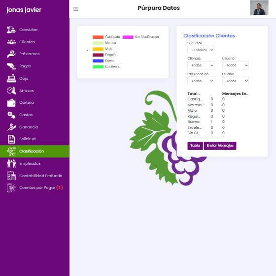

# 06 · Cartera y Clasificación

## 6.1 Cartera (`/cartera`)

| Filtro | Opciones |
| --- | --- |
| Sucursal | Todos / sucursales |
| Desde · Hasta | Fecha del préstamo (por defecto 01/01/2000 → hoy) |
| Tipo de Préstamo | Todos + 4 productos |
| Usuario | Cobrador |
| Forma de Pago | Todos + 5 frecuencias |
| Estado | Todos · Abiertos · Cerrados |
| Ciudad | Ciudades |

**Tabla:** Fecha · Cliente · Monto (inicial). Clic → modal *Datos Préstamo*.

**Tarjetas** (valores de la prueba, 4 préstamos, 2 activos):

| Indicador | Valor |
| --- | --- |
| Total Monto inicial | 3,600 |
| Total Capital Activo | 2,250 |
| Total Interés por Cobrar | 450 |
| Total Mora Cobrada | 5 |
| Balance General | 2,700 |
| Total Clientes / Total Préstamos | 1 / 4 |

**Datos Importantes** (modal): total de clientes, activos e inactivos, *Total Capital Activo Funcionando* (**2,000**, que no coincide con los 2,250 de la tarjeta), clientes por calificación, préstamos activos, préstamos atrasados, **Índice de Atrasos** (50 %), interés por cobrar, interés cobrado (220 → 67,2 %) e interés no cobrado (32,8 %).

**Imprimir Cartera** → PDF.

**Defectos:** dos cifras de «capital activo» distintas sin explicación; la mora pendiente no figura; y **cada filtro se comporta distinto** (verificado con 5 préstamos):

| Filtro | Tabla | Tarjetas de totales |
| --- | --- | --- |
| Tipo de Préstamo (Pagaré abierto) | Filtra (2 filas) | Filtra (monto inicial 2,500; balance 1,650) |
| Forma de Pago (Diario) | Filtra (1 fila) | Filtra |
| Estado (Cerrados) | Filtra (2 filas) y el contador | **No filtra**: montos iguales a «Todos» |
| Desde (29/09/2026) | **No filtra**: siguen 5 filas | Filtra (todo en 0) |

El usuario no puede saber si la cifra que ve corresponde a la tabla que tiene delante.

## 6.2 Clasificación (`/clasificacion`)

| Filtro | Opciones |
| --- | --- |
| Sucursal | Todos / sucursales |
| Clientes | Todos · Activos · Inactivos · Atrasados |
| Usuario | Cobrador |
| Clasificación | Castigado · Moroso · Malo · Regular · Bueno · Excelente · Sin Clasificación |
| Ciudad | Ciudades |

**Tabla:** ☐ · Cliente · Clasificación · % (p. ej. *Bueno 95.0*). Casilla «seleccionar todo». Clic → modal *Datos Préstamo*.

**Panel:** conteo por categoría y *Mensajes Enviados* por categoría. Botones **Gráfico** y **Enviar Mensajes**.

- **Enviar Mensajes** (modal, *existe; no se probó el envío por decisión del proyecto*): «Seleccione el tipo de mensaje» (select), «Editar mensaje» (texto editable) y **Enviar Mensajes** a los clientes marcados en la tabla. El contador *Mensajes Enviados* sugiere que se registra cada envío por categoría. Relacionado: el recibo ofrece *Enviar Email* y *Enviar Mensaje*.
- **Gráfico:** sustituye la tabla por un gráfico de Chart.js que se ve **vacío** (solo la leyenda de colores por categoría).

### Evolución observada de la calificación

| Momento | Calificación |
| --- | --- |
| Tras cobrar la 1.ª cuota con 3 días de atraso | Bueno 95.0 % |
| Tras cobrar otras 2 cuotas, una con 8 días de atraso | **Bueno 96.3 %** (sube) |
| Tras revertir ese cobro (cuota de nuevo atrasada) | Bueno 94.0 % |
| Préstamo pequeño liquidado antes de vencer | Excelente 100 % |

### Regla de calificación (inferida de dos puntos)

| Situación | Resultado |
| --- | --- |
| Préstamo pagado a tiempo y liquidado | Excelente 100 % |
| Cuota pagada con 3 días de atraso | Bueno 95 % |
| Sin historial de pagos | Sin Clasificación |

*Inferido:* puntaje = 100 % menos una penalización por días de atraso en los pagos, con tramos Excelente, Bueno, Regular, Malo, Moroso y Castigado. Faltan casos para fijar los umbrales. La calificación se usa en Consultar (buró), en el recibo y en la carta de saldo.

## 6.3 Qué haremos mejor

1. **Tablero de inicio** (hoy la home solo muestra el logotipo): cobros de hoy (esperado vs cobrado), vencidos por tramo (1–7, 8–30, 31–60, 61–90, 90+ días), cartera activa, colocación del mes, caja actual y tareas (promesas que vencen hoy, obligaciones por pagar).
2. **Cartera con definiciones:** cada tarjeta con tooltip de fórmula y fecha de corte; todos los totales respetan los filtros; exportación CSV/Excel.
3. **Indicadores estándar:** PAR30 (cartera en riesgo), índice de mora por monto y por cantidad, rendimiento de cartera, colocación, recuperación y castigos.
4. **Calificación transparente:** reglas configurables y visibles («Bueno: promedio de atraso ≤ 5 días en los últimos 6 meses»), historial y explicación por cliente.
5. **Mensajería** (fase 3): plantillas de WhatsApp/SMS con variables, envío a segmentos, registro de envío y exclusión voluntaria.
