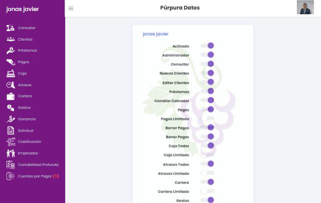
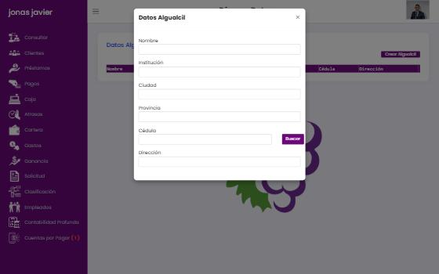

# 07 · Administración

> **Alcance de nuestro sistema: una sola compañía.** La referencia es un SaaS multiempresa, y parte de lo que se documenta aquí existe solo por eso: registro de empresas, licencias y planes, pago de licencia y buró compartido. Lo documentamos para entender la referencia, pero **no lo construiremos ahora**. En nuestro producto, estas pantallas se convierten en una sección **Ajustes** de la única compañía:
>
> | Pantalla de la referencia | En nuestro sistema |
> | --- | --- |
> | Editar Empresa | Ajustes → Empresa (datos, RNC, logo) |
> | Sucursales | Ajustes → Sucursales |
> | Permisos + Empleados + Cambia la contraseña | Ajustes → Usuarios y roles (invitación, roles, alcance) |
> | Configurar Mora, Gastos de Cierre | Ajustes → Productos y políticas (mora, cargos) |
> | Datos Abogados, Testigos, Alguacil | Ajustes → Personas legales |
> | Exportar Datos | Ajustes → Exportaciones y respaldos |
> | Editar Usuario (perfil) | Menú de usuario → Mi perfil y seguridad |
> | Información / Renovar licencia, Registro de empresa, Planes | **Fuera de alcance** (no aplica a una sola compañía) |

## 7.1 Empleados (`/empleados`)

- **Seleccionar Empleado** (select) → ficha de solo lectura: Nombre, Teléfono, Celular, Dirección, Ciudad, Cédula o RNC, Correo.
- Campos editables: **Función** y **Comentario** (+ Guardar).
- Botones:
  - **Cambia Contraseña** → modal *Nueva Contraseña* (el administrador fija la contraseña de otro usuario).
  - **Mapa** → modal con fecha y número de puntos (1, 2, 3, 4, 5, 10, 15, 20, 30): **rastreo de ubicación del empleado** por día (*inferido*: desde la app móvil del cobrador).
  - **Comisión** → tabla Fechas · Ganancia · % · Diferencia; **Configurar Comisión**: Fecha desde, Fecha hasta, *Cantidad Ganancia Cobro*, *% Ganancia Cobro*.

**Verificado en la segunda pasada:**
- *Función* y *Comentario* se guardan con un POST a `/empleados/{id}` (el botón Guardar aparece al escribir).
- **Comisión** (`GET /empleados/{id}/comision`): con período 01–30/09, *Cantidad Ganancia Cobro* = 100 y *% Ganancia Cobro* = 10, el sistema calculó **ganancia del cobrador 220** (interés cobrado en el período), **comisión 22** (10 % de toda la ganancia, no del excedente) y **diferencia 120** (ganancia − meta). No queda claro si la meta condiciona el pago de la comisión.
- **Mapa:** usa la API de Google Maps **sin clave** (`key=`), así que probablemente no carga. Lee `GET /empleados/{id}/{puntos}/{fecha}` y dibuja los últimos *N* puntos GPS (latitud, longitud, hora): el primero en rojo y el resto en azul. Sin datos en la cuenta de prueba.

### Cómo se crean usuarios (verificado)

No hay alta de empleados dentro del sistema (`/empleados/create` responde 403). Los usuarios se crean en la página pública **`/register`**, que tiene dos pestañas:
1. **Registrar Usuario → Registrar con Licencia:** Nombre, Contraseña, Teléfono, Celular, Dirección, Ciudad, Cédula o RNC, Correo y **Licencia** (el número de *Información de licencia*). Así se une un empleado a la empresa existente.
2. **Registrar Empresa / Adquirir Licencia:** datos de la empresa (nombre, dirección, ciudad, RNC, teléfonos, email, logo) y elección de plan.

Después, el administrador lo asigna en **Sucursales → Editar Usuarios** y le da permisos en **Permisos**. La licencia limita el número de personas.

**Planes ofrecidos** (sin precio visible): Básico (Clientes, Préstamos, Pagos, Atrasos), Superior (+ Consultar, Solicitud, Caja, Cartera), Premium (+ Gastos, Ganancia, Empleados, Contabilidad Profunda) y Empresarial (+ Clasificación), de 1 a 10 o más usuarios, más una prueba **gratis de 10 días con 3 usuarios** en plan Empresarial. Los permisos de cada usuario se limitan a los módulos del plan.

## 7.2 Permisos (`/permisos`, `/permisos/{usuario}`)

La lista muestra cada usuario con sus permisos activos; **Editar** abre interruptores:

| Interruptor | `name` | Grupo |
| --- | --- | --- |
| Activado | `activ` | Cuenta |
| Administrador | `Admin` | Cuenta |
| Consultar | `Pcons` | Operación |
| Nuevos Clientes | `Pclie` | Operación |
| Editar Clientes | `Pclie2` | Operación |
| Préstamos | `Prest` | Operación |
| Cambiar Cobrador | `Pcobr` | Operación |
| Pagos | `Pagos` | Cobro |
| **Pagos Limitado** | `Pali` | Cobro (solo su cartera, *inferido*) |
| Borrar Pagos | `Pborp` | Cobro |
| Bonar Pagos | `Pbonp` | Cobro (bonificar/condonar, *inferido*) |
| Caja Todos / **Caja Limitado** | `Pcaja` / `Pcaja2` | Reportes |
| Atrasos Todos / **Atrasos Limitado** | `Patra` / `Patra2` | Reportes |
| Cartera / **Cartera Limitado** | `Pcart` / `Pcarl` | Reportes |
| Gastos | `Pgast` | Finanzas |
| Ganancia | `Pgana` | Finanzas |
| Solicitud | `Psolic` | Operación |
| Clasificación | `Pquali` | Reportes |
| Empleados | `Pemp` | Administración |
| Notificación Atrasos / Notificación Atrasos Todos | `PaAle` / `PaAle2` | Alertas |
| Contabilidad Profunda / Limitada | `Pcontp` / `Pcontl` | Finanzas |
| Cuentas por Pagar | `Pcpp` | Finanzas |

Modelo: permisos individuales por usuario, sin roles. Los «Limitado» restringen a lo propio del usuario (*inferido*). No hay permisos separados para aprobar, desembolsar, editar términos, marcar incobrable, renovar ni configurar mora.

## 7.3 Sucursales (`/sucursales`)

Tabla Nombre · Datos · Usuarios con acciones **Desactivar**, **Editar Sucursal** (modal: Nombre, Dirección, Ciudad, Teléfono, Celular, Email) y **Editar Usuarios** (asignación). Botón **Crear Nueva Sucursal**. Las cuentas, préstamos, gastos y reportes se filtran por sucursal.

**Verificado (caso 20):** se creó `SUCURSAL PRUEBA CODEX` con el mismo modal. *Editar Usuarios* muestra «Usuarios de la Sucursal» (con *Quitar*) y «Usuarios disponibles» (con *Añadir*). Los formularios (por ejemplo, Gastos) solo ofrecen las sucursales **a las que pertenece el usuario**, así que la nueva no aparece hasta asignarla. **Desactivar** es inmediato, sin confirmación, y el botón pasa a **Activar**. No se pueden borrar sucursales.

## 7.4 Empresa (`/empresa`)

Nombre, Dirección, Ciudad, **RNC**, Teléfono, Celular, Email e **Ingresar Logo**. Estos datos encabezan todos los PDF. Sin logo, los documentos usan la **foto de perfil del usuario**.

## 7.5 Licencia (`/licencia`, `/licencia/renovar`)

*Información de licencia:* número de licencia y vigencia («7 días y 3 personas»). *Renovar:* instrucciones de pago por depósito o transferencia a cuentas bancarias, con confirmación manual por teléfono o correo. No hay pasarela de pago ni factura.

## 7.6 Abogados y testigos (`/notar`, `/Testigo/{abogado}`)

- **Abogado** (`/notar/-/create`): Nombre, Municipio, Provincia, Número de Colegiatura, Estudio profesional. Tabla con acciones **Testigos** y **Editar**.
- **Testigo** (por abogado): Nombre, Cédula. Los testigos pertenecen a un abogado.
- **Verificado:** se crearon un abogado y dos testigos ficticios.

## 7.7 Alguacil (`/algualcil`)

Modal Livewire: Nombre, Institución, Ciudad, Provincia, Cédula (+ **Buscar** en padrón), Dirección. **Defecto:** el botón **Guardar** queda fuera del área visible del modal a 1280×800 y no tiene barra de desplazamiento; solo se pudo guardar invocándolo por script. Tabla Nombre · Institución · Ciudad · Provincia · Cédula · Dirección · Editar.

## 7.8 Exportar Datos (`/exportardatos`)

La ruta responde con una **redirección a otro dominio** que entrega el archivo directamente, sin pantalla de opciones (qué exportar, formato o rango). El navegador de pruebas bloquea esa descarga. **Pendiente:** que el usuario la descargue manualmente y la deje en `docs/referencia/export/` para analizar su formato y contenido.

## 7.9 Perfil y contraseña (`/perfil`, `/password`)

*Editar Perfil:* Teléfono, Celular, Dirección, Ciudad, Cédula o RNC, Correo. *Cambia la contraseña:* selector de usuario + nueva contraseña; no pide la contraseña actual ni aplica política de complejidad visible.

## 7.10 Qué haremos mejor

1. **Roles con plantillas** (Administrador, Gerente de sucursal, Oficial de crédito, Cajero, Cobrador, Auditor) y permisos finos por acción, con **alcance** (propio, sucursal, empresa). Separación de funciones: quien aprueba no desembolsa; quien cobra no revierte.
2. **Invitación de usuarios** por correo con enlace de activación; el administrador nunca ve ni fija contraseñas; restablecimiento por el propio usuario; 2FA opcional.
3. **Configuración centralizada** («Ajustes»): Empresa, Sucursales, Productos, Mora, Cargos, Plantillas de documentos, Personas legales (abogados, notarios, testigos, alguaciles), Usuarios y roles, Integraciones.
4. **Ubicación de cobradores** solo con consentimiento, en horario laboral y con fines explícitos; registro de visitas en lugar de rastreo continuo.
5. **Exportación** con selector de entidades, formato (CSV/Excel) y registro de quién exportó.
6. **Auditoría** consultable: quién hizo qué, cuándo, desde dónde y con qué valores antes y después.
