# 08 · Documentos generados

Se revisaron **13 documentos** (12 PDF y 1 DOCX). Se obtuvieron dentro del navegador, se extrajo su texto y se renderizaron para capturarlos. En las capturas, los datos de contacto de la empresa de pruebas, la foto usada como logo y la cédula del usuario están tapados con recuadros grises.

## 8.1 Plantilla común de los PDF

```
┌──────────────────────────────────────────────────────┐
│ NOMBRE EMPRESA (serif, negrita, 16 pt)    ┌────────┐ │
│ Dirección                                 │  LOGO  │ │
│ Ciudad                                    │ (foto  │ │
│ Teléfono                                  │ perfil │ │
│ Email                                     │ si no  │ │
│ Título del documento (gris, cursiva)      │ hay)   │ │
│ ──────────────────────────────────────────└────────┘ │
│                                                      │
│   Lugar y fecha (alineado a la derecha)              │
│   Cuerpo: texto legal justificado, o pares           │
│   «Etiqueta: valor» centrados                        │
│   Tabla (cabecera púrpura #6D087A, filas lila)       │
│                                                      │
│   Firmas centradas (nombre + rol, sin línea)         │
│                                   28.09.2026 07:18 PM│
└──────────────────────────────────────────────────────┘
```

| Aspecto | Valor observado |
| --- | --- |
| Tamaño | Carta, 612 × 792 pt (el .docx notarial usa **A4**) |
| Tipografía | Serif tipo Times en todos los PDF; el .docx usa Arial y Bookman Old Style |
| Encabezado | Datos de `/empresa`; sin logo cargado, usa la **foto de perfil del usuario** |
| Título | Gris, cursiva, ~18 pt, filete horizontal debajo |
| Reportes | Página 1: filtros + totales centrados, mucho espacio vacío. Página 2: tabla de detalle |
| Pie | Fecha y hora de generación abajo a la derecha, en cursiva |
| Ausencias | Sin número de página, folio, código de verificación, usuario que emite ni versión de plantilla |
| Fechas | `dd.mm.yyyy` en documentos; `dd-mm-yyyy` o `dd-mm-yy` en pantallas |
| Montos | Sin separador de miles ni símbolo de moneda (salvo «$R.D» en el pagaré) |

## 8.2 Galería

| | |
| --- | --- |
| 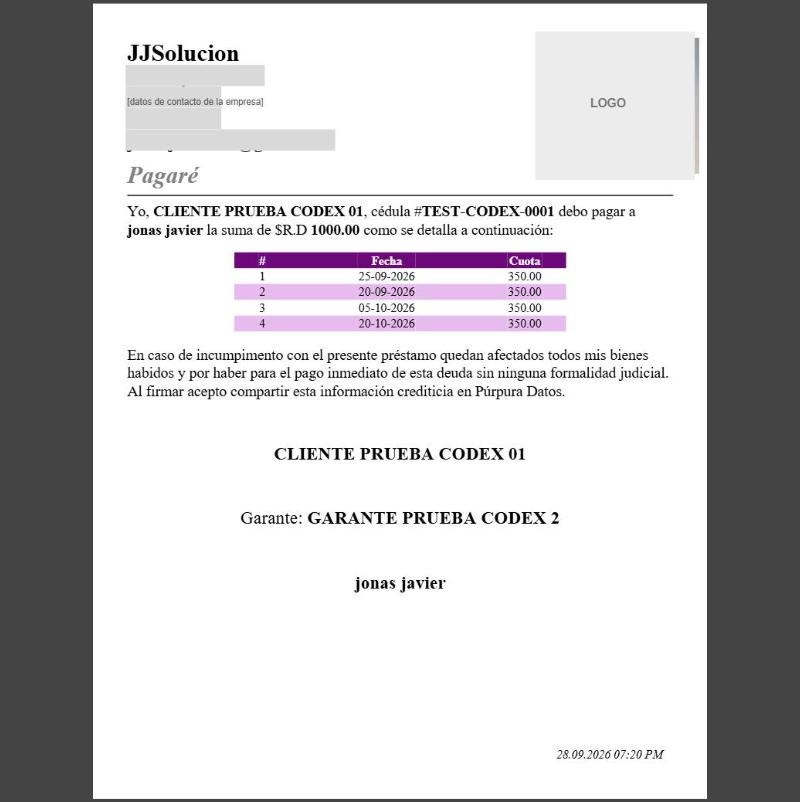 **1. Pagaré** | 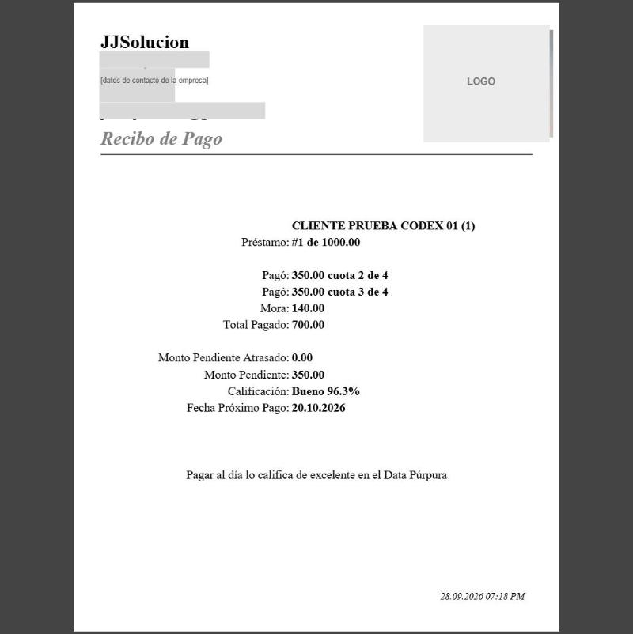 **2. Recibo de pago** |
| 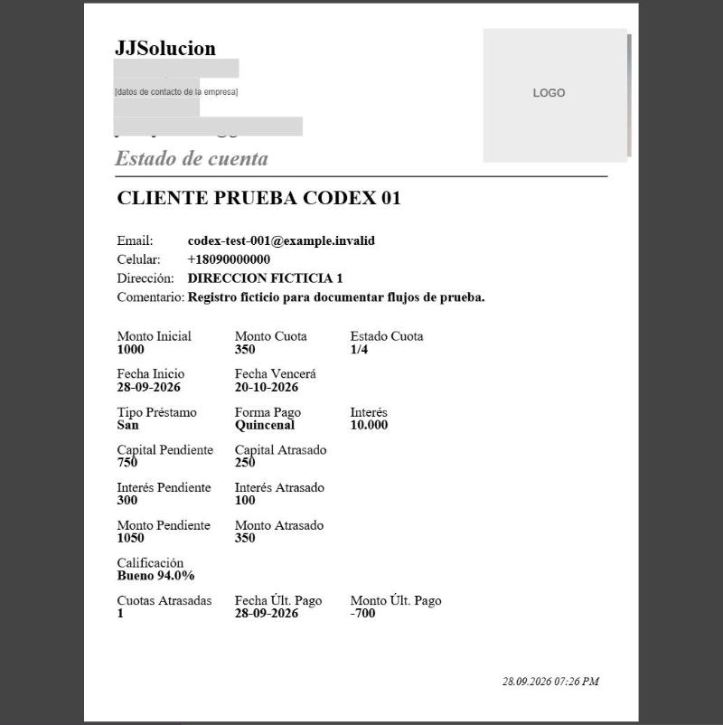 **3. Estado de cuenta** | 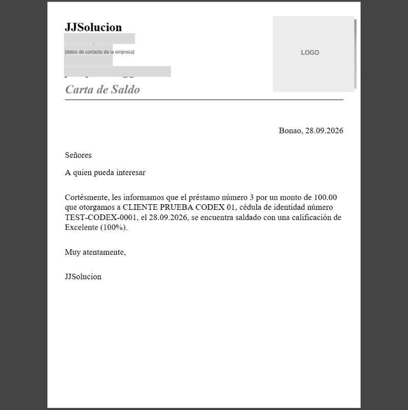 **4. Carta de saldo** |
| 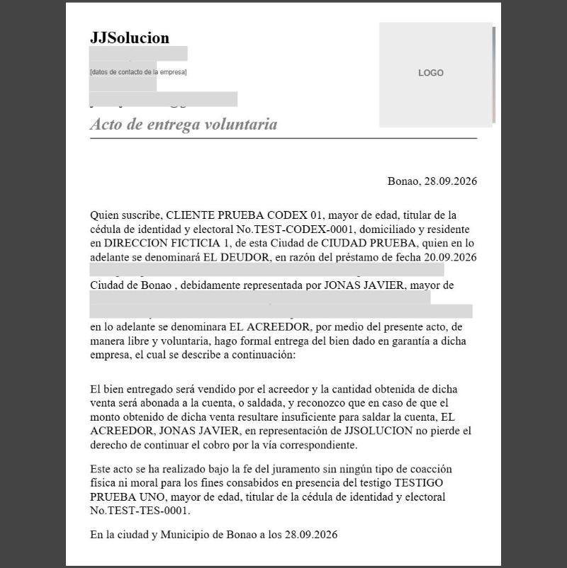 **5. Acto de entrega voluntaria** | 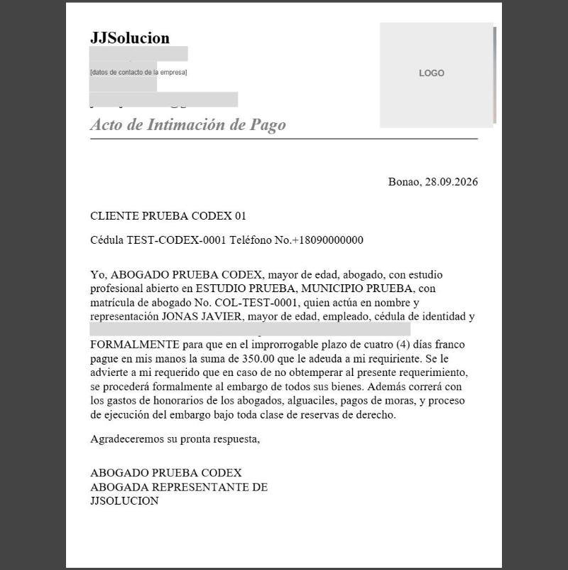 **6. Acto de intimación de pago** |
| 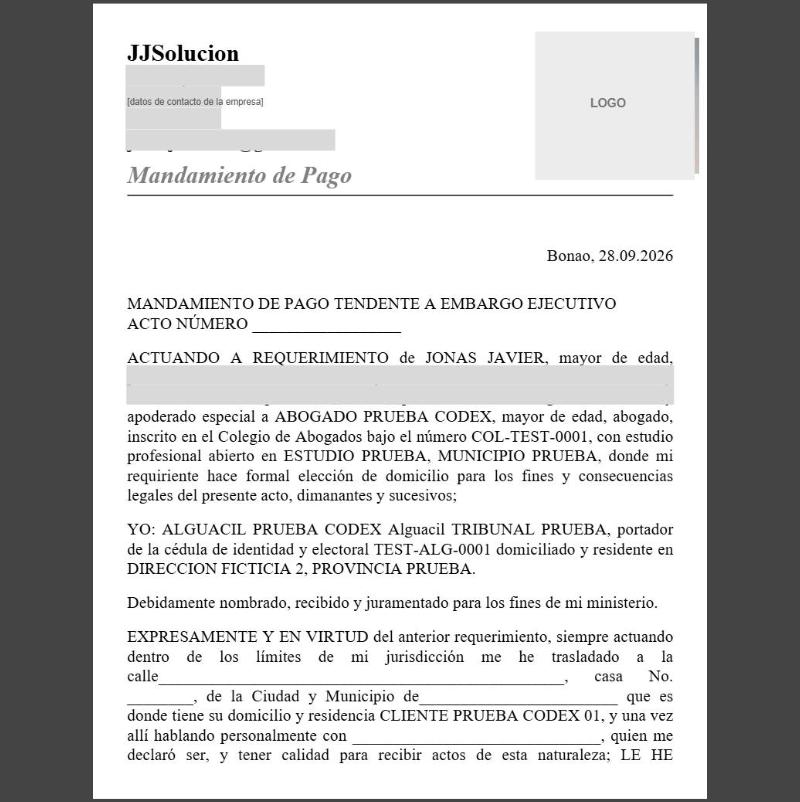 **7. Mandamiento de pago** | 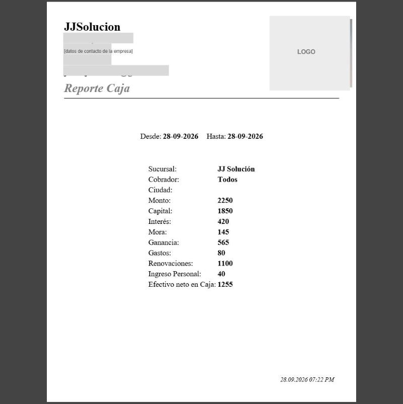 **8. Reporte de caja (p. 1)** |
| 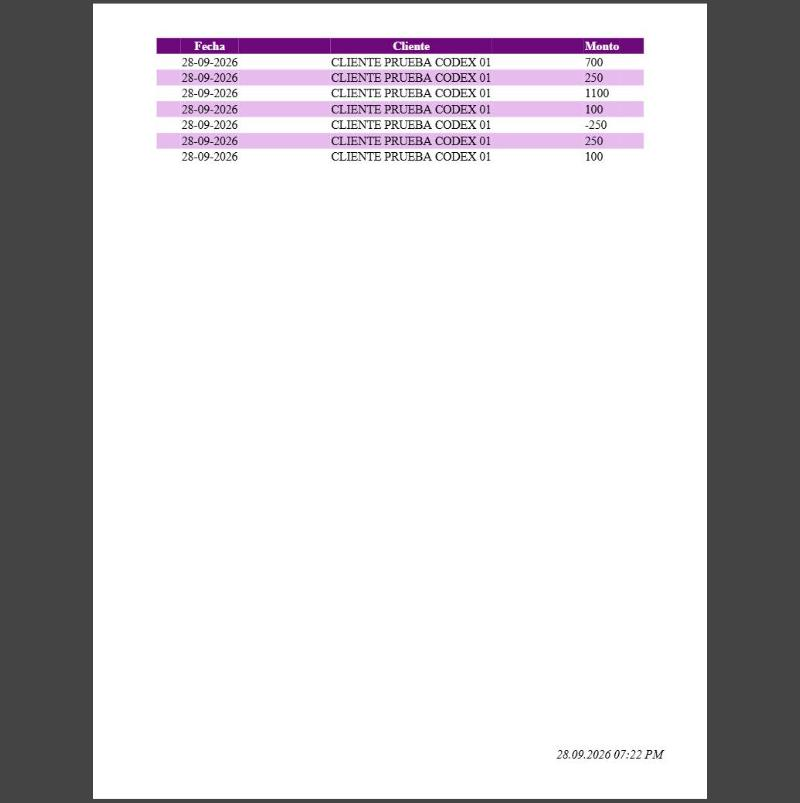 **Reporte de caja (p. 2)** | 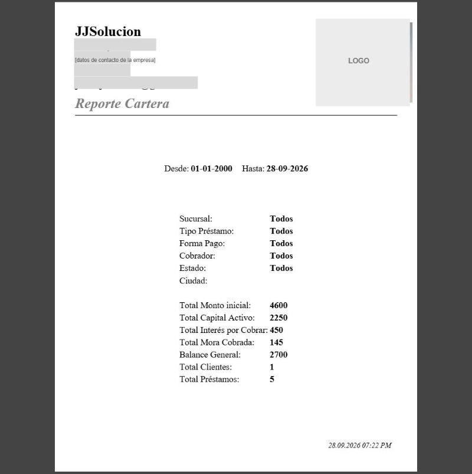 **9. Reporte de cartera** |
| 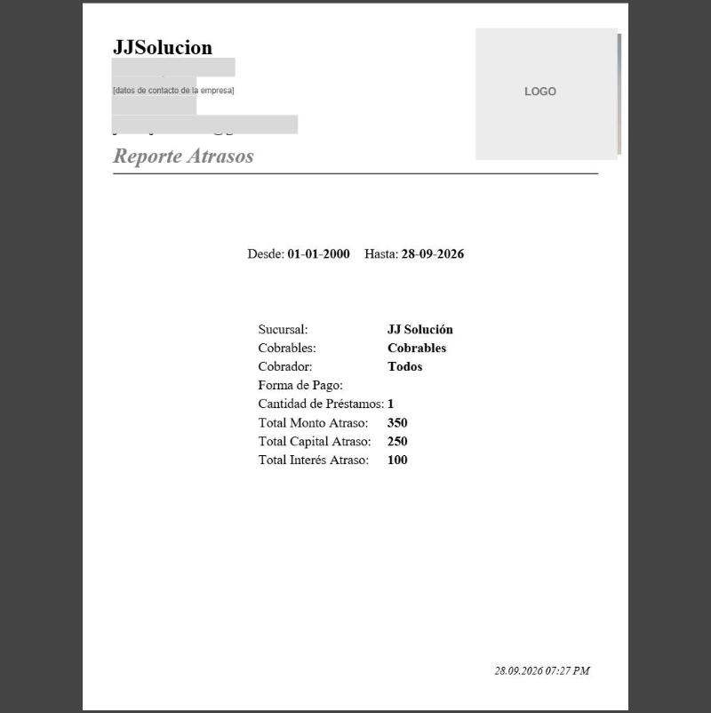 **10. Reporte de atrasos** | 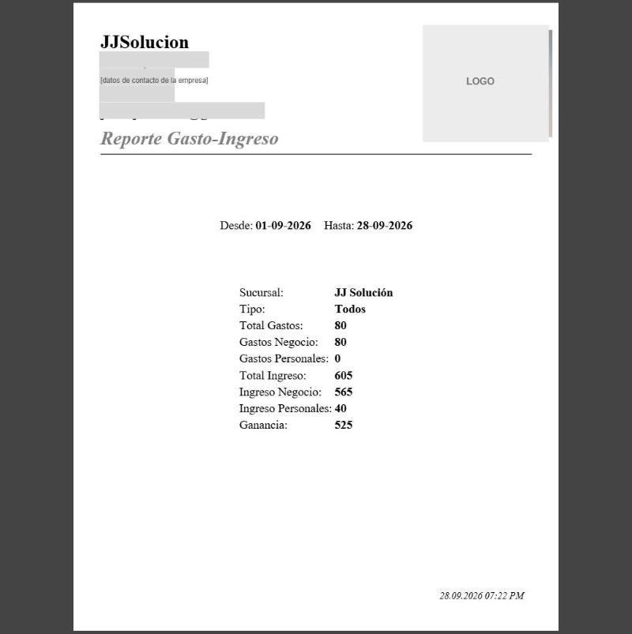 **11. Reporte gasto-ingreso (p. 1)** |
| 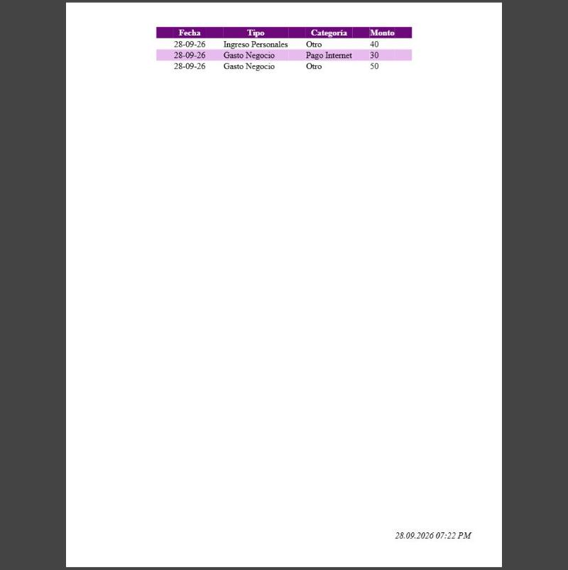 **Reporte gasto-ingreso (p. 2)** | |

## 8.3 Catálogo

| # | Documento | Dónde se genera | Formato | Pide | Contenido y organización |
| --- | --- | --- | --- | --- | --- |
| 1 | **Pagaré** | Préstamo → *Imprimir Pagaré* (`/prestamo/{id}/print`) | PDF 1 p. | — | «Yo, {cliente}, cédula #{doc} debo pagar a {**usuario**} la suma de $R.D {capital}»; tabla # · Fecha · Cuota (sin estado de pago); cláusula de garantía general; **consentimiento para compartir información crediticia en Púrpura Datos**; firmas del cliente, **garante** (si tiene) y usuario |
| 2 | **Recibo de pago** | Tras cobrar → modal *Recibo* → *Imprimir*; o botón *Imprimir Pago* (`/pagos/{c}/{p}/pdf`) | PDF 1 p. | Último pago | Cliente (ID), préstamo «#1 de 1000.00», una línea por cuota («Pagó: 350.00 cuota 2 de 4»), mora, **Total Pagado (sin la mora)**, pendiente atrasado, pendiente, calificación, próximo pago; lema «Pagar al día lo califica de excelente en el Data Púrpura». Etiquetas alineadas a la derecha y valores en negrita |
| 3 | **Estado de cuenta** | Modal *Datos Préstamo* (desde Caja, Cartera, Atrasos o Clasificación) → *Imprimir* (`/datosprestamo/{id}/pdf`) | PDF 1 p. | — | Cliente, contacto, comentario; rejilla de 3 columnas: monto inicial, cuota, estado de cuotas (1/4), fechas, tipo, frecuencia, tasa, capital e interés pendientes y atrasados, montos pendiente y atrasado, calificación, cuotas atrasadas, último pago. **No incluye la mora pendiente** que sí muestra el modal |
| 4 | **Carta de Saldo** | Pagos → préstamo cerrado (`/pagos/{c}/{p}/cartasaldo`) | PDF 1 p. | — | Carta «A quien pueda interesar»: préstamo número *n* por *monto*, fecha, saldado con calificación; firma solo con el nombre de la empresa |
| 5 | **Pagaré Notarial** | Préstamo → *Notarial* (POST `/prestamo/{id}/notarial`) | **DOCX** A4, márgenes 1″ | Abogado/notario, 2 testigos | Título centrado, **un solo párrafo justificado** con el acto notarial completo (número y folio en blanco, fecha en letras, comparecientes, cláusulas PRIMERO a CUARTO, arts. 545 CPC y 877 CC) y 5 bloques de firma centrados |
| 6 | **Acto de Entrega Voluntaria** | Préstamo → *Acto de Entrega* (Livewire) | PDF 2 p. | Abogado, testigo | Lugar y fecha; declaración del deudor; espacio para el bien (vacío); venta del bien y saldo remanente; testigo; firmas en página 2 |
| 7 | **Acto de Intimación de Pago** | Préstamo o Pagos (Livewire) | PDF 1 p. | Abogado | Datos del cliente; el abogado intima a pagar el **saldo pendiente total** en 4 días francos, bajo advertencia de embargo |
| 8 | **Mandamiento de Pago** | Préstamo o Pagos (Livewire) | PDF 2 p. | Abogado, alguacil | «Mandamiento de pago tendente a embargo ejecutivo»; texto justificado con espacios en blanco para calle, casa, municipio, persona que recibe, número de pagaré notarial y costo |
| 9 | **Reporte Caja** | Caja → *Imprimir Caja* | PDF 2 p. | Filtros | Rango de fechas, filtros, 9 indicadores; p. 2 tabla Fecha · Cliente · Monto |
| 10 | **Reporte Cartera** | Cartera → *Imprimir* | PDF 2 p. | Filtros | Filtros, 7 totales; p. 2 tabla Fecha · Cliente · Monto |
| 11 | **Reporte Atrasos** | Atrasos → *Imprimir* | PDF 2 p. | Filtros | Filtros, cantidad de préstamos, 3 totales; p. 2 Cliente · Monto · Tiempo |
| 12 | **Reporte Gasto-Ingreso** | Ganancia → *Imprimir* | PDF 2 p. | Filtros | 7 totales; p. 2 Fecha · Tipo · Categoría · Monto |
| 13 | **Imprimir Consulta** | Consultar | Impresión del navegador | — | La propia pantalla de Consultar |

El **Presupuesto** (`/WCalc/{préstamo}/show`) no tiene versión imprimible.

## 8.4 Defectos encontrados en los documentos

| Documento | Defecto | Riesgo |
| --- | --- | --- |
| Pagaré | El acreedor es la **persona usuaria**, no la empresa; menciona el capital (1,000) y no el total contractual (1,400); la tabla no indica qué cuotas están pagadas | Legal y de claridad |
| Recibo | «Total Pagado: 700» con «Mora: 140» aparte; el cliente entregó 840. Ya ocurría en la liquidación (FLUJOS caso 8) | Conciliación |
| Recibo | Solo se puede obtener el del **último** pago; no hay reimpresión por pago en el historial | Operación |
| Estado de cuenta | Omite la mora pendiente; «Monto Últ. Pago» muestra un reverso negativo (−700) | Claridad |
| Pagaré notarial | Estado civil, nacionalidad y ocupación **fijos** («dominicano, soltero, empleado privado»; testigos «dominicana, soltera, abogada») | Documento legal con datos falsos |
| Pagaré notarial | Llama «interés» a la cuota; conversión a letras de documentos alfanuméricos defectuosa; provincia del acreedor en blanco; A4 frente a carta en el resto | Contradicción contractual y forma |
| Acto de entrega | Usa la fecha del **próximo vencimiento** como fecha del préstamo; la descripción del bien en garantía queda **vacía** aunque el presupuesto tenga garantías | Documento inservible sin edición |
| Intimación | Se genera aunque el préstamo **no esté atrasado** y reclama el saldo total; firma fija «ABOGADA REPRESENTANTE» | Legal |
| Livewire (5, 6, 7) | La descarga incluye **cabeceras HTTP** (`HTTP/1.0 200 OK…`, 201 bytes) antes de `%PDF` | Archivo posiblemente corrupto |
| Reportes | Página 1 casi vacía; enteros sin decimales; sin totales al pie de la tabla | Legibilidad |
| Todos | Sin folio, paginación, usuario ni código QR de verificación; logo sustituido por la foto personal | Trazabilidad e imagen |

## 8.5 Qué haremos mejor

1. **Motor de plantillas** (HTML → PDF con WeasyPrint o similar) versionadas y editables por un administrador, con variables tipadas (`{{prestamo.total_contractual}}`, `{{cliente.estado_civil}}`) y vista previa.
2. **Datos reales en lugar de texto fijo:** estado civil, nacionalidad, ocupación y género salen del expediente o se piden al generar; las cifras en letras usan una librería probada para español.
3. **Encabezado profesional:** logo de la empresa (o monograma generado), RNC y sucursal; pie con número de página, folio correlativo, usuario, fecha y **QR de verificación**.
4. **Registro de documentos emitidos** por préstamo: cuándo, quién, versión y archivo; reimprimible. Los documentos legales quedan en borrador hasta que alguien confirme los datos, y solo se habilitan cuando el préstamo cumple la condición (p. ej., intimación solo con atraso).
5. **Recibo exacto:** total recibido = cuotas + mora + cargos; cambio entregado; reimpresión de cualquier pago; formato carta y **térmico 58/80 mm** para cobradores.
6. **Reportes compactos:** resumen y tabla en la misma página, totales al pie, centavos y filtros en una línea.
7. Revisión por un abogado dominicano antes de usar cualquier plantilla legal; no copiar la redacción de la referencia.
